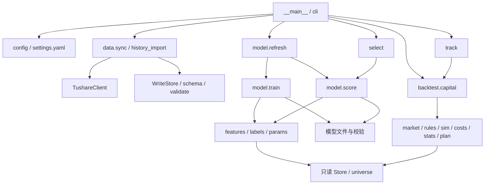

# 架构

正式程序通过命令行调用各层；正式代码只依赖 `rebound` 包，历史实验单独保留在 `experiments/`。

## 调用关系

`daily` 按同步、补训、补分、选股、刷新跟踪的顺序执行。
默认 `pick` 使用只读路径；`--refresh` 才会补模型和分数。

## 文件职责

| 文件 / 模块 | 职责 |
|---|---|
| `pyproject.toml` | 声明 Python 版本、固定依赖、打包范围和测试配置 |
| `config/settings.yaml`、`rebound/config.py` | 保存并校验运行配置，解析项目根和相对数据路径 |
| `rebound/__main__.py`、`rebound/cli.py` | 解析命令，调用业务层，输出结果和退出码 |
| `rebound/__init__.py`、`rebound/clock.py` | 初始化进程的北京时间，并提供显式北京时间读取 |
| `rebound/data/tushare_client.py` | 读取项目凭据，调用行情接口并校验返回字段 |
| `rebound/data/schema.py` | 定义七张正式表、字段和主键 |
| `rebound/data/db.py` | 管理可写连接、事务和幂等写入 |
| `rebound/data/validate.py`、`errors.py` | 校验行情格式，定义可报告的数据错误 |
| `rebound/data/sync.py` | 增量同步元数据和行情，审计缺口 |
| `rebound/data/freshness.py` | 按北京时间核对行情完整性和新鲜度 |
| `rebound/data/history_import.py` | 演练、核对、备份后分批导入旧库历史 |
| `rebound/store.py` | 只读查询行情、名称和交易日，限制可见范围 |
| `rebound/universe.py` | 执行主板、历史名称、价格和成交额过滤 |
| `rebound/features.py` | 计算模型固定的 28 个量价特征及特征指纹 |
| `rebound/labels.py` | 模拟标签交易，处理不能成交的情况，并计算收益百分位 |
| `rebound/params.py` | 固定两个股票池、训练参数、种子、线程数和重训频率 |
| `rebound/model/train.py` | 构建时间可见的训练集，滚动训练三个种子 |
| `rebound/model/artifacts.py` | 保存和校验模型文件及训练清单 |
| `rebound/model/score.py` | 选择当天可用的模型并生成每日全池分数 |
| `rebound/model/refresh.py` | 增量补齐到期训练和缺失分数 |
| `rebound/select.py` | 对模型分数排序，按行业限制形成每日名单 |
| `rebound/backtest/market.py` | 将行情和分数转换为逐日模拟用矩阵 |
| `rebound/backtest/rules.py` | 定义固定持有、每日调仓两类规则网格和规则名 |
| `rebound/backtest/sim.py` | 按规则、现金、一手取整和成交限制模拟账户 |
| `rebound/backtest/costs.py` | 计算佣金、印花税和过户费 |
| `rebound/backtest/stats.py` | 计算收益、回撤、超额区间和滚动规则检验 |
| `rebound/backtest/plan.py` | 生成下一交易日和新账户的模拟买卖清单 |
| `rebound/backtest/capital.py` | 比较 150 条规则和三种重训频率，缓存本金测算 |
| `rebound/track.py` | 管理纸面账户，重算持仓并冻结每日计划 |
| `tests/` | 用隔离的临时数据验证正式流程 |
| `experiments/shared/` | 历史研究的特征、标签和模拟器共用实现 |
| `experiments/decade/` | 十年、重训频率、规则、行业特征及训练窗口实验 |
| `experiments/execgap/` | 买卖时点、现金约束与滑点实验 |
| `experiments/minhold/`、`two_day/` | 最短持有天数与标签期限实验 |
| `experiments/parity/` | 研究实现和正式实现的历史一致性核对 |
| `docs/` | 模型口径、评估边界和数据维护说明 |

## 设计决定

1. **模型口径固定在代码里。** 股票池、特征和标签变化会影响训练含义；训练清单存指纹，加载时核对。
2. **配置、凭据、数据属于同一个项目。** 默认使用源码根；普通安装通过 `--config <项目>/config/settings.yaml` 明确指定，数据和 `.env` 从项目根解析。
3. **模型目录与数据库相邻。** 每个库对应自己的模型、测算缓存和跟踪文件，避免混用不同数据的产物。
4. **训练只使用重训前已知收益。** 先排除尚未卖出的样本，再计算当天收益百分位，避免未来结果影响训练标签。
5. **每日分数和纸面清单保留当时版本。** 已有分数不改写，跟踪计划按信号日冻结，便于核对当时实际输出。
6. **候选名单与账户规则分别处理。** 每日 6 只用于选股展示，持仓数量和卖出条件由账户规则决定。
7. **正式模拟使用可执行的换仓顺序。** 前一晚决定、开盘买、尾盘卖，卖出资金次日再投入；保留老规则名用于回放旧跟踪。
8. **历史实验保留原口径。** 原研究文件可能使用不同的名称过滤、标签处理或成交时点；比较结论必须同时说明版本。
9. **生成数据不进入 Git。** 根目录 `/data/` 和大模型、面板文件被忽略，`rebound/data/` 是必须交付的源码。
