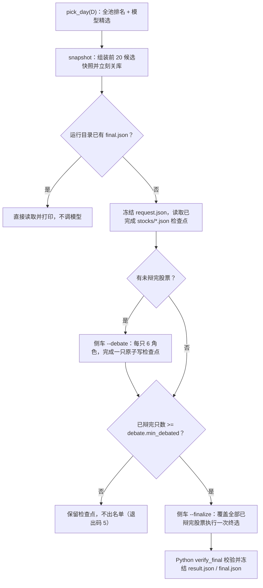

# AI 多角色辩论

在每日收盘模型选股后，对全股票池得分最高的前 `debate.candidates` 只（默认 20 只，不做行业先验去重）做 7 角色结构化复核，并在相同行业上限（`pick.max_per_industry`）约束下产出最终精选名单。

> 提示词正文、字段说明和角色职责的唯一来源是 [debate-methodology.md](debate-methodology.md)。

---

## 1. 整体流程



---

## 2. 角色职责与信息可见性

系统共 7 个角色，同一只股票内按顺序调用（不同股票间按 `debate.concurrency` 并发）：

| 阶段 | 角色 | user 消息可见内容 | 输出主要字段 |
|---|---|---|---|
| 分析（互不可见） | `model_analyst` | `{context, candidate}` | `stance`、`conclusion`、`risks`、`citations` |
| 分析（互不可见） | `chart_analyst` | `{context, candidate}` | `stance`、`conclusion`、`risks`、`citations` |
| 辩论第 1 轮 | `bull` | `{context, candidate, analyst_views}` | `argument`、`citations` |
| 辩论第 2 轮 | `bear` | `{context, candidate, analyst_views, debate: [bull]}` | `argument`、`citations` |
| 辩论第 3 轮 | `bull_counter` | `{context, candidate, analyst_views, debate: [bull, bear]}` | `argument`、`citations` |
| 辩论第 4 轮 | `risk_chair` | `{context, candidate, analyst_views, debate: [3 轮], roster}` | `verdict`、`score`、`thesis`、`risks`、`action`、`citations` |
| 整批终选 | `final_pick` | `{context, final_count, max_per_industry, model_picks, candidates}` | `picks`（恰好 `final_count` 条）、`reason` |

* `roster` 为全部送辩候选的简表（代码、名称、行业、名次、分位、核心涨跌幅/偏离/量比与 flags），用于风控主席横向比较。
* `final_pick` 的 `candidates` 已按风控分降序（同分按模型名次升序）排列，期望名额为 `min(pick.top_n, 辩完只数, 按行业上限可容纳总数)`。

---

## 3. 输入字段与单位

`RunRequest` 中的全部业务字段含义、单位换算与 6 类 `flags` 规则均以 [debate-methodology.md](debate-methodology.md) 的「四、字段说明」为准（实现在 [`rebound/debate/snapshot.py`](../rebound/debate/snapshot.py)）。特征展示单位经过明确换算，不影响模型本身的训练和打分特征。

---

## 4. 存储目录

运行产物保存在数据库旁的 `<库名>.debate/` 目录（例如 `data/market.debate/`）：

```text
data/market.debate/
└─ <variant>-<cadence>/<YYYY-MM-DD>/<input_hash 前 12 位>/
   ├─ request.json           完整请求（无密钥），首次写入后冻结
   ├─ stocks/<ts_code>.json  单只股票辩完后的完整检查点（原子写）
   ├─ events.ndjson          侧车 NDJSON 进度事件流（追加写）
   ├─ usage.json             各次尝试累计调用与 token 用量（原子写）
   ├─ result.json            全部角色产物、终选、失败票与用量，冻结
   └─ final.json             展示与对照用最终名单，冻结
```

* `input_hash` 覆盖除 `run_id` 和两个哈希本身外的全部请求内容；改了方法论、模型参数或候选数据会自动落入新运行目录。
* 已冻结的 `final.json` 目录不会重跑或覆盖；同一交易日多次不同配置的运行均会保留，`rebound debate show` 将最早完成的一次标为「当日正式结果」。

---

## 5. 重试常量、看门狗与调用次数

* **重试常量**（[`debate_agent/src/provider.ts`](../debate_agent/src/provider.ts) 代码常量，不从配置读取）：
  * `transport`（断流/网络异常）：最多尝试 **5** 次
  * `empty`（空内容或输出格式/行业上限校验不合格）：最多尝试 **3** 次
  * `provider`（上游 5xx 或服务错误）：最多尝试 **3** 次
  * `timeout`（单次调用达到 `limits.call_timeout_seconds`）：最多尝试 **2** 次
  * `request`（4xx 拒收）、`truncated`（`max_tokens` 用尽截断）、`aborted`（外部取消）：**1** 次，不重试
  * 退避间隔：5s → 10s → 20s → 40s（上限 40 秒）。
* **看门狗**（[`rebound/debate/sidecar.py`](../rebound/debate/sidecar.py)）：
  * 停滞判活阈值：`call_timeout_seconds × 1.5 + 60` 秒没有任何 stdout/stderr 输出即杀死子进程（默认 510 秒）。
  * 总时长硬上限：3 小时。
* **调用次数估算**：
  * 送辩 `N` 只（默认 20 只）不含重试共 `N × 6 + 1` 次调用（默认 `20 × 6 + 1 = 121` 次）。

---

## 6. 失败处理与断点续跑

* **单只全有或全无**：一只股票 6 个角色中任一角色在重试耗尽后仍失败，该股本次作废并记入 `failed_stocks`，不写检查点。
* **门限控制**：已辩完总数低于 `debate.min_debated`（默认 12）时，不出 `final.json` 与 `result.json`，退出码为 **5**。
* **断点续跑**：重跑同一天的 `rebound debate run` 时，程序自动读取 `stocks/*.json`，仅向 `--debate` 下发未完成的股票；当累计辩完达到 `min_debated` 后，再统一对**全部已辩完股票**调用一次 `--finalize`。
* **中断（Ctrl+C）**：父进程立刻杀掉 Node 侧车并保留已经落盘的单股检查点，不生成残缺名单。

---

## 7. 局限

1. **没有新闻与外部基本面信息**：输入仅包含模型得分、28 个量价特征、近 20 日前复权日线与同行统计，外部公告、财报或突发消息均视为未知。
2. **无法做历史回测**：AI 名单依赖在线大模型推理，不能回溯历史多年做无前视回测，只能从启用日起逐日记录并与模型原名单对比。
3. **风控分数仅当天横向可比**：`risk_chair` 的 `0~100` 分数是针对当天候选池的相对吸引力打分，不同交易日之间的分数绝对值不可直接跨天比较。
