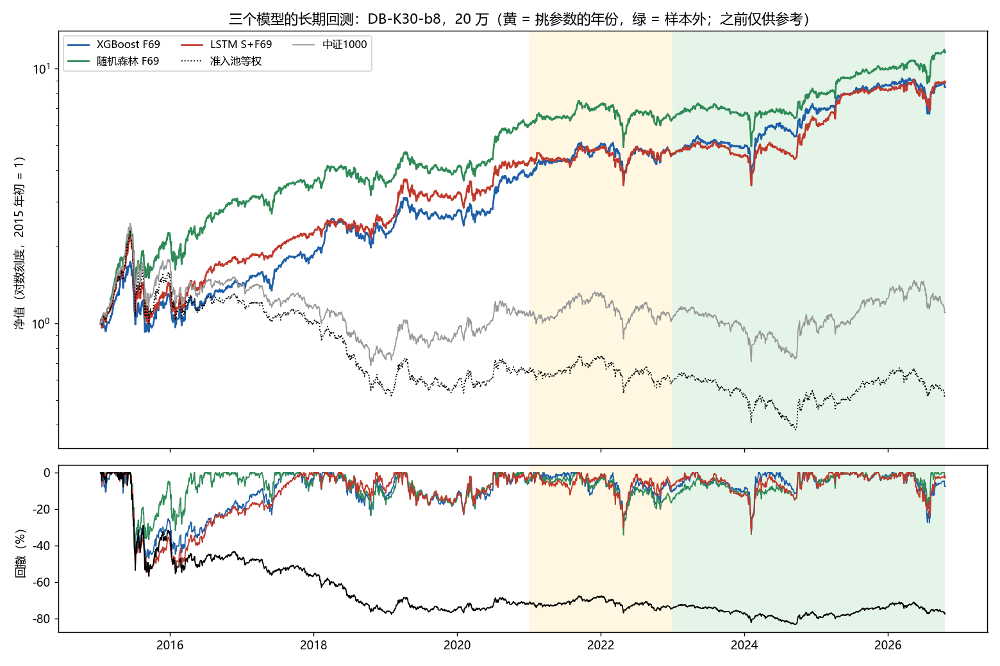
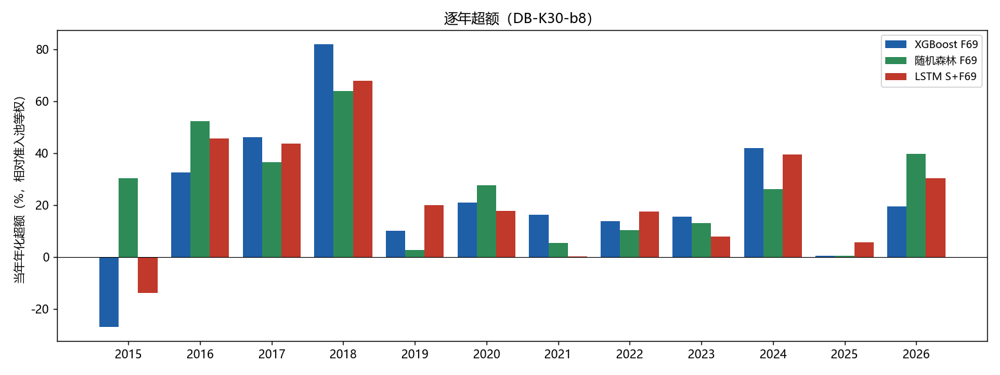
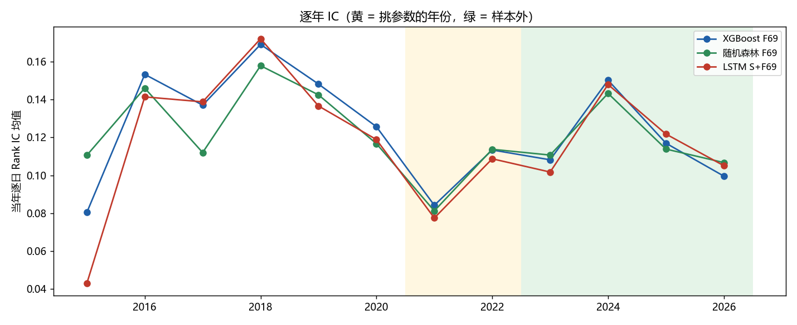
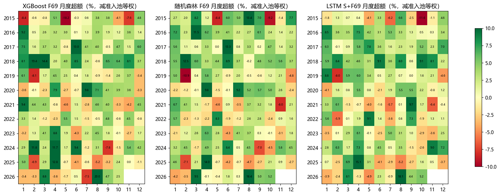

# 交付版结果：三个 F69 模型（XGBoost、随机森林、LSTM S+F69）

- 交付范围见 `ml/PREREG.md` 补充登记十三：交付物只保留这三个模型；其他模型的结果作为过程记录留在各步目录，不在这里出现。
- 代码：`ml/p8_delivery.py`（计算）、`ml/p8_delivery_report.py`（本报告）；LSTM 长期回测的训练：`ml/p7_history_lstm.py`。
- **第一部分是正式数字**（测试段 2023-01 ~ 2026-10，冻结后只跑一次，每年初重训）；**第二部分是补充分析**（2015 ~ 2026 长期回测，
  2015 ~ 2020 仅供参考，2021 ~ 2022 偏乐观，2023 ~ 2026 与测试段相同）。
- 这三个模型是看过测试结果之后才定为交付范围的，测试段数字因此略偏乐观。

## 读法

**一句话**：三个模型在测试段的预测力几乎一样（测试 IC 都是 0.119 ~ 0.120，两两的差区间都跨 0），组合收益的差别也都在噪声范围内。
选哪个更多是工程上的取舍，不是“谁更准”。

- **测试段（正式）**
  - IC：XGBoost 0.1199、随机森林 0.1193、LSTM S+F69 0.1199；随机森林 − XGBoost 是事先登记的 RQ1，判定“分不出”；其余两对只描述，也分不出。
  - 组合（DB-K30-b8，20 万）：年化超额 XGBoost 19.3%、随机森林 18.1%、LSTM 21.1%，三者最大回撤都在 −32% 左右；
    两两的超额差区间全部跨 0（同一模型换种子就能相差 3 ~ 6 个百分点）。
  - LSTM 换手最高（每年约 39 倍，XGBoost 31 倍、随机森林 26 倍），费用多吃 1.5 ~ 2 个百分点。
- **长期回测 2015 ~ 2026（补充分析）**
  - IC：全期 XGBoost 最高；LSTM − XGBoost −0.006 [−0.010, −0.002]，差距主要在 2015 ~ 2020（2015 年 LSTM 只有 0.043），2023 ~ 2026 三者持平。
  - 组合：全期年化超额（DB-K30-b8）XGBoost 23.0%、随机森林 25.5%、LSTM 23.6%；随机森林全期领先主要来自 2015 年（股灾期间回撤最小，−40%）。
    LSTM 2015 年股灾回撤最大（−55.6%）。
  - 换起点：从 2016 年以后任何一年起步，随机森林的年化都是三者最低；LSTM 在 DB-K30-b8 下 10 个起点里 6 个最高，在 FH-K6-h4 下 10 个都最高；
    XGBoost 在 DB-K30-b8 下大多居中、从不最差（FH-K6-h4 下 2015 年起步时最低）。
- **怎么用**
  - 默认展示 XGBoost F69：测试段与另外两个分不出，长期 IC 最高、主规则下换起点从不垫底，只依赖 xgboost（不需要 PyTorch），解释是精确的 TreeSHAP。
  - LSTM S+F69 是收益较高、但回撤和换手也更大的备选；随机森林回撤最小、但 2016 年以后起步收益最低。
  - 三个模型的分数高度相关，名单大部分重合；它们之间的差别不应被说成“显著更好”。
- **局限**：这三个模型是看过测试段和长期回测之后才定为交付范围的（PREREG 补充登记十三），数字略偏乐观；
  LSTM S+F69 的测试段在 2026-11-19 因 numexpr 偶发计算错误重跑过一次（PREREG 冻结后的运行记录（二）），本报告用的是重跑后的结果。

## 一、测试段（正式）

### 1. 排行榜

IC = 逐日 Rank IC 均值；超额、多空是小数（0.003 = 0.3%，5 天持有期）。验证 IC 是挑参数用的，偏乐观。

|                             | XGBoost F69      | 随机森林 F69     | LSTM S+F69       |
|:----------------------------|:-----------------|:-----------------|:-----------------|
| 验证 IC（用于选择，偏乐观） | 0.0986769587     | 0.0972156099     | 0.0935260204     |
| 测试 IC 全段                | 0.1198740918     | 0.119344359      | 0.1199464531     |
| 测试 IC 全段 区间           | [0.1015, 0.1379] | [0.0998, 0.1380] | [0.1012, 0.1383] |
| 测试 IC T1                  | 0.127850732      | 0.1268793334     | 0.1249955584     |
| 测试 IC T2                  | 0.1147237073     | 0.1144791507     | 0.1166863293     |
| 测试 ICIR                   | 0.7512926136     | 0.7168161685     | 0.750489561      |
| 测试 NW t                   | 12.1155460047    | 11.5004379361    | 12.3499073778    |
| 测试前30超额                | 0.0043723233     | 0.0040995927     | 0.0049898692     |
| 测试多空                    | 0.0154619751     | 0.0144192434     | 0.0155494703     |
| 测试 IC 2023                | 0.1082144837     | 0.1107182417     | 0.1017469116     |
| 测试 IC 2024                | 0.1502039276     | 0.1432424151     | 0.1478481828     |
| 测试 IC 2025                | 0.1169630015     | 0.113877099      | 0.1218082304     |
| 测试 IC 2026                | 0.0996038783     | 0.1067525237     | 0.1050510199     |
| 测试种子极差                | 0.0012462591     | 0.0004219601     | 0.0028246343     |
| 训练秒（最终阶段）          | 282.4            | 975.4            | 556.9            |

### 2. 模型两两之间的 IC 差（按月整块重抽 95% 区间）

| 比较                                |   IC 差 | 95% 区间           |   NW t | 判定（PREREG 2.4 的规则）   |
|:------------------------------------|--------:|:-------------------|-------:|:----------------------------|
| 随机森林 − XGBoost（RQ1，事先登记） | -0.0005 | [-0.0075, +0.0071] |  -0.16 | 分不出                      |
| LSTM S+F69 − XGBoost（只描述）      |  0.0001 | [-0.0052, +0.0058] |   0.02 | 分不出                      |
| LSTM S+F69 − 随机森林（只描述）     |  0.0006 | [-0.0089, +0.0100] |   0.13 | 分不出                      |

### 3. 逐年 IC

|   date |   XGBoost F69 |   随机森林 F69 |   LSTM S+F69 |
|-------:|--------------:|---------------:|-------------:|
|   2023 |        0.1082 |         0.1107 |       0.1017 |
|   2024 |        0.1502 |         0.1432 |       0.1478 |
|   2025 |        0.117  |         0.1139 |       0.1218 |
|   2026 |        0.0996 |         0.1068 |       0.1051 |

### 4. 组合回测（P5 基准口径：仓库模拟器、真实费用、现行印花税）

| 模型         | 规则      |   本金 |   全段 年化% |   全段 超额% | 全段 超额区间   |   全段 最大回撤% |   全段 β |   换手（倍/年） |   费用占比（%/年） |   平均持有天数 |
|:-------------|:----------|-------:|-------------:|-------------:|:----------------|-----------------:|---------:|----------------:|-------------------:|---------------:|
| XGBoost F69  | DB-K30-b8 | 200000 |        16.37 |        19.33 | [1.25, 36.91]   |           -31.72 |    0.792 |            30.9 |               5.06 |            6.9 |
| 随机森林 F69 | DB-K30-b8 | 200000 |        15.44 |        18.12 | [2.68, 34.1]    |           -31.87 |    0.708 |            26.2 |               4.58 |            8.3 |
| LSTM S+F69   | DB-K30-b8 | 200000 |        18.54 |        21.05 | [6.24, 37.29]   |           -31.99 |    0.804 |            38.9 |               6.54 |            5.4 |
| XGBoost F69  | FH-K6-h4  | 200000 |        12.49 |        15.74 | [-2.19, 33.65]  |           -31.61 |    0.654 |            44.2 |               7.93 |            4   |
| 随机森林 F69 | FH-K6-h4  | 200000 |         6.25 |         9.64 | [-6.91, 26.13]  |           -30.41 |    0.585 |            43.8 |               8.89 |            4   |
| LSTM S+F69   | FH-K6-h4  | 200000 |        17.3  |        19.74 | [5.18, 34.81]   |           -27.84 |    0.717 |            44.7 |               7.98 |            4   |
| XGBoost F69  | DB-K3-b16 |  20000 |        14.36 |        19.16 | [-5.02, 43.56]  |           -41.28 |    0.743 |            34.2 |               5.56 |            6.3 |
| 随机森林 F69 | DB-K3-b16 |  20000 |        24.8  |        26.95 | [3.7, 51.07]    |           -33.26 |    0.618 |            32.4 |               5.48 |            6.3 |
| LSTM S+F69   | DB-K3-b16 |  20000 |        24.52 |        26.7  | [9.22, 45.15]   |           -30.56 |    0.731 |            50.5 |               8.59 |            3.8 |

**组合超额差**（逐日收益差 × 242，按月整块重抽 95% 区间，%）

| 规则      | 比较                  |   年化超额差% | 95% 区间      |
|:----------|:----------------------|--------------:|:--------------|
| DB-K30-b8 | 随机森林 − XGBoost    |          -1.2 | [-9.8, +6.9]  |
| DB-K30-b8 | LSTM S+F69 − XGBoost  |           1.7 | [-8.6, +11.7] |
| DB-K30-b8 | LSTM S+F69 − 随机森林 |           2.9 | [-4.9, +10.2] |
| FH-K6-h4  | 随机森林 − XGBoost    |          -6.1 | [-14.7, +2.2] |
| FH-K6-h4  | LSTM S+F69 − XGBoost  |           4   | [-7.2, +15.2] |
| FH-K6-h4  | LSTM S+F69 − 随机森林 |          10.1 | [-0.6, +20.7] |

## 二、长期回测 2015 ~ 2026（补充分析）

做法与 P7 完全相同（补充登记十一）：冻结参数，每年第一个交易日用此前全部已卖出的样本重训（3 个种子），给当年准入池全部股票打分，
20 万本金连续回测到 2026-10，印花税按历史税率。

**LSTM 长期分数与测试段正式分数的一致性**（GPU 训练不能逐位复现，2023 ~ 2026）

|   对上的行数 |   测试段正式分数行数 |   逐日秩相关（中位数） |   逐日秩相关（最低） |   正式分数测试 IC |   长期回测分数测试 IC |
|-------------:|---------------------:|-----------------------:|---------------------:|------------------:|----------------------:|
|   1.6124e+06 |           1.6124e+06 |                      1 |                    1 |            0.1199 |                  0.12 |

### 1. 分段汇总（DB-K30-b8：年化 / 年化超额 [区间] / 最大回撤）

| 模型         | 2015 ~ 2020（仅供参考）                           | 2021 ~ 2022（挑参数的年份，偏乐观）             | 2023 ~ 2026（样本外）                            | 全期 2015 ~ 2026                                  |
|:-------------|:--------------------------------------------------|:------------------------------------------------|:-------------------------------------------------|:--------------------------------------------------|
| XGBoost F69  | +24.9% / 超额 +27.8% [+13.3, +43.0] / 回撤 -47.1% | +9.8% / 超额 +15.2% [-1.4, +32.8] / 回撤 -31.3% | +17.5% / 超额 +19.5% [+1.1, +37.2] / 回撤 -32.1% | +19.9% / 超额 +23.0% [+13.0, +33.3] / 回撤 -47.1% |
| 随机森林 F69 | +34.9% / 超额 +35.6% [+23.6, +48.1] / 回撤 -40.1% | +2.6% / 超额 +8.0% [-9.2, +25.6] / 回撤 -34.3%  | +17.2% / 超额 +18.8% [+2.9, +34.6] / 回撤 -32.4% | +23.1% / 超额 +25.5% [+16.8, +34.5] / 回撤 -40.1% |
| LSTM S+F69   | +27.6% / 超额 +30.4% [+18.2, +41.9] / 回撤 -55.6% | +3.5% / 超额 +8.9% [-10.9, +30.9] / 回撤 -30.1% | +18.6% / 超额 +20.3% [+4.3, +37.1] / 回撤 -33.0% | +20.3% / 超额 +23.6% [+14.8, +32.6] / 回撤 -55.6% |

**三条规则的全期结果**（年化 / 年化超额 / 最大回撤）

| 模型         | DB-K30-b8                          | FH-K6-h4                           | DB-K3-b16                          |
|:-------------|:-----------------------------------|:-----------------------------------|:-----------------------------------|
| XGBoost F69  | +19.9% / 超额 +23.0% / 回撤 -47.1% | +14.5% / 超额 +18.4% / 回撤 -45.8% | +7.8% / 超额 +14.6% / 回撤 -65.0%  |
| 随机森林 F69 | +23.1% / 超额 +25.5% / 回撤 -40.1% | +14.8% / 超额 +18.6% / 回撤 -41.2% | +24.4% / 超额 +28.0% / 回撤 -49.4% |
| LSTM S+F69   | +20.3% / 超额 +23.6% / 回撤 -55.6% | +18.6% / 超额 +21.7% / 回撤 -47.9% | +19.5% / 超额 +24.2% / 回撤 -62.6% |

**换手与费用（DB-K30-b8，全期）**

|              |   换手（倍/年） |   费用占比（%/年） |   平均持有天数 |   平均持股 |
|:-------------|----------------:|-------------------:|---------------:|-----------:|
| XGBoost F69  |            34.9 |               6.36 |            5.4 |       25.5 |
| 随机森林 F69 |            32.2 |               5.96 |            5.8 |       25.6 |
| LSTM S+F69   |            41.7 |               7.54 |            4.6 |       24.7 |

### 2. 逐年（DB-K30-b8）

**逐年收益（%）**，附准入池等权和指数

|   年 |   XGBoost F69 |   随机森林 F69 |   LSTM S+F69 |   准入池等权 |   沪深300 |   中证500 |   中证1000 |
|-----:|--------------:|---------------:|-------------:|-------------:|----------:|----------:|-----------:|
| 2015 |          27.1 |          122.9 |         40   |         54   |       6.2 |      42.9 |       75.1 |
| 2016 |          10.3 |           31.8 |         24.5 |        -21.9 |     -11.3 |     -17.8 |      -20   |
| 2017 |          32.2 |           19.8 |         30.1 |        -16.8 |      21.8 |      -0.2 |      -17.4 |
| 2018 |          21.6 |            1.8 |          6.5 |        -46.5 |     -25.3 |     -33.3 |      -36.9 |
| 2019 |          21   |           12.6 |         32.8 |          8.2 |      36.1 |      26.4 |       25.7 |
| 2020 |          40   |           50   |         35   |         13.2 |      27.2 |      20.9 |       19.4 |
| 2021 |          33.3 |           20   |         13.6 |         13   |      -5.2 |      15.6 |       20.5 |
| 2022 |          -9.5 |          -12.3 |         -5.7 |        -20.6 |     -21.6 |     -20.3 |      -21.6 |
| 2023 |           6.3 |            3.8 |         -1.6 |         -9.4 |     -11.4 |      -7.4 |       -6.3 |
| 2024 |          41.1 |           21.5 |         37.4 |         -7.3 |      14.7 |       5.5 |        1.2 |
| 2025 |          24.1 |           23.9 |         30.7 |         22.6 |      17.7 |      30.4 |       27.5 |
| 2026 |          -1.1 |           16.6 |          8.1 |        -14   |      -9.8 |      -8.9 |      -11.8 |

**逐年超额（%，相对准入池等权）**

|   年 |   XGBoost F69 |   随机森林 F69 |   LSTM S+F69 |
|-----:|--------------:|---------------:|-------------:|
| 2015 |         -26.8 |           30.3 |        -13.8 |
| 2016 |          32.8 |           52.4 |         45.7 |
| 2017 |          46.3 |           36.5 |         43.8 |
| 2018 |          82   |           63.9 |         68   |
| 2019 |          10.2 |            2.8 |         20   |
| 2020 |          21.1 |           27.6 |         17.9 |
| 2021 |          16.5 |            5.5 |          0.3 |
| 2022 |          13.8 |           10.5 |         17.6 |
| 2023 |          15.7 |           13.2 |          7.9 |
| 2024 |          42.1 |           26.2 |         39.5 |
| 2025 |           0.6 |            0.5 |          5.8 |
| 2026 |          19.6 |           39.8 |         30.4 |

**逐年最大回撤（%）**

|   年 |   XGBoost F69 |   随机森林 F69 |   LSTM S+F69 |
|-----:|--------------:|---------------:|-------------:|
| 2015 |         -47.2 |          -40.1 |        -55.6 |
| 2016 |         -24.1 |          -27.1 |        -25.4 |
| 2017 |         -15.9 |          -16   |         -6.3 |
| 2018 |         -23.1 |          -23.7 |        -15.7 |
| 2019 |         -18.1 |          -18.6 |        -18.2 |
| 2020 |         -15.6 |          -13   |        -16.3 |
| 2021 |         -12.4 |           -9   |        -12.3 |
| 2022 |         -31.2 |          -32.9 |        -29.7 |
| 2023 |         -10.8 |          -11   |        -13.4 |
| 2024 |         -26.1 |          -26.6 |        -24.6 |
| 2025 |          -6.3 |           -7.4 |         -6   |
| 2026 |         -27.6 |          -19   |        -24.5 |

### 3. 逐年 IC（只在有有效收益的行上算）

|   date |   XGBoost F69 |   随机森林 F69 |   LSTM S+F69 |
|-------:|--------------:|---------------:|-------------:|
|   2015 |        0.0805 |         0.1106 |       0.043  |
|   2016 |        0.1533 |         0.146  |       0.1414 |
|   2017 |        0.137  |         0.112  |       0.1388 |
|   2018 |        0.1691 |         0.1579 |       0.1721 |
|   2019 |        0.1482 |         0.1425 |       0.1366 |
|   2020 |        0.1257 |         0.1168 |       0.1189 |
|   2021 |        0.0842 |         0.0813 |       0.0775 |
|   2022 |        0.1134 |         0.1138 |       0.1087 |
|   2023 |        0.1082 |         0.1107 |       0.1018 |
|   2024 |        0.1502 |         0.1432 |       0.1479 |
|   2025 |        0.117  |         0.1139 |       0.1218 |
|   2026 |        0.0996 |         0.1068 |       0.1051 |

**模型之间的 IC 差（分段，按月整块重抽 95% 区间）**

| 比较                  | 2015 ~ 2020（仅供参考）    | 2021 ~ 2022（挑参数的年份，偏乐观）   | 2023 ~ 2026（样本外）      | 全期 2015 ~ 2026           |
|:----------------------|:---------------------------|:--------------------------------------|:---------------------------|:---------------------------|
| 随机森林 − XGBoost    | -0.0047 [-0.0101, +0.0017] | -0.0013 [-0.0084, +0.0059]            | -0.0005 [-0.0075, +0.0071] | -0.0028 [-0.0066, +0.0013] |
| LSTM S+F69 − XGBoost  | -0.0105 [-0.0168, -0.0037] | -0.0057 [-0.0119, +0.0008]            | +0.0001 [-0.0051, +0.0059] | -0.0063 [-0.0104, -0.0022] |
| LSTM S+F69 − 随机森林 | -0.0058 [-0.0163, +0.0036] | -0.0044 [-0.0132, +0.0042]            | +0.0006 [-0.0089, +0.0100] | -0.0035 [-0.0097, +0.0024] |

### 4. 极端行情（DB-K30-b8）

| 时期                                       |   xgb_F69｜区间收益% |   xgb_F69｜区间最大回撤% |   xgb_F69｜回到前高（交易日） |   rf_F69｜区间收益% |   rf_F69｜区间最大回撤% |   rf_F69｜回到前高（交易日） |   lstm_SF69｜区间收益% |   lstm_SF69｜区间最大回撤% |   lstm_SF69｜回到前高（交易日） |   准入池等权｜区间收益% |   准入池等权｜区间最大回撤% | 准入池等权｜回到前高（交易日）   |   中证1000｜区间收益% |   中证1000｜区间最大回撤% | 中证1000｜回到前高（交易日）   |   沪深300｜区间收益% |   沪深300｜区间最大回撤% | 沪深300｜回到前高（交易日）   |
|:-------------------------------------------|---------------------:|-------------------------:|------------------------------:|--------------------:|------------------------:|-----------------------------:|-----------------------:|---------------------------:|--------------------------------:|------------------------:|----------------------------:|:---------------------------------|----------------------:|--------------------------:|:-------------------------------|---------------------:|-------------------------:|:------------------------------|
| 2015 股灾（2015-06-12 ~ 2015-09-30）       |                -44.4 |                    -47.2 |                           469 |               -31   |                   -40.1 |                          200 |                  -51.5 |                      -55.6 |                             514 |                   -51.6 |                       -57   | 未回到                           |                 -47.7 |                     -53.1 | 未回到                         |                -39.6 |                    -43.3 | 1304                          |
| 2016 熔断（2016-01-01 ~ 2016-01-31）       |                -21   |                    -24.1 |                            49 |               -23   |                   -27.1 |                           42 |                  -21.7 |                      -25.4 |                              43 |                   -30.2 |                       -33   | 未回到                           |                 -30.4 |                     -33.1 | 未回到                         |                -21   |                    -23.5 | 358                           |
| 2018 熊市（2018-01-29 ~ 2018-12-31）       |                 13.1 |                    -23.1 |                            85 |                -4.1 |                   -23.7 |                           91 |                    1   |                      -15.7 |                              20 |                   -47.2 |                       -47.2 | 未回到                           |                 -37.2 |                     -41.2 | 419                            |                -31.3 |                    -31.7 | 365                           |
| 2020 疫情（2020-01-20 ~ 2020-03-31）       |                 -9.2 |                    -15.6 |                            61 |                -7.8 |                   -13   |                           46 |                   -4.8 |                      -16.3 |                              67 |                    -6.4 |                       -14.5 | 69                               |                  -7.7 |                     -15.5 | 62                             |                -11.3 |                    -16.1 | 66                            |
| 2024 小盘股暴跌（2024-01-01 ~ 2024-02-07） |                -22.2 |                    -26.1 |                             9 |               -21.7 |                   -26.6 |                           24 |                  -21.5 |                      -24.6 |                               9 |                   -19.2 |                       -23.3 | 181                              |                 -18.5 |                     -27.1 | 157                            |                 -2.5 |                     -7.3 | 7                             |
| 2026 年 7 月（2026-07-01 ~ 2026-07-31）    |                -15.4 |                    -21.6 |                            13 |                -7.6 |                   -15.7 |                           13 |                   -8.8 |                      -14.9 |                               7 |                    -7.9 |                       -12.4 | 未回到                           |                 -19.7 |                     -22.3 | 未回到                         |                 -7.9 |                     -9   | 未回到                        |

### 5. 换起点（2015 ~ 2024 每年第一个交易日起步，各跑到 2026-10）

年化按“起步日到 2026-10-23、每年 242 个交易日”折算，和上面分段表的口径略有不同。

**DB-K30-b8（20 万）**：按起点汇总

| 模型         |   年化中位数 |   年化最差 |   超额中位数 |   超额最差 |   回撤中位数 |   回撤最差 |
|:-------------|-------------:|-----------:|-------------:|-----------:|-------------:|-----------:|
| XGBoost F69  |         17.9 |        8.7 |         18.7 |       16.1 |        -32.4 |      -47.2 |
| 随机森林 F69 |         15.1 |        8.5 |         17.5 |       15   |        -34.5 |      -40.1 |
| LSTM S+F69   |         18   |       11.6 |         21.8 |       18   |        -32.4 |      -55.6 |

年化收益（%）

|   起步年 |   准入池同期年化 |   XGBoost F69 |   随机森林 F69 |   LSTM S+F69 |
|---------:|-----------------:|--------------:|---------------:|-------------:|
|     2015 |             -5.7 |          19.4 |           23.1 |         19.9 |
|     2016 |             -8.8 |          20.9 |           17.6 |         20.2 |
|     2017 |             -8.4 |          19.3 |           13.6 |         18.1 |
|     2018 |             -7.4 |          18   |           13.7 |         17.2 |
|     2019 |             -0.4 |          17.8 |           16   |         20.3 |
|     2020 |             -2   |          16.8 |           15.9 |         17.5 |
|     2021 |             -4.4 |          14.1 |           11.7 |         15.2 |
|     2022 |             -7.5 |           8.7 |            8.5 |         11.6 |
|     2023 |             -3.9 |          16.1 |           14.3 |         17.9 |
|     2024 |             -1.2 |          19.6 |           19.3 |         25   |

最大回撤（%）

|   起步年 |   XGBoost F69 |   随机森林 F69 |   LSTM S+F69 |
|---------:|--------------:|---------------:|-------------:|
|     2015 |         -47.2 |          -40.1 |        -55.6 |
|     2016 |         -32.4 |          -34.3 |        -32.2 |
|     2017 |         -32.3 |          -35.7 |        -32.2 |
|     2018 |         -32.8 |          -34.7 |        -32.5 |
|     2019 |         -32.6 |          -35.3 |        -32.3 |
|     2020 |         -32.4 |          -34.8 |        -32   |
|     2021 |         -32.6 |          -33.9 |        -33   |
|     2022 |         -31.9 |          -34.2 |        -32.8 |
|     2023 |         -31.3 |          -32.2 |        -33   |
|     2024 |         -26.6 |          -26.8 |        -24.8 |
**FH-K6-h4（20 万）**：按起点汇总

| 模型         |   年化中位数 |   年化最差 |   超额中位数 |   超额最差 |   回撤中位数 |   回撤最差 |
|:-------------|-------------:|-----------:|-------------:|-----------:|-------------:|-----------:|
| XGBoost F69  |         10   |        3.5 |         13.5 |        9.1 |        -39.2 |      -45.8 |
| 随机森林 F69 |          5.6 |        2.1 |          8.9 |        5.8 |        -37.8 |      -41.3 |
| LSTM S+F69   |         12.6 |       10.9 |         18.8 |       11.7 |        -31.8 |      -47.9 |

年化收益（%）

|   起步年 |   准入池同期年化 |   XGBoost F69 |   随机森林 F69 |   LSTM S+F69 |
|---------:|-----------------:|--------------:|---------------:|-------------:|
|     2015 |             -5.7 |          14.2 |           14.7 |         18.1 |
|     2016 |             -8.8 |          12.4 |            8.6 |         15.4 |
|     2017 |             -8.4 |          10.6 |            5   |         13.3 |
|     2018 |             -7.4 |           9.3 |            3.1 |         10.9 |
|     2019 |             -0.4 |           8.8 |            7.7 |         11.9 |
|     2020 |             -2   |           8   |            6.1 |         12   |
|     2021 |             -4.4 |           6.1 |            2.2 |         11.2 |
|     2022 |             -7.5 |           3.5 |            2.1 |         11.1 |
|     2023 |             -3.9 |          11.4 |            4.9 |         16.5 |
|     2024 |             -1.2 |          12.9 |            8.7 |         22.6 |

最大回撤（%）

|   起步年 |   XGBoost F69 |   随机森林 F69 |   LSTM S+F69 |
|---------:|--------------:|---------------:|-------------:|
|     2015 |         -45.8 |          -41.3 |        -47.9 |
|     2016 |         -39   |          -39.8 |        -33.3 |
|     2017 |         -38.5 |          -38.6 |        -33.4 |
|     2018 |         -40   |          -38.3 |        -32.4 |
|     2019 |         -39.5 |          -37   |        -32.2 |
|     2020 |         -40.7 |          -37.8 |        -31.3 |
|     2021 |         -40.8 |          -37.9 |        -30.7 |
|     2022 |         -37   |          -32.8 |        -29.4 |
|     2023 |         -32.4 |          -31.2 |        -28.4 |
|     2024 |         -27.8 |          -24.1 |        -21.3 |

### 6. 月度超额

全部规则的月度收益在 `long_monthly_<规则>.csv`（%）。

### 7. 选了哪些股票

**XGBoost F69**：逐年交易统计（胜率、平均单笔收益按扣费后计，%）

|   年 |   交易笔数 |   平均持有天数 |   胜率 |   平均单笔收益 |   被卡住笔数 |
|-----:|-----------:|---------------:|-------:|---------------:|-------------:|
| 2015 |       1233 |           5.09 |  55.96 |           0.56 |           94 |
| 2016 |       1051 |           5.62 |  52.05 |           0.71 |           17 |
| 2017 |       1413 |           3.93 |  51.38 |           0.55 |            9 |
| 2018 |       1243 |           4.68 |  53.98 |           0.56 |           12 |
| 2019 |       1185 |           4.97 |  49.54 |           0.53 |            5 |
| 2020 |       1417 |           3.91 |  54.41 |           0.8  |            7 |
| 2021 |       1051 |           5.86 |  50.9  |           0.74 |            3 |
| 2022 |       1091 |           5.82 |  48.3  |           0.03 |            3 |
| 2023 |        533 |          11.27 |  42.59 |           0.11 |            0 |
| 2024 |       1226 |           4.68 |  51.47 |           0.87 |            5 |
| 2025 |        735 |           8.81 |  52.38 |           1    |            9 |
| 2026 |        766 |           5.68 |  49.35 |           0.21 |            5 |

持有天数最多的 15 只股票

| ts_code   | 名称     | 行业     |   持有天数 |
|:----------|:---------|:---------|-----------:|
| 600900.SH | 长江电力 | 水力发电 |        991 |
| 601006.SH | 大秦铁路 | 铁路     |        879 |
| 600028.SH | 中国石化 | 石油加工 |        587 |
| 000333.SZ | 美的集团 | 家用电器 |        503 |
| 601088.SH | 中国神华 | 煤炭开采 |        487 |
| 002129.SZ | TCL中环  | 电气设备 |        464 |
| 600008.SH | 首创环保 | 水务     |        456 |
| 601288.SH | 农业银行 | 银行     |        403 |
| 000623.SZ | 吉林敖东 | 中成药   |        396 |
| 601985.SH | 中国核电 | 新型电力 |        389 |
| 600153.SH | 建发股份 | 仓储物流 |        387 |
| 601857.SH | 中国石油 | 石油开采 |        383 |
| 601988.SH | 中国银行 | 银行     |        371 |
| 601318.SH | 中国平安 | 保险     |        364 |
| 000895.SZ | 双汇发展 | 食品     |        361 |

每年持仓最多的 3 个行业（按持有天数占比）

|   年 | 行业（占比%）                                     |
|-----:|:--------------------------------------------------|
| 2015 | 电气设备（4.6）、证券（4.6）、元器件（3.6）       |
| 2016 | 电气设备（6.5）、软件服务（5.8）、仓储物流（4.6） |
| 2017 | 电气设备（6.3）、（3.7）、建筑工程（3.6）         |
| 2018 | 电气设备（4.7）、医疗保健（4.3）、元器件（4.1）   |
| 2019 | 银行（5.8）、建筑工程（4.1）、证券（4.0）         |
| 2020 | 银行（4.7）、建筑工程（3.7）、电气设备（3.6）     |
| 2021 | 银行（6.2）、水力发电（4.4）、元器件（3.6）       |
| 2022 | 银行（5.5）、电气设备（4.2）、汽车配件（3.9）     |
| 2023 | 银行（7.2）、水力发电（6.1）、证券（5.9）         |
| 2024 | 银行（5.3）、电气设备（4.4）、化工原料（3.9）     |
| 2025 | 中成药（6.1）、银行（6.0）、汽车配件（3.9）       |
| 2026 | 元器件（4.3）、银行（4.1）、电气设备（3.9）       |

**随机森林 F69**：逐年交易统计（胜率、平均单笔收益按扣费后计，%）

|   年 |   交易笔数 |   平均持有天数 |   胜率 |   平均单笔收益 |   被卡住笔数 |
|-----:|-----------:|---------------:|-------:|---------------:|-------------:|
| 2015 |       1471 |           3.99 |  63.97 |           1.87 |           62 |
| 2016 |       1637 |           3.47 |  55.53 |           0.74 |           22 |
| 2017 |       1541 |           3.75 |  49.12 |           0.37 |            5 |
| 2018 |       1212 |           5.14 |  50.5  |           0.07 |           12 |
| 2019 |        969 |           6.6  |  46.65 |           0.39 |            7 |
| 2020 |       1102 |           5.55 |  57.44 |           1.25 |            5 |
| 2021 |        914 |           7.09 |  52.74 |           0.48 |            3 |
| 2022 |        922 |           7.03 |  49.13 |          -0.17 |            6 |
| 2023 |        614 |          10.5  |  42.18 |           0.09 |            0 |
| 2024 |       1016 |           6.01 |  51.48 |           0.57 |            3 |
| 2025 |        621 |          10.9  |  54.43 |           1.24 |            3 |
| 2026 |        691 |           6.87 |  50.07 |           0.81 |            4 |

持有天数最多的 15 只股票

| ts_code   | 名称     | 行业     |   持有天数 |
|:----------|:---------|:---------|-----------:|
| 600900.SH | 长江电力 | 水力发电 |       1223 |
| 601006.SH | 大秦铁路 | 铁路     |       1173 |
| 600028.SH | 中国石化 | 石油加工 |        783 |
| 600008.SH | 首创环保 | 水务     |        630 |
| 601988.SH | 中国银行 | 银行     |        548 |
| 601985.SH | 中国核电 | 新型电力 |        519 |
| 000895.SZ | 双汇发展 | 食品     |        495 |
| 000538.SZ | 云南白药 | 中成药   |        494 |
| 601088.SH | 中国神华 | 煤炭开采 |        485 |
| 600018.SH | 上港集团 | 港口     |        472 |
| 601766.SH | 中国中车 | 运输设备 |        459 |
| 600177.SH | 雅戈尔   | 服饰     |        454 |
| 601857.SH | 中国石油 | 石油开采 |        448 |
| 601318.SH | 中国平安 | 保险     |        448 |
| 601398.SH | 工商银行 | 银行     |        428 |

每年持仓最多的 3 个行业（按持有天数占比）

|   年 | 行业（占比%）                                 |
|-----:|:----------------------------------------------|
| 2015 | 中成药（4.4）、（4.3）、化学制药（4.2）       |
| 2016 | （5.9）、软件服务（4.4）、电气设备（4.2）     |
| 2017 | （6.5）、元器件（3.4）、电气设备（2.9）       |
| 2018 | （4.8）、电气设备（4.4）、银行（4.1）         |
| 2019 | 银行（6.2）、建筑工程（4.4）、水力发电（3.8） |
| 2020 | 银行（5.8）、建筑工程（4.3）、电气设备（3.7） |
| 2021 | 银行（7.2）、（4.8）、证券（4.3）             |
| 2022 | 银行（5.2）、电气设备（4.3）、通信设备（4.0） |
| 2023 | 银行（6.8）、水力发电（5.9）、新型电力（5.6） |
| 2024 | 银行（5.6）、水力发电（4.4）、电气设备（4.2） |
| 2025 | 中成药（5.9）、银行（5.9）、新型电力（4.7）   |
| 2026 | 银行（5.1）、建筑工程（4.3）、水力发电（3.8） |

**LSTM S+F69**：逐年交易统计（胜率、平均单笔收益按扣费后计，%）

|   年 |   交易笔数 |   平均持有天数 |   胜率 |   平均单笔收益 |   被卡住笔数 |
|-----:|-----------:|---------------:|-------:|---------------:|-------------:|
| 2015 |       1214 |           5.07 |  57.58 |           1.07 |           92 |
| 2016 |       1801 |           3.06 |  53.86 |           0.59 |           19 |
| 2017 |       1707 |           3.39 |  50.56 |           0.42 |           13 |
| 2018 |       1178 |           5.2  |  49.24 |           0.32 |            5 |
| 2019 |       1172 |           5.23 |  49.06 |           0.73 |           11 |
| 2020 |       1350 |           4.34 |  51.48 |           0.83 |            3 |
| 2021 |       1095 |           5.67 |  47.67 |           0.31 |            4 |
| 2022 |       1470 |           4.03 |  47.89 |           0    |            6 |
| 2023 |        593 |          11.05 |  43.51 |          -0.29 |            0 |
| 2024 |       1523 |           3.69 |  50.36 |           0.69 |            5 |
| 2025 |       1015 |           6.29 |  52.71 |           0.95 |            8 |
| 2026 |       1139 |           3.71 |  48.55 |           0.27 |            7 |

持有天数最多的 15 只股票

| ts_code   | 名称     | 行业     |   持有天数 |
|:----------|:---------|:---------|-----------:|
| 600900.SH | 长江电力 | 水力发电 |       1032 |
| 601006.SH | 大秦铁路 | 铁路     |        892 |
| 600028.SH | 中国石化 | 石油加工 |        577 |
| 601857.SH | 中国石油 | 石油开采 |        499 |
| 000333.SZ | 美的集团 | 家用电器 |        496 |
| 000895.SZ | 双汇发展 | 食品     |        478 |
| 600019.SH | 宝钢股份 | 普钢     |        469 |
| 601088.SH | 中国神华 | 煤炭开采 |        464 |
| 000166.SZ | 申万宏源 | 证券     |        439 |
| 600104.SH | 上汽集团 | 汽车整车 |        425 |
| 601988.SH | 中国银行 | 银行     |        416 |
| 601288.SH | 农业银行 | 银行     |        415 |
| 601766.SH | 中国中车 | 运输设备 |        399 |
| 601668.SH | 中国建筑 | 建筑工程 |        396 |
| 601211.SH | 国泰海通 | 证券     |        387 |

每年持仓最多的 3 个行业（按持有天数占比）

|   年 | 行业（占比%）                                   |
|-----:|:------------------------------------------------|
| 2015 | 化学制药（3.8）、专用机械（3.6）、中成药（3.5） |
| 2016 | （4.6）、软件服务（4.0）、电气设备（3.9）       |
| 2017 | （5.3）、银行（4.3）、证券（3.5）               |
| 2018 | （3.9）、银行（3.4）、中成药（3.2）             |
| 2019 | 银行（5.4）、煤炭开采（4.2）、水力发电（3.9）   |
| 2020 | 电气设备（4.0）、银行（3.9）、软件服务（3.8）   |
| 2021 | 银行（6.2）、证券（4.2）、水力发电（3.8）       |
| 2022 | 元器件（5.2）、电气设备（4.8）、化工原料（4.2） |
| 2023 | 银行（7.0）、证券（5.5）、水力发电（5.3）       |
| 2024 | 电气设备（4.5）、银行（4.4）、汽车配件（3.7）   |
| 2025 | 银行（6.2）、中成药（4.9）、食品（4.3）         |
| 2026 | 电气设备（4.1）、通信设备（3.9）、元器件（3.7） |

明细（不进 Git，在 `data/ml/history/`）：`trades_<模型>__<规则>.parquet`、`holdings_<模型>__<规则>.parquet`、`picks_<模型>.parquet`。

## 三、交易策略说明

**DB-K30-b8（20 万本金，主规则）**：每天收盘后，模型给准入池里全部股票打分排名。第二天：
1. 先卖：持仓里排名掉出前 240 名（30 × 8）的股票，在持有满 5 天后的尾盘卖出（跌停卖不出、停牌就继续拿着，记为“被卡住”）；
2. 再补：按当天排名从高往低，把空位补满到 30 只，开盘买入，每只分到的钱大致相等；同一个行业最多 2 只；
   涨停买不进就顺延到下一名；一手（100 股）都买不起的跳过；
3. 排名还在前 240 名以内的持仓继续拿着，不必每天换。目的是减少换手和手续费。

**FH-K6-h4（20 万本金，最朴素的对照）**：资金分成 4 份轮流用。每天用其中一份，开盘买入当天排名前 6 的股票（同样每个行业最多 2 只），
持有到第 5 天尾盘卖出。这条规则不是搜出来的。

**DB-K3-b16（2 万本金，集中）**：同 DB-K30-b8，但最多持 3 只，排名掉出前 48 名才卖。

**费用（三条规则相同）**：佣金万五（每笔最低 5 元）、过户费十万分之一（双边）、印花税卖出时收（2023-08-28 之前 0.1%，之后 0.05%）、买入按一手取整。
不计冲击成本。**买卖时点**：信号日 T 收盘后出名单，T+1 开盘买，持有期最后一天尾盘卖（仓库现行口径）。
