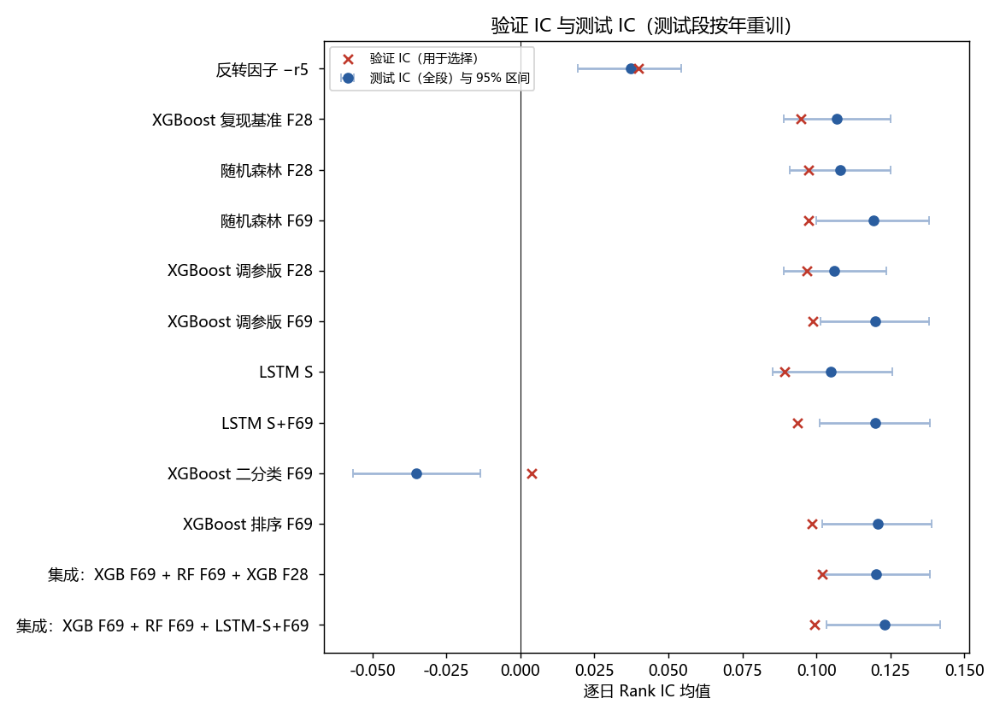
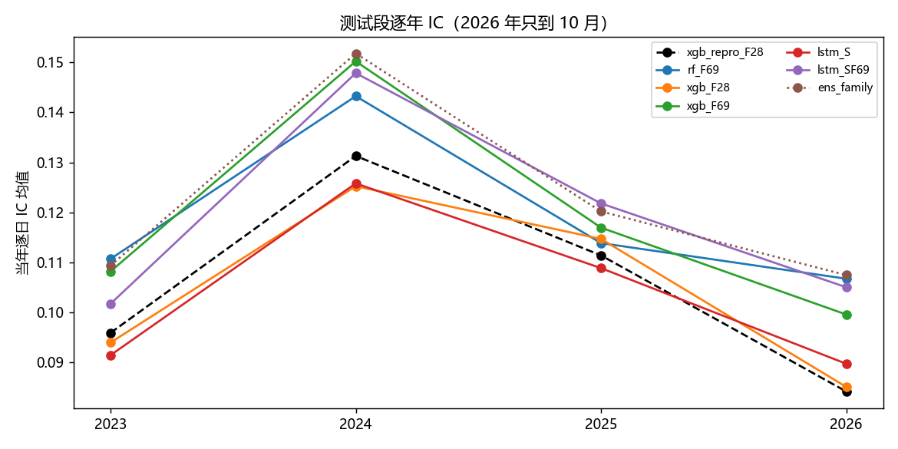

# 总排行榜（任务 3.11）

- 验证 IC 用于选择，偏乐观；测试段（2023-01 起）在所有选择冻结后只跑一次（冻结记录见 `ml/PREREG.md`）。
- 测试段的正式分数是**按年重训**的：每年第一个交易日用此前全部数据重训一次，参数不变（PREREG 补充登记十）。
  “对照：只训练一次”两列是 2023 年那次训练的模型给整个测试段打的分，用来看不重训会过时多少，不用于判定。
- 区间：按月整块重抽 95% 区间。超额、多空是小数（0.003 = 0.3%）。

| model_id      | 模型                                        | 类别     | 特征集   |   验证 IC（用于选择，偏乐观） |   验证前30超额 |   测试 IC T1 | 测试 IC T1 区间    |   测试 IC T2 | 测试 IC T2 区间    |   测试 IC 全段 | 测试 IC 全段 区间   |   测试 ICIR |   测试 NW t |   测试前6超额 |   测试前30超额 |   测试多空 |   测试10组单调性 |   测试 IC 2023 |   测试 IC 2024 |   测试 IC 2025 |   测试 IC 2026 |   对照：只训练一次 测试 IC 全段 |   对照：只训练一次 测试 IC T2 |   测试种子标准差 |   测试种子极差 |   训练秒（最终阶段） |
|:--------------|:--------------------------------------------|:---------|:---------|------------------------------:|---------------:|-------------:|:-------------------|-------------:|:-------------------|---------------:|:--------------------|------------:|------------:|--------------:|---------------:|-----------:|-----------------:|---------------:|---------------:|---------------:|---------------:|--------------------------------:|------------------------------:|-----------------:|---------------:|---------------------:|
| random        | 随机打分                                    | 参照     | —        |                       -0.0009 |        -0.0003 |      -0      | [-0.0022, 0.0024]  |      -0.0007 | [-0.0026, 0.0011]  |        -0.0004 | [-0.0018, 0.0010]   |     -0.0179 |     -0.5726 |       -0.0013 |        -0.0006 |     0.0001 |           0.1515 |        -0.0005 |        -0.0003 |        -0.0004 |        -0.0007 |                         -0.0004 |                       -0.0007 |           0      |         0      |                  0   |
| rev_r5        | 反转因子 −r5                                | 参照     | r5       |                        0.04   |        -0.0018 |       0.0292 | [-0.0017, 0.0590]  |       0.0424 | [0.0227, 0.0622]   |         0.0372 | [0.0193, 0.0543]    |      0.2422 |      4.5956 |       -0.0042 |        -0.0024 |     0.0061 |          -0.1273 |         0.0296 |         0.045  |         0.0636 |         0.0029 |                          0.0372 |                        0.0424 |           0      |         0      |                  0   |
| xgb_repro_F28 | XGBoost 复现基准                            | 参照     | F28      |                        0.0946 |         0.0032 |       0.1131 | [0.0910, 0.1354]   |       0.1031 | [0.0774, 0.1287]   |         0.107  | [0.0891, 0.1250]    |      0.7392 |     11.8432 |        0.0042 |         0.0033 |     0.0131 |           1      |         0.0959 |         0.1313 |         0.1114 |         0.0842 |                          0.1065 |                        0.1026 |           0.0002 |         0.0003 |                287.5 |
| rf_F28        | 随机森林                                    | 模型     | F28      |                        0.0973 |         0.0035 |       0.1108 | [0.0910, 0.1315]   |       0.1061 | [0.0810, 0.1308]   |         0.108  | [0.0909, 0.1250]    |      0.7615 |     12.2528 |        0.0043 |         0.0035 |     0.0131 |           1      |         0.0979 |         0.1278 |         0.1142 |         0.0873 |                          0.1071 |                        0.1046 |           0.0002 |         0.0003 |               2633.9 |
| rf_F69        | 随机森林                                    | 模型     | F69      |                        0.0972 |         0.0021 |       0.1269 | [0.0992, 0.1544]   |       0.1145 | [0.0880, 0.1408]   |         0.1193 | [0.0998, 0.1380]    |      0.7168 |     11.5004 |        0.0042 |         0.0041 |     0.0144 |           1      |         0.1107 |         0.1432 |         0.1139 |         0.1068 |                          0.1181 |                        0.1124 |           0.0002 |         0.0004 |                975.4 |
| xgb_F28       | XGBoost 调参版                              | 模型     | F28      |                        0.0967 |         0.0041 |       0.1087 | [0.0889, 0.1292]   |       0.1041 | [0.0796, 0.1287]   |         0.1059 | [0.0891, 0.1235]    |      0.7698 |     12.4088 |        0.0039 |         0.0026 |     0.0132 |           1      |         0.094  |         0.1252 |         0.1147 |         0.0851 |                          0.1053 |                        0.103  |           0.0004 |         0.0008 |                495.6 |
| xgb_F69       | XGBoost 调参版                              | 模型     | F69      |                        0.0987 |         0.0027 |       0.1279 | [0.0989, 0.1575]   |       0.1147 | [0.0910, 0.1386]   |         0.1199 | [0.1015, 0.1379]    |      0.7513 |     12.1155 |        0.0046 |         0.0044 |     0.0155 |           1      |         0.1082 |         0.1502 |         0.117  |         0.0996 |                          0.1193 |                        0.1134 |           0.0006 |         0.0012 |                282.4 |
| lstm_S        | LSTM                                        | 模型     | S        |                        0.0893 |         0.0023 |       0.1072 | [0.0789, 0.1375]   |       0.1033 | [0.0749, 0.1308]   |         0.1048 | [0.0852, 0.1255]    |      0.6615 |     10.251  |        0.0025 |         0.0027 |     0.0133 |           0.9879 |         0.0915 |         0.1258 |         0.1089 |         0.0898 |                          0.1024 |                        0.1003 |           0.0009 |         0.0018 |                344.4 |
| lstm_SF69     | LSTM                                        | 模型     | S+F69    |                        0.0935 |         0.0021 |       0.125  | [0.0947, 0.1559]   |       0.1167 | [0.0930, 0.1418]   |         0.1199 | [0.1012, 0.1383]    |      0.7505 |     12.3499 |        0.0053 |         0.005  |     0.0155 |           1      |         0.1017 |         0.1478 |         0.1218 |         0.1051 |                          0.1177 |                        0.1132 |           0.0014 |         0.0028 |                556.9 |
| xgb_clf_F69   | XGBoost 二分类（3.9）                       | 任务形式 | F69      |                        0.0038 |         0.0052 |      -0.0429 | [-0.0788, -0.0064] |      -0.0302 | [-0.0556, -0.0043] |        -0.0352 | [-0.0564, -0.0136]  |     -0.2262 |     -3.3951 |       -0.0004 |         0.001  |     0.0013 |           0.6606 |        -0.0495 |        -0.0346 |        -0.0314 |        -0.0226 |                         -0.0316 |                       -0.0266 |           0.0011 |         0.0022 |               2932.3 |
| xgb_rank_F69  | XGBoost 排序（3.9）                         | 任务形式 | F69      |                        0.0985 |         0.002  |       0.1312 | [0.1026, 0.1594]   |       0.1137 | [0.0892, 0.1383]   |         0.1206 | [0.1019, 0.1388]    |      0.7519 |     12.0017 |        0.0048 |         0.0049 |     0.015  |           1      |         0.1101 |         0.1504 |         0.1182 |         0.0988 |                          0.1184 |                        0.1103 |           0.0013 |         0.0025 |                304.9 |
| ens_top3      | 集成：XGB F69 + RF F69 + XGB F28（3.10）    | 集成     | —        |                        0.102  |         0.003  |       0.1269 | [0.0998, 0.1534]   |       0.1158 | [0.0907, 0.1405]   |         0.1202 | [0.1015, 0.1382]    |      0.7584 |     12.196  |        0.0049 |         0.0039 |     0.0147 |           1      |         0.1088 |         0.1462 |         0.1192 |         0.1026 |                          0.1195 |                        0.1145 |           0.0002 |         0.0004 |                  0   |
| ens_family    | 集成：XGB F69 + RF F69 + LSTM-S+F69（3.10） | 集成     | —        |                        0.0994 |         0.0026 |       0.1303 | [0.1009, 0.1603]   |       0.1184 | [0.0934, 0.1435]   |         0.1231 | [0.1035, 0.1418]    |      0.752  |     12.1228 |        0.0049 |         0.0048 |     0.0154 |           1      |         0.1094 |         0.1518 |         0.1202 |         0.1075 |                          0.122  |                        0.1165 |           0.0004 |         0.0009 |                  0   |

## 主要比较（PREREG 补充登记四，测试段全段，正式判定）

判定规则（PREREG 2.4）：区间下限 > 0 且差值 > 两者种子极差中较大的 → 更好；只有前者 → 可能更好；区间跨 0 → 分不出。

| 比较                                                    | 指标            |      差 | 95% 区间           |   NW t | 判定   |
|:--------------------------------------------------------|:----------------|--------:|:-------------------|-------:|:-------|
| RQ1：随机森林-F69 vs XGBoost-F69（Bagging vs Boosting） | 逐日 IC         | -0.0005 | [-0.0075, +0.0071] |  -0.16 | 分不出 |
| RQ1：随机森林-F69 vs XGBoost-F69（Bagging vs Boosting） | 前 30 超额（%） | -0.0273 | [-0.1426, +0.0882] |  -0.47 |        |
| RQ2：LSTM-S vs XGBoost-F69                              | 逐日 IC         | -0.015  | [-0.0326, +0.0026] |  -1.67 | 分不出 |
| RQ2：LSTM-S vs XGBoost-F69                              | 前 30 超额（%） | -0.1638 | [-0.4963, +0.1809] |  -0.99 |        |
| RQ2：LSTM-S+F69 vs LSTM-S                               | 逐日 IC         |  0.0151 | [-0.0028, +0.0335] |   1.72 | 分不出 |
| RQ2：LSTM-S+F69 vs LSTM-S                               | 前 30 超额（%） |  0.2256 | [-0.0168, +0.4532] |   1.99 |        |
| RQ3：XGBoost-F69 vs XGBoost-F28                         | 逐日 IC         |  0.0139 | [+0.0034, +0.0245] |   2.81 | 更好   |
| RQ3：XGBoost-F69 vs XGBoost-F28                         | 前 30 超额（%） |  0.1778 | [+0.0020, +0.3641] |   2.12 |        |

## 其他比较（只描述，不做判定）

| 比较                                         | 指标            |      差 | 95% 区间           |
|:---------------------------------------------|:----------------|--------:|:-------------------|
| XGBoost F69 − 仓库原模型（全部改进的总效果） | 逐日 IC         |  0.0129 | [+0.0018, +0.0238] |
| XGBoost F69 − 仓库原模型（全部改进的总效果） | 前 30 超额（%） |  0.1031 | [-0.0538, +0.2610] |
| XGBoost F28 − 仓库原模型（只调参）           | 逐日 IC         | -0.0011 | [-0.0035, +0.0013] |
| XGBoost F28 − 仓库原模型（只调参）           | 前 30 超额（%） | -0.0747 | [-0.1491, -0.0060] |
| 随机森林 F28 − XGBoost F28                   | 逐日 IC         |  0.002  | [+0.0001, +0.0040] |
| 随机森林 F28 − XGBoost F28                   | 前 30 超额（%） |  0.0934 | [-0.0160, +0.2027] |
| LSTM-S+F69 − XGBoost F69                     | 逐日 IC         |  0.0001 | [-0.0052, +0.0058] |
| LSTM-S+F69 − XGBoost F69                     | 前 30 超额（%） |  0.0618 | [-0.1065, +0.2292] |
| 随机森林 F69 − F28（新特征）                 | 逐日 IC         |  0.0114 | [+0.0040, +0.0186] |
| 随机森林 F69 − F28（新特征）                 | 前 30 超额（%） |  0.0572 | [-0.0510, +0.1722] |
| 集成 top3 − XGBoost F69                      | 逐日 IC         |  0.0003 | [-0.0048, +0.0062] |
| 集成 top3 − XGBoost F69                      | 前 30 超额（%） | -0.0426 | [-0.1357, +0.0507] |
| 集成 family − XGBoost F69                    | 逐日 IC         |  0.0032 | [+0.0005, +0.0063] |
| 集成 family − XGBoost F69                    | 前 30 超额（%） |  0.0469 | [-0.0716, +0.1669] |
| 排序 − 回归（3.9）                           | 逐日 IC         |  0.0007 | [-0.0021, +0.0035] |
| 排序 − 回归（3.9）                           | 前 30 超额（%） |  0.0526 | [-0.0074, +0.1125] |
| 二分类 − 回归（3.9）                         | 逐日 IC         | -0.1551 | [-0.1828, -0.1255] |
| 二分类 − 回归（3.9）                         | 前 30 超额（%） | -0.3413 | [-0.7421, +0.0521] |
| LSTM-S − 反转因子                            | 逐日 IC         |  0.0676 | [+0.0385, +0.0991] |
| LSTM-S − 反转因子                            | 前 30 超额（%） |  0.5148 | [+0.0899, +0.9839] |

## 按年重训 − 只训练一次（逐日 IC 差）

| model_id      | 模型                                          |   全段：IC 差 | 全段：区间         |   T2：IC 差 | T2：区间           |   2026：IC 差 | 2026：区间         |
|:--------------|:----------------------------------------------|--------------:|:-------------------|------------:|:-------------------|--------------:|:-------------------|
| xgb_repro_F28 | XGBoost 复现基准 F28                          |        0.0005 | [-0.0015, +0.0024] |      0.0005 | [-0.0028, +0.0039] |        0.0036 | [-0.0025, +0.0101] |
| rf_F28        | 随机森林 F28                                  |        0.0008 | [-0.0012, +0.0029] |      0.0016 | [-0.0019, +0.0047] |        0.005  | [-0.0010, +0.0114] |
| rf_F69        | 随机森林 F69                                  |        0.0012 | [-0.0030, +0.0057] |      0.0021 | [-0.0044, +0.0096] |        0.0091 | [-0.0063, +0.0265] |
| xgb_F28       | XGBoost 调参版 F28                            |        0.0007 | [-0.0014, +0.0027] |      0.0012 | [-0.0023, +0.0045] |        0.0059 | [-0.0002, +0.0122] |
| xgb_F69       | XGBoost 调参版 F69                            |        0.0006 | [-0.0041, +0.0055] |      0.0013 | [-0.0061, +0.0096] |        0.0058 | [-0.0124, +0.0255] |
| lstm_S        | LSTM S                                        |        0.0024 | [+0.0001, +0.0048] |      0.003  | [-0.0001, +0.0060] |        0.0052 | [-0.0000, +0.0114] |
| lstm_SF69     | LSTM S+F69                                    |        0.0022 | [-0.0019, +0.0063] |      0.0035 | [-0.0029, +0.0098] |        0.0112 | [+0.0000, +0.0241] |
| xgb_clf_F69   | XGBoost 二分类（3.9） F69                     |       -0.0036 | [-0.0072, -0.0002] |     -0.0036 | [-0.0090, +0.0015] |       -0.0037 | [-0.0127, +0.0065] |
| xgb_rank_F69  | XGBoost 排序（3.9） F69                       |        0.0022 | [-0.0024, +0.0066] |      0.0035 | [-0.0036, +0.0113] |        0.0089 | [-0.0066, +0.0261] |
| ens_top3      | 集成：XGB F69 + RF F69 + XGB F28（3.10） —    |        0.0007 | [-0.0030, +0.0046] |      0.0014 | [-0.0045, +0.0080] |        0.0073 | [-0.0059, +0.0222] |
| ens_family    | 集成：XGB F69 + RF F69 + LSTM-S+F69（3.10） — |        0.001  | [-0.0034, +0.0056] |      0.0019 | [-0.0050, +0.0094] |        0.0083 | [-0.0069, +0.0251] |

## 读法

**正式结论（4 个主要比较，测试段全段，PREREG 2.4 的判定规则）**

| 研究问题 | 结论 |
|---|---|
| RQ1 Bagging vs Boosting（随机森林 F69 vs XGBoost F69） | **分不出**：IC 差 −0.0005，区间 [−0.008, +0.007]；T1、T2 分开看也一样 |
| RQ2 原始序列 + 深度网络 vs 手工特征 + 树（LSTM-S vs XGBoost F69） | **分不出**，但 LSTM-S 点估计低 0.015（区间 [−0.033, +0.003]，接近显著地更差） |
| RQ2 给 LSTM 加手工特征（LSTM-S+F69 vs LSTM-S） | **分不出**：+0.012（区间 [−0.005, +0.029]），方向为正 |
| RQ3 新特征有没有用（XGBoost F69 vs F28） | **更好**：+0.014（区间 [+0.003, +0.025]，NW t 2.8），差值远大于种子极差 0.0012；前 30 超额也高 0.18 个百分点（区间 [+0.002, +0.364]） |

1. **新特征有用，而且是本项目所有改进里唯一有效的一项。**（补充：风格归因 `p5_style/` 显示，这个增益几乎全部来自换手、特质波动、市值这几种已知风格；去掉 4 种风格后 F69 与 F28 没有差别。详见 REPORT.md。）
   - XGBoost：F69 比 F28 高 0.014（判定“更好”）。随机森林 +0.011（区间 [+0.004, +0.019]）、LSTM +0.012（区间跨 0），三个模型方向一致。
   - 和仓库原模型相比，XGBoost F69 总共高 0.013（区间 [+0.002, +0.024]）。而“只调参”（XGBoost F28 − 原模型）是 −0.001，前 30 超额还低了 0.07 个百分点：
     验证段上调参带来的 +0.002 到测试段消失了。**总提升全部来自新特征，调参没有贡献。**
   - 测试段的结果和验证段不一样：验证段上新特征是“IC 略升、头部变差”，测试段上 IC 和前 30 超额都升高了。
     验证段只有两年，头部指标噪声大，那个现象没有在测试段重复出现。
   - 稳健性：优势在 T1 更大（+0.019，区间 [+0.004, +0.035]），T2 是 +0.011（区间 [−0.003, +0.026]，跨 0）。
     T1 和作者挑选特征、参数的时期重叠，这种重叠本来只对**原特征**有利，所以 F69 在 T1 赢不是因为占了便宜；
     但 T2 上的优势变小、不再显著，结论应表述为“新特征在整个测试期显著有用，后半段优势缩小”。逐年看，2023 ~ 2026 每年 F69 都高于 F28。
2. **模型之间分不出高下：用什么模型远没有用什么信息重要。** 同样用 F69，随机森林、XGBoost、LSTM-S+F69、两个集成、排序版本的测试 IC 都在 0.117 ~ 0.122，
   区间大面积重叠；同样用 F28，随机森林、XGBoost、原模型都在 0.106 ~ 0.108。换模型最多带来 0.002 左右，换信息带来 0.011 ~ 0.014。
3. **LSTM：只看原始序列，能做到手工特征树模型的水平，但追不上加了新特征的树模型。**
   LSTM-S（只用 60 天日线）测试 IC 0.105，和用 28 个手工特征的树模型几乎一样（0.106 ~ 0.108），比反转因子高 0.068；
   但比 XGBoost F69 低 0.015。加上手工特征后（LSTM-S+F69，0.117）和 XGBoost F69 只差 0.003，前 6 超额（0.57%）是所有模型里最高的。
   LSTM 的种子差异仍明显大于树模型（种子极差：S 0.0018、S+F69 0.0036；树模型 0.0003 ~ 0.0012）。
4. **集成没有带来额外收益**：两个集成比 XGBoost F69 只高 0.0003 / 0.002，区间都跨 0。成员的逐日 IC 相关 0.8 ~ 0.96，能互补的部分很少。
5. **任务形式（3.9）**：排序和回归一样（+0.0007）。二分类在测试段 IC 变成显著的负值（−0.035），
   验证段上那个“IC ≈ 0 但头部超额更高”的优势也没有延续（测试段前 30 超额 0.10%，回归 0.44%）。
   “是否进前 20%”这个目标学到的是波动，不是收益，不适合用来选股。
6. **所有模型的测试 IC 都高于验证 IC**（图 1），而不是像通常那样变低：测试期本身更容易预测，2024 年各模型 IC 都在 0.125 ~ 0.15。
   这是时期差异，不是模型变好。比较模型时只看同一时期内的差值，不受影响。
   但要注意：F69 模型从验证到测试平均多涨约 0.021，F28 模型约 0.011，说明新特征在测试期比验证期更有用。
7. **按年重训的作用很小**：和只训练一次相比，全段 IC 只多 0.001 ~ 0.002，区间都跨 0；差别主要在 2026 年（+0.005 ~ +0.011）。
   规律在 1 ~ 3 年内变化不大（和 4.1 单因子的逐年稳定一致），离训练期越远，重训的好处越明显。
   LSTM-S+F69 重训后反而略低（−0.003，区间跨 0），可能是 LSTM 训练本身的随机性。
8. **逐年衰减**：2026 年（截至 10 月）所有模型的 IC 都明显下降（0.08 ~ 0.11），用 F69 的模型降得少（约 0.10 ~ 0.11，F28 约 0.085）。
9. **种子差异**：树模型的测试段种子极差 ≤ 0.0012，判定时不构成门槛；LSTM 和二分类较大。
10. **运行情况**：第一次、第二次运行时出现过偶发的计算错误（见 PREREG“冻结后的运行记录”）。第三次运行加了完整性检查和“评估算两遍”，
    记录到 2 次评估报错（反转因子、随机森林 F28），重算后两遍一致才保存。报告里的全部数字都来自第三次运行。
