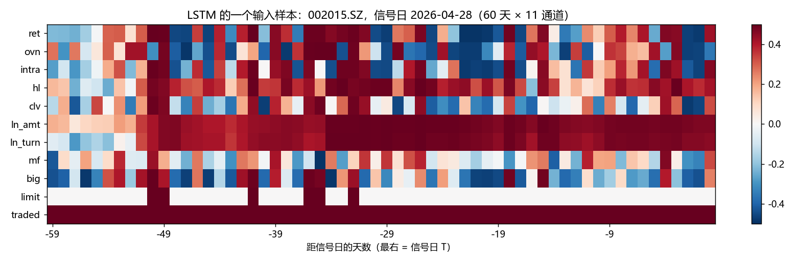
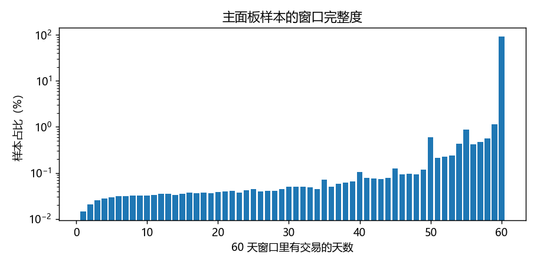

# 1.6 LSTM 的序列数据

- 代码：`ml/seq_data.py`（定义和计算）、`ml/p1_6_build_seq.py`（构建与核对）；单元测试 `ml/tests/test_seq_data.py`
- 运行：`python -X utf8 -m ml.p1_6_build_seq [--rebuild]`
- 产物：`data/ml/seq/`（不进 Git）——`X.npy` 张量、`codes.npy` 股票代码、`dates.npy` 交易日、`panel_j.npy` 主面板每行的股票下标
- 构建耗时 58 秒，本次核对的进程内存 1.0 GB

## 一、为什么要单独准备

Ridge 和 XGBoost 读的是“一行 = 一只股票一天的手工特征”。LSTM 的意义在于直接读**过去一段时间的原始日线**，
让网络自己学出时间上的模式（参考 Qlib 的 Alpha360：60 天 × 几个原始量）。所以给它一条序列：
**一个样本 = 主面板的一行 (股票, 信号日 T)，输入是这只股票 T−59 ~ T 共 60 个交易日 × 11 个通道。**

| 通道 | 计算 | 含义 |
|---|---|---|
| `ret` | ln(复权收盘 / 前一交易日复权收盘) | 日收益 |
| `ovn` | ln(复权开盘 / 前一交易日复权收盘) | 隔夜收益 |
| `intra` | ln(收盘 / 开盘) | 日内收益 |
| `hl` | ln(最高 / 最低) | 日内振幅 |
| `clv` | (2C − H − L) / (H − L)，一字板记 0 | 收盘位置 |
| `ln_amt` | ln(成交额) | 成交活跃度、规模 |
| `ln_turn` | ln(自由流通换手率) | 换手 |
| `mf` | 净流入额 / 成交额 | 资金流 |
| `big` | 大单 + 特大单净买入 / 成交额 | 大资金动向 |
| `limit` | 涨停 +0.5、跌停 −0.5、其余 0 | 涨跌停 |
| `traded` | 有交易 1，停牌 / 未上市 / 已退市 0 | 有效标记 |

- **标准化**：前 9 个通道每天在**全主板**截面排名到 (−0.5, 0.5)，和 1.5 的做法一致：对极端值不敏感、每天独立、不需要拟合，没有跨期泄漏。
  缺失（停牌、没有资金流）填 0，并由 `traded` 通道告诉网络“这一天没有交易”。
- **存储**：张量 `[股票 3,413, 交易日 3,350, 通道 11]`，float16，0.23 GB，可以整份放进显卡（8 GB）。
  训练时按下标现切窗口，不展开成“430 万 × 60 × 11”的大数组（那样要 5 GB）。
- 截面排名的范围是全主板（不只准入池），因为窗口里有的天这只股票还没进池。

## 二、核对

### 1. 每个通道的取值（随机 300 天、有交易的格子）

| 通道    |    最小 |   最大 |    均值 |   为 0 的比例 |   每天均值的最大偏离 |
|:--------|--------:|-------:|--------:|--------------:|---------------------:|
| ret     | -0.4998 | 0.4998 | -0      |        0.0004 |                    0 |
| ovn     | -0.4998 | 0.4998 |  0      |        0.0018 |                    0 |
| intra   | -0.4998 | 0.4998 |  0      |        0.0002 |                    0 |
| hl      | -0.4998 | 0.4998 | -0      |        0.0002 |                    0 |
| clv     | -0.4998 | 0.499  |  0      |        0.0002 |                    0 |
| ln_amt  | -0.4998 | 0.4998 | -0      |        0.0002 |                    0 |
| ln_turn | -0.4998 | 0.4998 |  0      |        0.0002 |                    0 |
| mf      | -0.4998 | 0.4998 | -0      |        0.001  |                    0 |
| big     | -0.4998 | 0.4998 |  0      |        0.001  |                    0 |
| limit   | -0.5    | 0.5    |  0.0049 |        0.9711 |                  nan |
| traded  |  1      | 1      |  1      |        0      |                  nan |

排名通道都在 (−0.5, 0.5) 内、每天居中（偏离不到 1e-4，表中四舍五入为 0）；`limit` 只有 −0.5 / 0 / 0.5（约 2.9% 的格子是涨停或跌停）；`traded` 全是 1。

### 2. 防前视：把库截断到某一天（所有表只读到这一天）单独重算，和张量逐格比较

| 日期       |   股票数 |   不一致的格子 | 其他股票当天是否都标为未交易   |
|:-----------|---------:|---------------:|:-------------------------------|
| 2015-07-09 |     1147 |              0 | True                           |
| 2021-04-23 |     3050 |              0 | True                           |
| 2026-10-23 |     3193 |              0 | True                           |

“不一致的格子”都是 0：每个格子只用到当天及以前的数据。

### 3. 独立重算：不用窗口函数，另写一段代码按定义直接算，再用 scipy 排名

| 日期       |   股票数 |   最大绝对差 |   差 > 1e-3 的格子 | 最差的通道   |
|:-----------|---------:|-------------:|-------------------:|:-------------|
| 2015-07-09 |     1147 |  0.000121742 |                  0 | ret          |
| 2021-04-23 |     3050 |  0.000121981 |                  0 | ret          |
| 2026-10-23 |     3193 |  0.000121891 |                  0 | ret          |

差别都在 float16 的精度以内（float16 在 0.5 附近的分辨率约 2.4e-4）。

### 4. 主面板的覆盖

- 主面板 4,278,794 行全部找到了股票下标；信号日当天在张量里都标为“有交易”：True
- 60 天窗口里有交易的天数：平均 59.0 天，**92.3%** 的样本 60 天都有交易，最少 1 天
  （准入池要求至少 150 根日线，所以窗口不会落到上市前；少于 60 天的是窗口里有停牌，极少数是长期停牌后刚复牌的股票，
  窗口里几乎全是“未交易”。这些样本照常保留：`traded` 通道让网络知道哪些天是空的，删掉反而和其他模型的样本不一致）。





## 三、计算量摸底（dl-study 环境，RTX 5060 8 GB）

|   隐藏维度 |   层数 |   批大小 |   参数个数 |   每步毫秒 |   全量一个 epoch 秒 |   显存峰值 GB |
|-----------:|-------:|---------:|-----------:|-----------:|--------------------:|--------------:|
|         64 |      1 |     4096 |      19777 |       13.5 |                 6.3 |          2.22 |
|         64 |      2 |     4096 |      53057 |       26.9 |                12.6 |          2.66 |
|        128 |      2 |     4096 |     204417 |      106.4 |                50   |          4.8  |
|        128 |      2 |     8192 |     204417 |      671.4 |               157.7 |          9.12 |

读法（每步含前向、反向、参数更新；“全量一个 epoch”= 选择阶段 192 万训练行全部过一遍）：
- 隐藏维度 64 以内，一个全量 epoch 只要 6 ~ 13 秒；隐藏维度 128、两层约 50 秒。最多 30 个 epoch，单组超参数最慢约 25 分钟，
  调参 10 ~ 12 组在可接受范围内（任务清单 0.5 的目标：单次完整训练不超过 30 分钟）。
- 隐藏维度 128、两层、批大小 8192 时显存峰值超过 8 GB，借用了共享内存，每步慢了 6 倍：**批大小上限定为 4096**。
- 序列张量整份放进显卡只占 0.23 GB，按下标在显卡上切窗口，不用 DataLoader，也不经过内存。

## 四、给后续任务的用法

```python
from ml.seq_data import load_X, window
X, codes, dates, panel_j = load_X()               # X: [股票, 交易日, 11]，float16
seq = window(X, panel_j[rows], keys["di"].to_numpy()[rows])   # [样本, 60, 11]
```
LSTM 训练时把 X 整份放进显卡，按同样的下标在显卡上切（`ml/lstm_train.py`，任务 3.6）。
