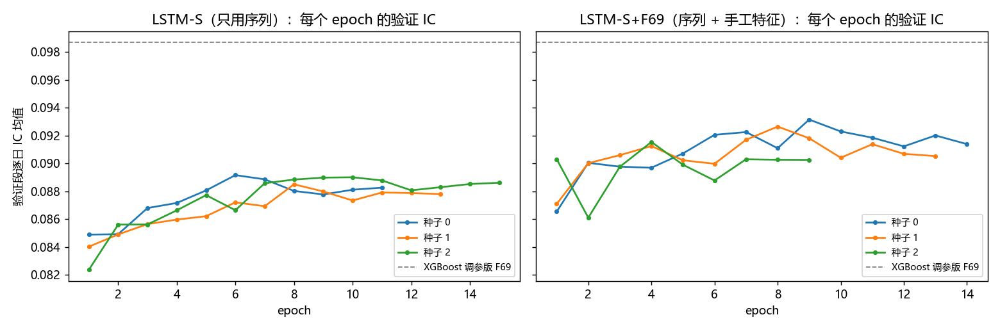
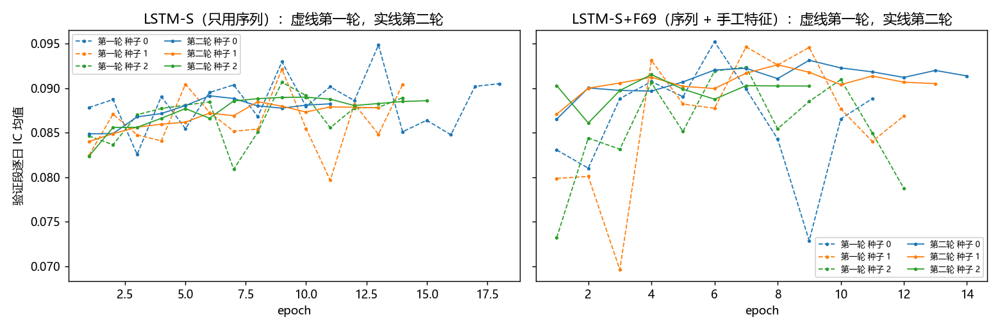

# 3.6 LSTM（验证段，第二轮）

- 代码：`ml/lstm_prep.py`（主环境准备数据）、`ml/lstm_train.py`（dl-study 环境训练，只依赖 numpy、torch）、`ml/p3_6_lstm.py`（调度、评估、报告）
- 运行：`python -X utf8 -m ml.p3_6_lstm`
- 产物：`tuning_S.csv`、`tuning_SF.csv`、`chosen.json`、`fig1_valid_ic_curves.png`；分数 `data/ml/scores/lstm_S__select.parquet`、`lstm_SF69__select.parquet`
- 所有数字都只来自验证段（2021 ~ 2022）；测试段等所有模型的选择冻结后统一跑（任务 3.11）

## 一、设置

- 输入：每个样本是这只股票过去 60 个交易日 × 11 个原始日线通道（1.6）；S+F69 版本再把 69 个手工特征（dense 预处理，71 维）
  拼到 LSTM 最后一步的隐状态上。
- 结构：LSTM（1 ~ 2 层）→ 最后一步隐状态 → dropout →（拼手工特征）→ 全连接 → ReLU → 全连接 → 一个分数。
- 训练：均方误差，目标 = 训练标签 − 0.5；Adam；每个 epoch 随机抽一部分交易日，每批由完整的交易日组成（≤ 4096 行）；
  每个 epoch 末算验证段逐日 IC，连续 5 个 epoch 不提高就停（第一轮最多 30 个，第二轮最多 20 个），取 IC 最高的 epoch。
- 调参：事先列出的 12 组（隐藏维度、层数、dropout、学习率、权重衰减、每 epoch 抽样比例），S 和 S+F69 各调一遍，只用种子 0。
- **一共跑了两轮**，网格相同。第一轮验证曲线噪声很大（相邻 epoch 的验证 IC 差 0.005 ~ 0.02），早停取的是噪声的最高点，
  最终阶段固定 epoch 数时停在哪里也靠运气。第二轮（本报告第二、三节）加了两项常规的稳定化做法（PREREG 补充登记九）：
  **学习率余弦衰减**（第 1 个 epoch 用设定值，第 20 个 epoch 降到接近 0，最多 20 个 epoch）和**权重的指数滑动平均**
  （衰减 0.999、前几百步预热，验证、早停、输出都用平均权重）。第二轮替换第一轮是事先定的，不按两轮谁高来挑；第一轮见第五节。
- 说明：显卡上的 LSTM（cuDNN）训练不是逐位可复现的，同一种子重跑结果会有很小的差别；种子之间的差别见下表。

## 二、调参结果（种子 0）

### LSTM-S（只用序列）

|   组 |   hidden |   layers |   dropout |     lr |     wd |   frac |   参数个数 |   最佳 epoch |   跑了 epoch |   验证 IC |   ICIR |   NW t |   前6 超额% |   前30 超额% |   训练秒 |   显存 GB |
|-----:|---------:|---------:|----------:|-------:|-------:|-------:|-----------:|-------------:|-------------:|----------:|-------:|-------:|------------:|-------------:|---------:|----------:|
|    1 |       32 |        1 |       0   | 0.001  | 0      |   0.5  |       6849 |            6 |           11 |    0.0892 | 0.668  |   8.17 |        0.13 |         0.17 |       30 |      1.2  |
|    2 |       64 |        1 |       0   | 0.001  | 0      |   0.5  |      23937 |            6 |           11 |    0.0896 | 0.6828 |   8.36 |        0.09 |         0.16 |      145 |      2.06 |
|    3 |      128 |        1 |       0   | 0.001  | 0      |   0.5  |      88833 |            6 |           11 |    0.0898 | 0.683  |   8.37 |        0.18 |         0.15 |      222 |      3.77 |
|    4 |       64 |        2 |       0.1 | 0.001  | 0      |   0.5  |      57217 |           16 |           20 |    0.0895 | 0.7191 |   8.79 |        0.26 |         0.24 |      205 |      2.49 |
|    5 |      128 |        2 |       0.1 | 0.001  | 0      |   0.5  |     220929 |           11 |           16 |    0.0895 | 0.7264 |   8.8  |        0.25 |         0.28 |      607 |      2.98 |
|    6 |       64 |        1 |       0   | 0.0003 | 0      |   0.5  |      23937 |           11 |           16 |    0.0873 | 0.6541 |   8.03 |        0.11 |         0.13 |       87 |      1.64 |
|    7 |       64 |        2 |       0.1 | 0.0003 | 0      |   0.5  |      57217 |           17 |           20 |    0.0877 | 0.6578 |   8    |        0.12 |         0.17 |      201 |      1.66 |
|    8 |       64 |        1 |       0   | 0.001  | 0.0001 |   0.5  |      23937 |           17 |           20 |    0.0864 | 0.6347 |   7.75 |        0.07 |         0.15 |      112 |      1.64 |
|    9 |       64 |        2 |       0.3 | 0.001  | 0.0001 |   0.5  |      57217 |            1 |            6 |    0.0819 | 0.5392 |   6.56 |       -0.14 |         0.06 |       62 |      1.66 |
|   10 |       64 |        1 |       0   | 0.001  | 0      |   0.25 |      23937 |           16 |           20 |    0.0884 | 0.6877 |   8.41 |        0.21 |         0.22 |       68 |      1.64 |
|   11 |       64 |        2 |       0.1 | 0.001  | 0      |   1    |      57217 |           14 |           19 |    0.0906 | 0.7798 |   9.62 |        0.28 |         0.29 |      335 |      1.66 |
|   12 |      128 |        2 |       0.3 | 0.0003 | 0.0001 |   0.5  |     220929 |           10 |           15 |    0.0827 | 0.5497 |   6.75 |       -0.11 |         0.05 |      567 |      2.98 |

### LSTM-S+F69（序列 + 手工特征）

|   组 |   hidden |   layers |   dropout |     lr |     wd |   frac |   参数个数 |   最佳 epoch |   跑了 epoch |   验证 IC |   ICIR |   NW t |   前6 超额% |   前30 超额% |   训练秒 |   显存 GB |
|-----:|---------:|---------:|----------:|-------:|-------:|-------:|-----------:|-------------:|-------------:|----------:|-------:|-------:|------------:|-------------:|---------:|----------:|
|    1 |       32 |        1 |       0   | 0.001  | 0      |   0.5  |       9121 |            9 |           14 |    0.0898 | 0.6939 |   8.94 |        0.36 |         0.25 |       49 |      1.34 |
|    2 |       64 |        1 |       0   | 0.001  | 0      |   0.5  |      28481 |            9 |           14 |    0.0931 | 0.7244 |   9.5  |        0.35 |         0.22 |       79 |      1.99 |
|    3 |      128 |        1 |       0   | 0.001  | 0      |   0.5  |      97921 |            9 |           14 |    0.0949 | 0.7443 |   9.76 |        0.23 |         0.32 |      272 |      3.3  |
|    4 |       64 |        2 |       0.1 | 0.001  | 0      |   0.5  |      61761 |            9 |           14 |    0.0941 | 0.7352 |   9.56 |        0.42 |         0.27 |      143 |      2.01 |
|    5 |      128 |        2 |       0.1 | 0.001  | 0      |   0.5  |     230017 |            9 |           14 |    0.0945 | 0.7543 |   9.77 |        0.35 |         0.31 |      530 |      3.33 |
|    6 |       64 |        1 |       0   | 0.0003 | 0      |   0.5  |      28481 |            9 |           14 |    0.0906 | 0.6798 |   8.87 |        0.33 |         0.24 |       80 |      1.99 |
|    7 |       64 |        2 |       0.1 | 0.0003 | 0      |   0.5  |      61761 |            9 |           14 |    0.0918 | 0.7075 |   9.04 |        0.19 |         0.25 |      144 |      2.01 |
|    8 |       64 |        1 |       0   | 0.001  | 0.0001 |   0.5  |      28481 |            9 |           14 |    0.0931 | 0.7159 |   9.31 |        0.28 |         0.3  |       84 |      1.99 |
|    9 |       64 |        2 |       0.3 | 0.001  | 0.0001 |   0.5  |      61761 |            9 |           14 |    0.0931 | 0.7131 |   9.05 |        0.38 |         0.29 |      140 |      2.01 |
|   10 |       64 |        1 |       0   | 0.001  | 0      |   0.25 |      28481 |            7 |           12 |    0.0928 | 0.714  |   9.13 |        0.34 |         0.32 |       43 |      1.99 |
|   11 |       64 |        2 |       0.1 | 0.001  | 0      |   1    |      61761 |            8 |           13 |    0.094  | 0.7545 |  10    |        0.35 |         0.34 |      222 |      2.01 |
|   12 |      128 |        2 |       0.3 | 0.0003 | 0.0001 |   0.5  |     230017 |            9 |           14 |    0.0923 | 0.7038 |   8.91 |        0.25 |         0.25 |      506 |      3.33 |

### 选定

- **LSTM-S（只用序列）**：第 1、2、3、4、5、11 组和最高值相差不到 0.002，按规则取参数最少（最简单）的第 1 组——{'hidden': 32, 'layers': 1, 'dropout': 0.0, 'lr': 0.001, 'wd': 0.0, 'frac': 0.5}，6,849 个参数（种子 0 验证 IC 0.0892）；3 个种子最佳 epoch [6, 8, 10]，最终阶段训练 **8** 个 epoch
- **LSTM-S+F69（序列 + 手工特征）**：第 2、3、4、5、8、9、11 组和最高值相差不到 0.002，按规则取参数最少（最简单）的第 8 组——{'hidden': 64, 'layers': 1, 'dropout': 0.0, 'lr': 0.001, 'wd': 0.0001, 'frac': 0.5}，28,481 个参数（种子 0 验证 IC 0.0931）；3 个种子最佳 epoch [9, 8, 4]，最终阶段训练 **7** 个 epoch

## 三、最终模型（选定参数 × 3 个种子，分数取平均）与其他模型对照

| 模型                     |   验证 IC |   ICIR |   NW t |   前6 超额% |   前30 超额% |   多空% |   10组单调性 | 各种子 IC                |   种子极差 |
|:-------------------------|----------:|-------:|-------:|------------:|-------------:|--------:|-------------:|:-------------------------|-----------:|
| LSTM-S                   |    0.0893 |  0.699 |    8.5 |       0.009 |        0.231 |   1.205 |        0.952 | 0.0892 / 0.0885 / 0.0890 |     0.0007 |
| LSTM-S+F69               |    0.0935 |  0.72  |    9.1 |       0.298 |        0.214 |   1.333 |        0.988 | 0.0931 / 0.0926 / 0.0915 |     0.0016 |
| 第一轮 LSTM-S            |    0.0937 |  0.785 |    9.6 |       0.363 |        0.302 |   1.379 |        0.927 | 0.0949 / 0.0922 / 0.0907 |     0.0042 |
| 第一轮 LSTM-S+F69        |    0.0963 |  0.739 |    9.2 |       0.303 |        0.272 |   1.371 |        0.988 | 0.0952 / 0.0946 / 0.0924 |     0.0028 |
| XGBoost 调参版 F69       |    0.0987 |  0.837 |   11   |       0.326 |        0.266 |   1.414 |        0.988 | 0.0980 / 0.0980 / 0.0973 |     0.0007 |
| XGBoost 调参版 F28       |    0.0967 |  0.859 |   10.4 |       0.499 |        0.408 |   1.28  |        0.988 | 0.0956 / 0.0964 / 0.0962 |     0.0008 |
| 随机森林 F69             |    0.0972 |  0.748 |    9.2 |       0.078 |        0.208 |   1.273 |        0.952 | 0.0972 / 0.0971 / 0.0969 |     0.0003 |
| XGBoost 复现 F28（参照） |    0.0946 |  0.804 |    9.9 |       0.348 |        0.316 |   1.215 |        1     | 0.0947 / 0.0942 / 0.0942 |     0.0005 |
| 反转因子（参照）         |    0.04   |  0.309 |    4.2 |      -0.555 |       -0.178 |   0.687 |        0.564 | 0.0400                   |     0      |

**分 10 组的平均超额（%，第 10 组 = 分数最高）**

|            |      1 |      2 |     3 |     4 |     5 |     6 |     7 |     8 |     9 |    10 |
|:-----------|-------:|-------:|------:|------:|------:|------:|------:|------:|------:|------:|
| LSTM-S     | -1.005 | -0.125 | 0.052 | 0.099 | 0.1   | 0.167 | 0.154 | 0.159 | 0.202 | 0.2   |
| LSTM-S+F69 | -1.096 | -0.134 | 0.028 | 0.103 | 0.095 | 0.18  | 0.181 | 0.184 | 0.228 | 0.237 |

**逐年 IC**

|   date |   lstm_S |   lstm_SF69 |   lstm_r1_S |   lstm_r1_SF69 |   xgb_F69 |   xgb_F28 |   rf_F69 |   xgb_repro_F28 |   rev_r5 |
|-------:|---------:|------------:|------------:|---------------:|----------:|----------:|---------:|----------------:|---------:|
|   2021 |   0.0729 |      0.0783 |      0.0777 |         0.0813 |    0.0852 |    0.0804 |   0.0813 |          0.0783 |   0.0236 |
|   2022 |   0.1058 |      0.1088 |      0.1097 |         0.1114 |    0.1122 |    0.1132 |   0.1132 |          0.111  |   0.0566 |

**比较（按月整块重抽 95% 区间；仅供参考，正式判定在测试段，见 PREREG 2.4）**

| 比较                               | 指标            |      差 | 95% 区间           |
|:-----------------------------------|:----------------|--------:|:-------------------|
| LSTM-S − XGBoost 调参版 F69（RQ2） | 逐日 IC         | -0.0094 | [-0.0199, +0.0003] |
| LSTM-S − XGBoost 调参版 F69（RQ2） | 前 30 超额（%） | -0.035  | [-0.2932, +0.2082] |
| LSTM-S+F69 − LSTM-S（加手工特征）  | 逐日 IC         |  0.0042 | [-0.0055, +0.0150] |
| LSTM-S+F69 − LSTM-S（加手工特征）  | 前 30 超额（%） | -0.0169 | [-0.2346, +0.2046] |
| LSTM-S+F69 − XGBoost 调参版 F69    | 逐日 IC         | -0.0052 | [-0.0119, +0.0020] |
| LSTM-S+F69 − XGBoost 调参版 F69    | 前 30 超额（%） | -0.052  | [-0.2585, +0.1617] |
| LSTM-S − 反转因子                  | 逐日 IC         |  0.0493 | [+0.0293, +0.0702] |
| LSTM-S − 反转因子                  | 前 30 超额（%） |  0.4086 | [+0.0581, +0.7729] |
| LSTM-S 第二轮 − 第一轮             | 逐日 IC         | -0.0044 | [-0.0085, -0.0002] |
| LSTM-S 第二轮 − 第一轮             | 前 30 超额（%） | -0.0715 | [-0.2160, +0.0766] |
| LSTM-S+F69 第二轮 − 第一轮         | 逐日 IC         | -0.0028 | [-0.0070, +0.0009] |
| LSTM-S+F69 第二轮 − 第一轮         | 前 30 超额（%） | -0.0584 | [-0.1435, +0.0219] |

**两轮的验证曲线对比**（选定配置的 3 个种子）

| 版本                          |   第一轮：相邻 epoch 验证 IC 平均跳动 |   第二轮：相邻 epoch 验证 IC 平均跳动 |
|:------------------------------|--------------------------------------:|--------------------------------------:|
| LSTM-S（只用序列）            |                                0.0036 |                                0.0006 |
| LSTM-S+F69（序列 + 手工特征） |                                0.0056 |                                0.0012 |

## 四、读法

1. **第二轮把验证曲线的噪声压下去了，这是本轮的目的，也达到了。** 相邻两个 epoch 验证 IC 的平均跳动，S 从 0.0036 降到 0.0006，
   S+F69 从 0.0056 降到 0.0012（图 2：虚线是第一轮，实线是第二轮）。种子极差也明显变小：S 从 0.0042 降到 0.0007（和树模型一样小），
   S+F69 从 0.0028 降到 0.0016。曲线平稳以后，选出的 epoch 和最终阶段固定的 epoch 数（S 8 个、S+F69 7 个）都不再靠运气。
2. **第二轮的验证 IC 比第一轮低，但这是因为第一轮偏乐观，不是因为第二轮学得差。**
   - 选定模型的验证 IC：S 从 0.0937 降到 0.0893（区间 [−0.0085, −0.0002]），S+F69 从 0.0963 降到 0.0935（区间跨 0）；
   - 但看曲线的**典型水平**（每个种子从第 3 个 epoch 起的平均验证 IC），第二轮和第一轮一样甚至更高：
     S 是 0.0874 → 0.0877，S+F69 是 0.0875 → **0.0909**。
   - 第一轮多出来的分数，基本来自“在一条噪声很大的曲线上挑最高点”（每个种子各挑一次，再加上 3 个种子平均的抵消）。
     这部分在测试段上拿不到，因为最终阶段只能固定训练若干个 epoch，不能挑。所以第二轮的验证 IC 更接近 LSTM 在测试段上的真实水平。
   - 按事先的登记（补充登记九），第二轮替换第一轮，不按谁的验证 IC 高来挑。
3. **对比树模型，LSTM 仍然落后。**
   - LSTM-S（只用 60 天原始序列）0.0893，比 XGBoost 调参版 F69 低 0.0094（区间 [−0.020, +0.0003]，几乎不含 0），
     也低于 XGBoost 复现基准（0.0946）；但比反转因子高 0.049（区间 [+0.029, +0.070]），说明它确实从原始序列里学到了很多东西。
   - LSTM-S+F69 0.0935，比 LSTM-S 高 0.0042（区间跨 0），比 XGBoost F69 低 0.0052（区间跨 0）。
   - 这和补充登记三事先写下的预期一致：LSTM-S 不一定胜过 XGBoost-F69。
4. **加手工特征对 LSTM 的帮助在第二轮更清楚。** 第二轮的 12 组里，S+F69 每一组都比同样结构的 S 高（高 0.0006 ~ 0.011，多数在 0.003 ~ 0.005）；
   曲线典型水平高 0.003（0.0877 → 0.0909）。说明手工特征（多周期价格、换手、资金流等）里有 60 天原始序列没能学到的信息。
5. **头部表现：LSTM-S 的前 6 超额几乎为 0**（0.01%），前 30 超额 0.23%；S+F69 是 0.30% / 0.21%。
   都不如 XGBoost F28（0.50% / 0.41%）。LSTM 的排序能力主要体现在把最差的一组挑出来（第 1 组 −1.0% ~ −1.1%）。
6. **选择结果。**
   - S：有 6 组打平（第 1、2、3、4、5、11 组，与最高值 0.0906 相差 < 0.002），按规则选参数最少的第 1 组（隐藏 32、一层，6,849 个参数）。
     第一轮在 S 上“唯一突出”的第 11 组（每 epoch 用全部训练日），第二轮只比别的组高 0.001，说明第一轮它的突出主要是噪声。
   - S+F69：7 组打平，选参数最少的第 8 组（隐藏 64、一层、权重衰减 1e-4），和第一轮相同。
   - 在这份数据上，LSTM 的结构大小影响很小，小模型就够了。
7. **运行情况。** 第二轮在 S 的第 5 组（隐藏 128、两层）显存不足中断：一批一个交易日（约 3000 行），这个结构会用满 8 GB 显存。
   之后改为把一批再切成 ≤ 2048 行的小块、梯度累加后更新一次。这和整批一起算在数学上相同：在第 1 组上核对，前两个 epoch 的验证 IC 只差约 0.00005。
   第 1 ~ 4 组是改动前跑的，保留不重跑。第二轮 GPU 总计约 1.5 小时。

## 五、第一轮（无学习率衰减和权重平均，不参与选择）

### LSTM-S

|   组 |   hidden |   layers |   dropout |     lr |     wd |   frac |   参数个数 |   最佳 epoch |   跑了 epoch |   验证 IC |   ICIR |   NW t |   前6 超额% |   前30 超额% |   训练秒 |   显存 GB |
|-----:|---------:|---------:|----------:|-------:|-------:|-------:|-----------:|-------------:|-------------:|----------:|-------:|-------:|------------:|-------------:|---------:|----------:|
|    1 |       32 |        1 |       0   | 0.001  | 0      |   0.5  |       6849 |            4 |            9 |    0.0906 | 0.6938 |   8.41 |        0.05 |         0.24 |       20 |      1.2  |
|    2 |       64 |        1 |       0   | 0.001  | 0      |   0.5  |      23937 |            6 |           11 |    0.0904 | 0.7291 |   8.96 |        0.19 |         0.25 |       53 |      2.06 |
|    3 |      128 |        1 |       0   | 0.001  | 0      |   0.5  |      88833 |            6 |           11 |    0.0901 | 0.7103 |   8.75 |        0.19 |         0.25 |      197 |      3.77 |
|    4 |       64 |        2 |       0.1 | 0.001  | 0      |   0.5  |      57217 |            4 |            9 |    0.0897 | 0.6922 |   8.33 |        0.16 |         0.26 |       82 |      2.49 |
|    5 |      128 |        2 |       0.1 | 0.001  | 0      |   0.5  |     220929 |            6 |           11 |    0.0891 | 0.6965 |   8.49 |        0.24 |         0.18 |      398 |      4.64 |
|    6 |       64 |        1 |       0   | 0.0003 | 0      |   0.5  |      23937 |            6 |           11 |    0.0884 | 0.6339 |   7.79 |        0.1  |         0.15 |      122 |      2.06 |
|    7 |       64 |        2 |       0.1 | 0.0003 | 0      |   0.5  |      57217 |            6 |           11 |    0.088  | 0.613  |   7.52 |        0.05 |         0.1  |      102 |      2.49 |
|    8 |       64 |        1 |       0   | 0.001  | 0.0001 |   0.5  |      23937 |            6 |           11 |    0.0863 | 0.6115 |   7.47 |        0.04 |         0.11 |      122 |      2.06 |
|    9 |       64 |        2 |       0.3 | 0.001  | 0.0001 |   0.5  |      57217 |           23 |           28 |    0.0848 | 0.5869 |   7.09 |       -0.1  |         0.06 |      249 |      2.49 |
|   10 |       64 |        1 |       0   | 0.001  | 0      |   0.25 |      23937 |           12 |           17 |    0.0893 | 0.6593 |   8.08 |        0.21 |         0.2  |       48 |      2.06 |
|   11 |       64 |        2 |       0.1 | 0.001  | 0      |   1    |      57217 |           13 |           18 |    0.0949 | 0.8073 |   9.93 |        0.56 |         0.38 |      286 |      2.49 |
|   12 |      128 |        2 |       0.3 | 0.0003 | 0.0001 |   0.5  |     220929 |            9 |           14 |    0.0826 | 0.5388 |   6.7  |       -0.12 |         0.04 |      502 |      4.64 |

### LSTM-S+F69

|   组 |   hidden |   layers |   dropout |     lr |     wd |   frac |   参数个数 |   最佳 epoch |   跑了 epoch |   验证 IC |   ICIR |   NW t |   前6 超额% |   前30 超额% |   训练秒 |   显存 GB |
|-----:|---------:|---------:|----------:|-------:|-------:|-------:|-----------:|-------------:|-------------:|----------:|-------:|-------:|------------:|-------------:|---------:|----------:|
|    1 |       32 |        1 |       0   | 0.001  | 0      |   0.5  |       9121 |            6 |           11 |    0.0933 | 0.7418 |   9.38 |        0.24 |         0.36 |       24 |      1.55 |
|    2 |       64 |        1 |       0   | 0.001  | 0      |   0.5  |      28481 |            6 |           11 |    0.0948 | 0.775  |   9.96 |        0.37 |         0.27 |      121 |      2.41 |
|    3 |      128 |        1 |       0   | 0.001  | 0      |   0.5  |      97921 |            6 |           11 |    0.0967 | 0.7934 |  10.03 |        0.29 |         0.3  |      197 |      4.12 |
|    4 |       64 |        2 |       0.1 | 0.001  | 0      |   0.5  |      61761 |            6 |           11 |    0.0949 | 0.7883 |   9.94 |        0.36 |         0.4  |      104 |      2.84 |
|    5 |      128 |        2 |       0.1 | 0.001  | 0      |   0.5  |     230017 |            6 |           11 |    0.0959 | 0.8171 |  10.42 |        0.26 |         0.34 |      396 |      4.99 |
|    6 |       64 |        1 |       0   | 0.0003 | 0      |   0.5  |      28481 |            6 |           11 |    0.0924 | 0.7106 |   9.06 |        0.43 |         0.29 |      120 |      2.41 |
|    7 |       64 |        2 |       0.1 | 0.0003 | 0      |   0.5  |      61761 |            6 |           11 |    0.0938 | 0.7348 |   9.09 |        0.3  |         0.28 |      101 |      2.84 |
|    8 |       64 |        1 |       0   | 0.001  | 0.0001 |   0.5  |      28481 |            6 |           11 |    0.0952 | 0.7695 |   9.78 |        0.44 |         0.36 |      121 |      2.41 |
|    9 |       64 |        2 |       0.3 | 0.001  | 0.0001 |   0.5  |      61761 |            6 |           11 |    0.0963 | 0.7902 |   9.78 |        0.46 |         0.36 |      101 |      2.84 |
|   10 |       64 |        1 |       0   | 0.001  | 0      |   0.25 |      28481 |            7 |           12 |    0.0926 | 0.7213 |   9.51 |        0.23 |         0.34 |       34 |      2.41 |
|   11 |       64 |        2 |       0.1 | 0.001  | 0      |   1    |      61761 |            1 |            6 |    0.093  | 0.8063 |   9.87 |        0.31 |         0.28 |      101 |      2.84 |
|   12 |      128 |        2 |       0.3 | 0.0003 | 0.0001 |   0.5  |     230017 |            6 |           11 |    0.0951 | 0.731  |   8.99 |        0.44 |         0.35 |      409 |      4.99 |

第一轮选定：S 第 11 组、S+F69 第 8 组；3 个种子的结果见第三节表中“第一轮”两行。完整报告 `round1_report.md`。
