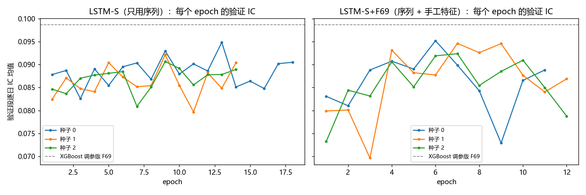

# 3.6 LSTM（验证段）

- 代码：`ml/lstm_prep.py`（主环境准备数据）、`ml/lstm_train.py`（dl-study 环境训练，只依赖 numpy、torch）、`ml/p3_6_lstm.py`（调度、评估、报告）
- 运行：`python -X utf8 -m ml.p3_6_lstm`
- 产物：`tuning_S.csv`、`tuning_SF.csv`、`chosen.json`、`fig1_valid_ic_curves.png`；分数 `data/ml/scores/lstm_S__select.parquet`、`lstm_SF69__select.parquet`
- 所有数字都只来自验证段（2021 ~ 2022）；测试段等所有模型的选择冻结后统一跑（任务 3.11）

## 一、设置

- 输入：每个样本是这只股票过去 60 个交易日 × 11 个原始日线通道（1.6）；S+F69 版本再把 69 个手工特征（dense 预处理，71 维）
  拼到 LSTM 最后一步的隐状态上。
- 结构：LSTM（1 ~ 2 层）→ 最后一步隐状态 → dropout →（拼手工特征）→ 全连接 → ReLU → 全连接 → 一个分数。
- 训练：均方误差，目标 = 训练标签 − 0.5；Adam；每个 epoch 随机抽一部分交易日，每批由完整的交易日组成（≤ 4096 行）；
  每个 epoch 末算验证段逐日 IC，连续 5 个 epoch 不提高就停（最多 30 个），取 IC 最高的 epoch。
- 调参：事先列出的 12 组（隐藏维度、层数、dropout、学习率、权重衰减、每 epoch 抽样比例），S 和 S+F69 各调一遍，只用种子 0。
- 说明：显卡上的 LSTM（cuDNN）训练不是逐位可复现的，同一种子重跑结果会有很小的差别；种子之间的差别见下表。

## 二、调参结果（种子 0）

### LSTM-S（只用序列）

|   组 |   hidden |   layers |   dropout |     lr |     wd |   frac |   参数个数 |   最佳 epoch |   跑了 epoch |   验证 IC |   ICIR |   NW t |   前6 超额% |   前30 超额% |   训练秒 |   显存 GB |
|-----:|---------:|---------:|----------:|-------:|-------:|-------:|-----------:|-------------:|-------------:|----------:|-------:|-------:|------------:|-------------:|---------:|----------:|
|    1 |       32 |        1 |       0   | 0.001  | 0      |   0.5  |       6849 |            4 |            9 |    0.0906 | 0.6938 |   8.41 |        0.05 |         0.24 |       20 |      1.2  |
|    2 |       64 |        1 |       0   | 0.001  | 0      |   0.5  |      23937 |            6 |           11 |    0.0904 | 0.7291 |   8.96 |        0.19 |         0.25 |       53 |      2.06 |
|    3 |      128 |        1 |       0   | 0.001  | 0      |   0.5  |      88833 |            6 |           11 |    0.0901 | 0.7103 |   8.75 |        0.19 |         0.25 |      197 |      3.77 |
|    4 |       64 |        2 |       0.1 | 0.001  | 0      |   0.5  |      57217 |            4 |            9 |    0.0897 | 0.6922 |   8.33 |        0.16 |         0.26 |       82 |      2.49 |
|    5 |      128 |        2 |       0.1 | 0.001  | 0      |   0.5  |     220929 |            6 |           11 |    0.0891 | 0.6965 |   8.49 |        0.24 |         0.18 |      398 |      4.64 |
|    6 |       64 |        1 |       0   | 0.0003 | 0      |   0.5  |      23937 |            6 |           11 |    0.0884 | 0.6339 |   7.79 |        0.1  |         0.15 |      122 |      2.06 |
|    7 |       64 |        2 |       0.1 | 0.0003 | 0      |   0.5  |      57217 |            6 |           11 |    0.088  | 0.613  |   7.52 |        0.05 |         0.1  |      102 |      2.49 |
|    8 |       64 |        1 |       0   | 0.001  | 0.0001 |   0.5  |      23937 |            6 |           11 |    0.0863 | 0.6115 |   7.47 |        0.04 |         0.11 |      122 |      2.06 |
|    9 |       64 |        2 |       0.3 | 0.001  | 0.0001 |   0.5  |      57217 |           23 |           28 |    0.0848 | 0.5869 |   7.09 |       -0.1  |         0.06 |      249 |      2.49 |
|   10 |       64 |        1 |       0   | 0.001  | 0      |   0.25 |      23937 |           12 |           17 |    0.0893 | 0.6593 |   8.08 |        0.21 |         0.2  |       48 |      2.06 |
|   11 |       64 |        2 |       0.1 | 0.001  | 0      |   1    |      57217 |           13 |           18 |    0.0949 | 0.8073 |   9.93 |        0.56 |         0.38 |      286 |      2.49 |
|   12 |      128 |        2 |       0.3 | 0.0003 | 0.0001 |   0.5  |     220929 |            9 |           14 |    0.0826 | 0.5388 |   6.7  |       -0.12 |         0.04 |      502 |      4.64 |

### LSTM-S+F69（序列 + 手工特征）

|   组 |   hidden |   layers |   dropout |     lr |     wd |   frac |   参数个数 |   最佳 epoch |   跑了 epoch |   验证 IC |   ICIR |   NW t |   前6 超额% |   前30 超额% |   训练秒 |   显存 GB |
|-----:|---------:|---------:|----------:|-------:|-------:|-------:|-----------:|-------------:|-------------:|----------:|-------:|-------:|------------:|-------------:|---------:|----------:|
|    1 |       32 |        1 |       0   | 0.001  | 0      |   0.5  |       9121 |            6 |           11 |    0.0933 | 0.7418 |   9.38 |        0.24 |         0.36 |       24 |      1.55 |
|    2 |       64 |        1 |       0   | 0.001  | 0      |   0.5  |      28481 |            6 |           11 |    0.0948 | 0.775  |   9.96 |        0.37 |         0.27 |      121 |      2.41 |
|    3 |      128 |        1 |       0   | 0.001  | 0      |   0.5  |      97921 |            6 |           11 |    0.0967 | 0.7934 |  10.03 |        0.29 |         0.3  |      197 |      4.12 |
|    4 |       64 |        2 |       0.1 | 0.001  | 0      |   0.5  |      61761 |            6 |           11 |    0.0949 | 0.7883 |   9.94 |        0.36 |         0.4  |      104 |      2.84 |
|    5 |      128 |        2 |       0.1 | 0.001  | 0      |   0.5  |     230017 |            6 |           11 |    0.0959 | 0.8171 |  10.42 |        0.26 |         0.34 |      396 |      4.99 |
|    6 |       64 |        1 |       0   | 0.0003 | 0      |   0.5  |      28481 |            6 |           11 |    0.0924 | 0.7106 |   9.06 |        0.43 |         0.29 |      120 |      2.41 |
|    7 |       64 |        2 |       0.1 | 0.0003 | 0      |   0.5  |      61761 |            6 |           11 |    0.0938 | 0.7348 |   9.09 |        0.3  |         0.28 |      101 |      2.84 |
|    8 |       64 |        1 |       0   | 0.001  | 0.0001 |   0.5  |      28481 |            6 |           11 |    0.0952 | 0.7695 |   9.78 |        0.44 |         0.36 |      121 |      2.41 |
|    9 |       64 |        2 |       0.3 | 0.001  | 0.0001 |   0.5  |      61761 |            6 |           11 |    0.0963 | 0.7902 |   9.78 |        0.46 |         0.36 |      101 |      2.84 |
|   10 |       64 |        1 |       0   | 0.001  | 0      |   0.25 |      28481 |            7 |           12 |    0.0926 | 0.7213 |   9.51 |        0.23 |         0.34 |       34 |      2.41 |
|   11 |       64 |        2 |       0.1 | 0.001  | 0      |   1    |      61761 |            1 |            6 |    0.093  | 0.8063 |   9.87 |        0.31 |         0.28 |      101 |      2.84 |
|   12 |      128 |        2 |       0.3 | 0.0003 | 0.0001 |   0.5  |     230017 |            6 |           11 |    0.0951 | 0.731  |   8.99 |        0.44 |         0.35 |      409 |      4.99 |

### 选定

- **LSTM-S（只用序列）**：第 11 组验证 IC 最高——{'hidden': 64, 'layers': 2, 'dropout': 0.1, 'lr': 0.001, 'wd': 0.0, 'frac': 1.0}，57,217 个参数（种子 0 验证 IC 0.0949）；3 个种子最佳 epoch [13, 9, 9]，最终阶段训练 **10** 个 epoch
- **LSTM-S+F69（序列 + 手工特征）**：第 2、3、4、5、8、9、12 组和最高值相差不到 0.002，按规则取参数最少（最简单）的第 8 组——{'hidden': 64, 'layers': 1, 'dropout': 0.0, 'lr': 0.001, 'wd': 0.0001, 'frac': 0.5}，28,481 个参数（种子 0 验证 IC 0.0952）；3 个种子最佳 epoch [6, 7, 7]，最终阶段训练 **7** 个 epoch

## 三、最终模型（选定参数 × 3 个种子，分数取平均）与其他模型对照

| 模型                     |   验证 IC |   ICIR |   NW t |   前6 超额% |   前30 超额% |   多空% |   10组单调性 | 各种子 IC                |   种子极差 |
|:-------------------------|----------:|-------:|-------:|------------:|-------------:|--------:|-------------:|:-------------------------|-----------:|
| LSTM-S                   |    0.0937 |  0.785 |    9.6 |       0.363 |        0.302 |   1.379 |        0.927 | 0.0949 / 0.0922 / 0.0907 |     0.0042 |
| LSTM-S+F69               |    0.0963 |  0.739 |    9.2 |       0.303 |        0.272 |   1.371 |        0.988 | 0.0952 / 0.0946 / 0.0924 |     0.0028 |
| XGBoost 调参版 F69       |    0.0987 |  0.837 |   11   |       0.326 |        0.266 |   1.414 |        0.988 | 0.0980 / 0.0980 / 0.0973 |     0.0007 |
| XGBoost 调参版 F28       |    0.0967 |  0.859 |   10.4 |       0.499 |        0.408 |   1.28  |        0.988 | 0.0956 / 0.0964 / 0.0962 |     0.0008 |
| 随机森林 F69             |    0.0972 |  0.748 |    9.2 |       0.078 |        0.208 |   1.273 |        0.952 | 0.0972 / 0.0971 / 0.0969 |     0.0003 |
| XGBoost 复现 F28（参照） |    0.0946 |  0.804 |    9.9 |       0.348 |        0.316 |   1.215 |        1     | 0.0947 / 0.0942 / 0.0942 |     0.0005 |
| 反转因子（参照）         |    0.04   |  0.309 |    4.2 |      -0.555 |       -0.178 |   0.687 |        0.564 | 0.0400                   |     0      |

**分 10 组的平均超额（%，第 10 组 = 分数最高）**

|            |      1 |      2 |      3 |     4 |     5 |     6 |     7 |     8 |     9 |    10 |
|:-----------|-------:|-------:|-------:|------:|------:|------:|------:|------:|------:|------:|
| LSTM-S     | -1.113 | -0.092 |  0.034 | 0.095 | 0.182 | 0.12  | 0.152 | 0.173 | 0.189 | 0.265 |
| LSTM-S+F69 | -1.096 | -0.13  | -0.024 | 0.087 | 0.101 | 0.163 | 0.186 | 0.183 | 0.258 | 0.276 |

**逐年 IC**

|   date |   lstm_S |   lstm_SF69 |   xgb_F69 |   xgb_F28 |   rf_F69 |   xgb_repro_F28 |   rev_r5 |
|-------:|---------:|------------:|----------:|----------:|---------:|----------------:|---------:|
|   2021 |   0.0777 |      0.0813 |    0.0852 |    0.0804 |   0.0813 |          0.0783 |   0.0236 |
|   2022 |   0.1097 |      0.1114 |    0.1122 |    0.1132 |   0.1132 |          0.111  |   0.0566 |

**比较（按月整块重抽 95% 区间；仅供参考，正式判定在测试段，见 PREREG 2.4）**

| 比较                               | 指标            |      差 | 95% 区间           |
|:-----------------------------------|:----------------|--------:|:-------------------|
| LSTM-S − XGBoost 调参版 F69（RQ2） | 逐日 IC         | -0.005  | [-0.0139, +0.0035] |
| LSTM-S − XGBoost 调参版 F69（RQ2） | 前 30 超额（%） |  0.0364 | [-0.1990, +0.2446] |
| LSTM-S+F69 − LSTM-S（加手工特征）  | 逐日 IC         |  0.0027 | [-0.0060, +0.0122] |
| LSTM-S+F69 − LSTM-S（加手工特征）  | 前 30 超额（%） | -0.03   | [-0.2432, +0.2130] |
| LSTM-S+F69 − XGBoost 调参版 F69    | 逐日 IC         | -0.0024 | [-0.0097, +0.0056] |
| LSTM-S+F69 − XGBoost 调参版 F69    | 前 30 超额（%） |  0.0064 | [-0.2233, +0.2563] |
| LSTM-S − 反转因子                  | 逐日 IC         |  0.0536 | [+0.0330, +0.0748] |
| LSTM-S − 反转因子                  | 前 30 超额（%） |  0.48   | [+0.1260, +0.8307] |

## 四、读法

1. **只用 60 天原始序列，LSTM 就达到了树模型 + 28 个手工特征的水平。**
   LSTM-S 的验证 IC 是 0.0937，和 XGBoost 复现基准（0.0946）、随机森林 F28（0.0949）是一个量级，比反转因子高 0.054（区间 [+0.033, +0.075]）。
   但它低于 XGBoost 调参版 F69（差 −0.005，区间 [−0.014, +0.004]，验证段分不出）。这和补充登记三里事先写下的预期一致：
   LSTM-S 不一定胜过 XGBoost-F69。
2. **加上手工特征（S+F69）有小幅提升，但还是追不上 XGBoost F69。**
   - S+F69 的 IC 是 0.0963，比 S 高 0.0027（区间跨 0）。种子 0 调参时，同样的结构加特征后普遍高 0.003 ~ 0.007。
   - S+F69 仍比 XGBoost 调参版 F69 低 0.0024（区间跨 0）。
   - 头部的表现：S+F69 的前 30 超额是 0.27%，和 XGBoost F69 几乎一样（0.27%），低于 XGBoost F28（0.41%）。
3. **验证曲线的噪声很大，这是 LSTM 和树模型最大的不同（见图 1）。**
   - 相邻两个 epoch 的验证 IC 平均相差 0.002 ~ 0.006，单次可达 0.02。XGBoost 的早停曲线基本是平滑的。
   - 噪声主要来自训练顺序：模型对最近训练的那些交易日很敏感。调参时所有组都用种子 0，抽到的交易日顺序完全相同，
     所以抽样比例都是 0.5 的那些组，曲线形状几乎一样：都在第 6 个 epoch 冲高、第 9 个 epoch 落低，最佳 epoch 也大都是第 6 个。
     这不是程序错误，但说明**调参表里各组之间的差别（大多在 0.003 以内）和曲线噪声是同一个量级**，
     选哪一组在很大程度上取决于运气。
   - 后果是 **LSTM 的验证 IC 比树模型更偏乐观**：早停取的是一条噪声曲线的最高点。
     3 个种子的曲线从第 3 个 epoch 起的平均值只有 0.087 ~ 0.089，最高点是 0.091 ~ 0.095。
     最终阶段按固定的 epoch 数训练（S 为 10 个，S+F69 为 7 个），不能再挑最高点，所以预计**测试段 IC 会比验证段低得更多**。
     读测试段结果时要考虑这一点；验证段上 LSTM 和树模型的差距，很可能比表里显示的更大。
   - 3 个种子的分数取平均后，IC 比单个种子的平均值高：S 是 0.0937 对 0.0926，S+F69 是 0.0963 对 0.0941。平均可以抵消一部分噪声。
4. **LSTM-S 选定的第 11 组在网格边缘。** 它是唯一一组每个 epoch 用全部训练日的设置，也是 LSTM-S 唯一一组超过 0.091 的配置，
   没有其他组和它打平。
   - 这说明对只看序列的 LSTM 来说，多看数据比改结构更有用；加正则的几组（第 8、9、12 组）反而更差，说明模型是学得不够，而不是过拟合。
   - 但同样的设置在 S+F69 上第 1 个 epoch 就达到最高（0.093），之后再没提高过。按第 3 条，这一组的优势也可能部分来自运气。
   - 按“事先写定网格、不看结果加组”的规则，不再往外扩网格。
5. **S+F69 有 7 组打平**（与最高值相差 < 0.002），按规则选了参数最少的第 8 组：隐藏 64、一层、权重衰减 1e-4，共 28,481 个参数。
6. **种子之间的差别比树模型大得多。** 各种子 IC 的极差：S 是 0.0042，S+F69 是 0.0028；树模型都在 0.001 以内。
   按 PREREG 2.4 的判定规则，差值必须超过种子极差才算“更好”，所以 LSTM 参与的比较门槛更高。
7. **计算量。** 24 组调参加上 2 × 3 个种子，GPU 上总共约 1 小时：一组 0.5 ~ 8 分钟，显存峰值 ≤ 5 GB。
   运行中断过两次：
   - 第一次是打分批太大，在第 3 组显存不足，批大小改成 4096 后从头重跑；第一次运行的文件保留在 `data/ml/lstm/aborted_run1/`。
   - 第二次是其他程序同时占用显卡，第 5 组临时显存不足；加了“等 60 秒同一种子重试”后续跑，没有改任何设置。
