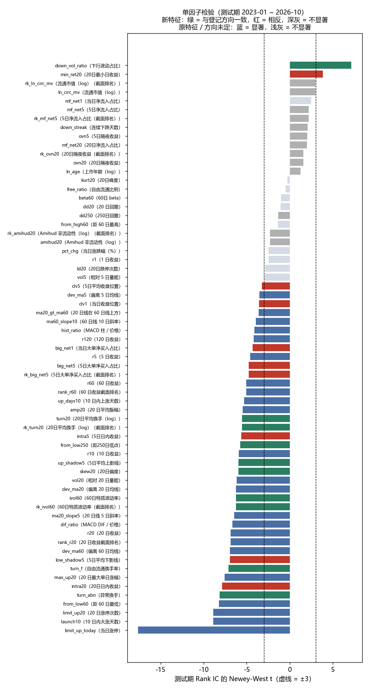

# 4.1 单因子检验（测试期）

- 代码：`ml/p4_1_single_factor.py`；结果表 `single_factor.csv`（全部列，含覆盖率、ICIR、NW t 的滞后 5 / 20 敏感性、逐年 IC）
- 做法：每个特征每天在有值的行里算 Spearman(特征, T+1 开盘买 T+5 开盘卖的收益)，再按时间平均；测试期 = 2023-01-03 ~ 2026-10-16
- 显著：Newey-West |t| > 3（滞后 10 天）；判定规则在看数据之前写在 `ml/PREREG.md` 第一节
- 这是“单个特征本身”的预测力，不涉及任何模型；IC 为负的特征对模型同样有用（模型会反着用）

## 一、新特征：和事先登记的方向对照

41 个新特征的判定：无证据 13 个、假设得到支持 10 个、与假设相反 9 个、不显著 5 个、不检验（市场状态） 4 个。

| 特征           | 中文名                             | 组                       | 预期方向   |   测试 IC |   NW t |    IC T1 |    IC T2 |   验证 IC（2021 ~ 2022） | 判定               |
|:---------------|:-----------------------------------|:-------------------------|:-----------|----------:|-------:|---------:|---------:|-------------------------:|:-------------------|
| turn_f         | 自由流通换手率                     | A 换手与流动性           | -          |   -0.0925 |  -7.11 |  -0.1021 |  -0.0862 |                  -0.0721 | 假设得到支持       |
| turn20         | 20日平均换手（log）                | A 换手与流动性           | -          |   -0.0815 |  -5.54 |  -0.0984 |  -0.0706 |                  -0.0671 | 假设得到支持       |
| turn_abn       | 异常换手                           | A 换手与流动性           | -          |   -0.0565 |  -8.17 |  -0.0465 |  -0.063  |                  -0.0441 | 假设得到支持       |
| amihud20       | Amihud 非流动性（log）             | A 换手与流动性           | +          |   -0.0226 |  -2.28 |  -0.0393 |  -0.0118 |                  -0.014  | 无证据             |
| ln_circ_mv     | 流通市值（log）                    | B 规模与上市年龄         | -          |    0.0376 |   2.96 |   0.0661 |   0.0192 |                   0.0256 | 无证据             |
| free_ratio     | 自由流通比例                       | B 规模与上市年龄         | ?          |   -0.0034 |  -0.5  |  -0.0198 |   0.0072 |                  -0.002  | 不显著             |
| ln_age         | 上市年龄（log）                    | B 规模与上市年龄         | -          |    0.0073 |   1.26 |   0.0189 |  -0.0001 |                   0.0096 | 无证据             |
| mf_net1        | 当日净流入占比                     | C 资金流                 | ?          |    0.0117 |   2.46 |   0.0209 |   0.0057 |                   0.0005 | 不显著             |
| mf_net5        | 5日净流入占比                      | C 资金流                 | +          |    0.0159 |   2.21 |   0.0253 |   0.0099 |                   0.006  | 无证据             |
| mf_net20       | 20日净流入占比                     | C 资金流                 | +          |    0.0168 |   1.99 |   0.03   |   0.0083 |                   0.012  | 无证据             |
| big_net1       | 当日大单净买入占比                 | C 资金流                 | +          |   -0.0126 |  -4.31 |  -0.0105 |  -0.0139 |                  -0.0142 | 与假设相反         |
| big_net5       | 5日大单净买入占比                  | C 资金流                 | +          |   -0.0208 |  -4.77 |  -0.0096 |  -0.0281 |                  -0.0144 | 与假设相反         |
| skew20         | 20日偏度                           | D 波动与收益分布         | -          |   -0.025  |  -5.96 |  -0.0283 |  -0.0228 |                  -0.0165 | 假设得到支持       |
| kurt20         | 20日峰度                           | D 波动与收益分布         | ?          |   -0.0011 |  -0.27 |   0.0041 |  -0.0044 |                   0.0302 | 不显著             |
| min_ret20      | 20日最小日收益                     | D 波动与收益分布         | -          |    0.0528 |   3.86 |   0.0687 |   0.0425 |                   0.0325 | 与假设相反         |
| down_vol_ratio | 下行波动占比                       | D 波动与收益分布         | +          |    0.0607 |   7.15 |   0.0525 |   0.0661 |                   0.0421 | 假设得到支持       |
| clv1           | 当日收盘位置                       | E K线结构与隔夜/日内     | +          |   -0.0162 |  -3.57 |  -0.0108 |  -0.0196 |                  -0.0254 | 与假设相反         |
| clv5           | 5日平均收盘位置                    | E K线结构与隔夜/日内     | +          |   -0.0238 |  -3.22 |  -0.0138 |  -0.0303 |                  -0.0318 | 与假设相反         |
| low_shadow5    | 5日平均下影线                      | E K线结构与隔夜/日内     | +          |   -0.0681 |  -6.95 |  -0.0697 |  -0.067  |                  -0.0543 | 与假设相反         |
| up_shadow5     | 5日平均上影线                      | E K线结构与隔夜/日内     | -          |   -0.0625 |  -5.95 |  -0.0777 |  -0.0528 |                  -0.0457 | 假设得到支持       |
| ovn5           | 5日隔夜收益                        | E K线结构与隔夜/日内     | -          |    0.0121 |   2.03 |   0.0218 |   0.0058 |                   0.0126 | 无证据             |
| ovn20          | 20日隔夜收益                       | E K线结构与隔夜/日内     | -          |    0.0085 |   1.56 |   0.0183 |   0.0021 |                   0.0132 | 无证据             |
| intra5         | 5日日内收益                        | E K线结构与隔夜/日内     | +          |   -0.0421 |  -5.64 |  -0.0385 |  -0.0444 |                  -0.0463 | 与假设相反         |
| intra20        | 20日日内收益                       | E K线结构与隔夜/日内     | +          |   -0.0693 |  -7.84 |  -0.0633 |  -0.0731 |                  -0.0552 | 与假设相反         |
| beta60         | 60日 beta                          | F 与市场的关系、市场状态 | ?          |   -0.0166 |  -1.02 |  -0.0432 |   0.0007 |                  -0.0024 | 不显著             |
| ivol60         | 60日特质波动率                     | F 与市场的关系、市场状态 | -          |   -0.0842 |  -6.26 |  -0.1018 |  -0.0729 |                  -0.0653 | 假设得到支持       |
| mkt_ret20      | 市场20日收益                       | F 与市场的关系、市场状态 | 交互       |  nan      | nan    | nan      | nan      |                 nan      | 不检验（市场状态） |
| mkt_vol20      | 市场20日波动率                     | F 与市场的关系、市场状态 | 交互       |  nan      | nan    | nan      | nan      |                 nan      | 不检验（市场状态） |
| breadth5       | 5日上涨家数占比                    | F 与市场的关系、市场状态 | 交互       |  nan      | nan    | nan      | nan      |                 nan      | 不检验（市场状态） |
| limit_down_pct | 当日跌停家数占比                   | F 与市场的关系、市场状态 | 交互       |  nan      | nan    | nan      | nan      |                 nan      | 不检验（市场状态） |
| ld20           | 20日跌停次数                       | G 超跌与跌停             | ?          |   -0.0232 |  -2.86 |  -0.023  |  -0.0234 |                  -0.025  | 不显著             |
| down_streak    | 连续下跌天数                       | G 超跌与跌停             | +          |    0.0088 |   2.05 |   0.0082 |   0.0093 |                   0.0162 | 无证据             |
| from_low250    | 距250日低点                        | G 超跌与跌停             | -          |   -0.0675 |  -5.74 |  -0.0664 |  -0.0681 |                  -0.0549 | 假设得到支持       |
| dd250          | 250日回撤                          | G 超跌与跌停             | -          |   -0.0156 |  -1.34 |   0.0104 |  -0.0325 |                  -0.0287 | 无证据             |
| rk_turn20      | 20日平均换手（log）（截面排名）    | H 截面排名版本           | -          |   -0.0815 |  -5.54 |  -0.0984 |  -0.0706 |                  -0.0671 | 假设得到支持       |
| rk_amihud20    | Amihud 非流动性（log）（截面排名） | H 截面排名版本           | +          |   -0.0226 |  -2.28 |  -0.0393 |  -0.0118 |                  -0.014  | 无证据             |
| rk_ln_circ_mv  | 流通市值（log）（截面排名）        | H 截面排名版本           | -          |    0.0376 |   2.96 |   0.0661 |   0.0192 |                   0.0256 | 无证据             |
| rk_mf_net5     | 5日净流入占比（截面排名）          | H 截面排名版本           | +          |    0.0159 |   2.21 |   0.0253 |   0.0099 |                   0.006  | 无证据             |
| rk_big_net5    | 5日大单净买入占比（截面排名）      | H 截面排名版本           | +          |   -0.0208 |  -4.77 |  -0.0096 |  -0.0281 |                  -0.0144 | 与假设相反         |
| rk_ivol60      | 60日特质波动率（截面排名）         | H 截面排名版本           | -          |   -0.0842 |  -6.26 |  -0.1018 |  -0.0729 |                  -0.0653 | 假设得到支持       |
| rk_ovn20       | 20日隔夜收益（截面排名）           | H 截面排名版本           | -          |    0.0085 |   1.56 |   0.0183 |   0.0021 |                   0.0132 | 无证据             |

## 二、原特征（仓库 28 个，没有登记方向，只描述）

| 特征           | 中文名                |   测试 IC |   NW t |   IC T1 |   IC T2 |   验证 IC（2021 ~ 2022） | 判定     |
|:---------------|:----------------------|----------:|-------:|--------:|--------:|-------------------------:|:---------|
| pct_chg        | 当日涨跌幅（%）       |   -0.013  |  -2.45 | -0.0097 | -0.0151 |                  -0.0241 | 不显著   |
| r1             | 1 日收益              |   -0.013  |  -2.45 | -0.0097 | -0.0151 |                  -0.0241 | 不显著   |
| r5             | 5 日收益              |   -0.0372 |  -4.6  | -0.0292 | -0.0424 |                  -0.04   | 显著为负 |
| r10            | 10 日收益             |   -0.0531 |  -5.94 | -0.0511 | -0.0544 |                  -0.0429 | 显著为负 |
| r20            | 20 日收益             |   -0.0672 |  -6.86 | -0.056  | -0.0744 |                  -0.0492 | 显著为负 |
| r60            | 60 日收益             |   -0.0584 |  -5.05 | -0.0534 | -0.0617 |                  -0.0594 | 显著为负 |
| r120           | 120 日收益            |   -0.0477 |  -4.17 | -0.027  | -0.061  |                  -0.052  | 显著为负 |
| from_low60     | 距 60 日最低          |   -0.0818 |  -8.22 | -0.0812 | -0.0821 |                  -0.0687 | 显著为负 |
| from_high60    | 距 60 日最高          |   -0.0166 |  -1.4  |  0.0016 | -0.0284 |                  -0.0271 | 不显著   |
| dev_ma5        | 偏离 5 日均线         |   -0.0276 |  -3.52 | -0.022  | -0.0311 |                  -0.033  | 显著为负 |
| dev_ma20       | 偏离 20 日均线        |   -0.0593 |  -6.25 | -0.0529 | -0.0634 |                  -0.048  | 显著为负 |
| dev_ma60       | 偏离 60 日均线        |   -0.0718 |  -6.94 | -0.0637 | -0.0771 |                  -0.0677 | 显著为负 |
| ma20_gt_ma60   | 20 日线在 60 日线上方 |   -0.0332 |  -3.62 | -0.0272 | -0.037  |                  -0.0439 | 显著为负 |
| ma20_slope5    | 20 日线 5 日斜率      |   -0.063  |  -6.46 | -0.0551 | -0.0681 |                  -0.0448 | 显著为负 |
| ma60_slope10   | 60 日线 10 日斜率     |   -0.0469 |  -3.94 | -0.0448 | -0.0483 |                  -0.0468 | 显著为负 |
| dd20           | 20 日回撤             |   -0.0122 |  -1.07 | -0.0007 | -0.0196 |                  -0.0111 | 不显著   |
| vol5           | 相对 5 日量能         |   -0.0153 |  -2.92 | -0.0109 | -0.0182 |                  -0.0114 | 不显著   |
| vol20          | 相对 20 日量能        |   -0.0384 |  -6.15 | -0.0271 | -0.0457 |                  -0.0241 | 显著为负 |
| amp20          | 20 日平均振幅         |   -0.0853 |  -5.46 | -0.1042 | -0.073  |                  -0.0692 | 显著为负 |
| launch10       | 10 日内大涨天数       |   -0.0754 |  -8.88 | -0.081  | -0.0717 |                  -0.0598 | 显著为负 |
| up_days10      | 10 日内上涨天数       |   -0.0327 |  -5.31 | -0.0342 | -0.0318 |                  -0.0196 | 显著为负 |
| max_up20       | 20 日最大单日涨幅     |   -0.0853 |  -7.58 | -0.0957 | -0.0787 |                  -0.0661 | 显著为负 |
| limit_up_today | 当日涨停              |   -0.0561 | -17.6  | -0.0595 | -0.0539 |                  -0.0505 | 显著为负 |
| limit_up20     | 20 日涨停次数         |   -0.0816 |  -8.88 | -0.0863 | -0.0785 |                  -0.0667 | 显著为负 |
| dif_ratio      | MACD DIF / 价格       |   -0.0672 |  -6.68 | -0.0605 | -0.0715 |                  -0.0569 | 显著为负 |
| hist_ratio     | MACD 柱 / 价格        |   -0.0382 |  -4.13 | -0.0359 | -0.0397 |                  -0.0194 | 显著为负 |
| rank_r20       | 20 日收益截面排名     |   -0.0672 |  -6.86 | -0.056  | -0.0744 |                  -0.0492 | 显著为负 |
| rank_r60       | 60 日收益截面排名     |   -0.0584 |  -5.05 | -0.0534 | -0.0617 |                  -0.0594 | 显著为负 |

## 三、逐年 IC

| 特征           | 中文名                             |   IC 2023 |   IC 2024 |   IC 2025 |   IC 2026 |
|:---------------|:-----------------------------------|----------:|----------:|----------:|----------:|
| pct_chg        | 当日涨跌幅（%）                    |   -0.0161 |   -0.0075 |   -0.0301 |    0.006  |
| r1             | 1 日收益                           |   -0.0161 |   -0.0075 |   -0.0301 |    0.006  |
| r5             | 5 日收益                           |   -0.0296 |   -0.045  |   -0.0636 |   -0.0029 |
| r10            | 10 日收益                          |   -0.0575 |   -0.0581 |   -0.0721 |   -0.0166 |
| r20            | 20 日收益                          |   -0.058  |   -0.0738 |   -0.087  |   -0.0448 |
| r60            | 60 日收益                          |   -0.0534 |   -0.0677 |   -0.067  |   -0.042  |
| r120           | 120 日收益                         |   -0.0346 |   -0.0533 |   -0.06   |   -0.0413 |
| from_low60     | 距 60 日最低                       |   -0.0806 |   -0.0944 |   -0.0831 |   -0.0654 |
| from_high60    | 距 60 日最高                       |   -0.01   |   -0.0108 |   -0.0403 |   -0.0019 |
| dev_ma5        | 偏离 5 日均线                      |   -0.0265 |   -0.0284 |   -0.0541 |    0.0065 |
| dev_ma20       | 偏离 20 日均线                     |   -0.0612 |   -0.0615 |   -0.0809 |   -0.0258 |
| dev_ma60       | 偏离 60 日均线                     |   -0.0646 |   -0.0774 |   -0.0918 |   -0.0483 |
| ma20_gt_ma60   | 20 日线在 60 日线上方              |   -0.0289 |   -0.0293 |   -0.0377 |   -0.0379 |
| ma20_slope5    | 20 日线 5 日斜率                   |   -0.0515 |   -0.0746 |   -0.0746 |   -0.0478 |
| ma60_slope10   | 60 日线 10 日斜率                  |   -0.0465 |   -0.0506 |   -0.0522 |   -0.0358 |
| dd20           | 20 日回撤                          |   -0.011  |   -0.0058 |   -0.0288 |   -0.0004 |
| vol5           | 相对 5 日量能                      |   -0.0119 |   -0.0146 |   -0.0287 |   -0.0033 |
| vol20          | 相对 20 日量能                     |   -0.0267 |   -0.0443 |   -0.0568 |   -0.0219 |
| amp20          | 20 日平均振幅                      |   -0.0933 |   -0.1078 |   -0.0669 |   -0.0696 |
| launch10       | 10 日内大涨天数                    |   -0.0745 |   -0.0955 |   -0.0703 |   -0.0572 |
| up_days10      | 10 日内上涨天数                    |   -0.0348 |   -0.038  |   -0.0347 |   -0.0208 |
| max_up20       | 20 日最大单日涨幅                  |   -0.0834 |   -0.1058 |   -0.0758 |   -0.0738 |
| limit_up_today | 当日涨停                           |   -0.0529 |   -0.0716 |   -0.0586 |   -0.0371 |
| limit_up20     | 20 日涨停次数                      |   -0.0739 |   -0.0988 |   -0.0818 |   -0.0689 |
| dif_ratio      | MACD DIF / 价格                    |   -0.0616 |   -0.0715 |   -0.0839 |   -0.0472 |
| hist_ratio     | MACD 柱 / 价格                     |   -0.0412 |   -0.0478 |   -0.0504 |   -0.0062 |
| rank_r20       | 20 日收益截面排名                  |   -0.058  |   -0.0738 |   -0.087  |   -0.0448 |
| rank_r60       | 60 日收益截面排名                  |   -0.0534 |   -0.0677 |   -0.067  |   -0.042  |
| turn_f         | 自由流通换手率                     |   -0.0892 |   -0.1121 |   -0.0861 |   -0.0797 |
| turn20         | 20日平均换手（log）                |   -0.0862 |   -0.0989 |   -0.0668 |   -0.0721 |
| turn_abn       | 异常换手                           |   -0.0399 |   -0.0728 |   -0.0702 |   -0.0393 |
| amihud20       | Amihud 非流动性（log）             |   -0.0173 |   -0.0558 |   -0.0221 |    0.0127 |
| ln_circ_mv     | 流通市值（log）                    |    0.0436 |    0.0675 |    0.0236 |    0.0093 |
| free_ratio     | 自由流通比例                       |   -0.0133 |   -0.0107 |    0.0178 |   -0.0087 |
| ln_age         | 上市年龄（log）                    |    0.0186 |    0.0138 |   -0.0011 |   -0.0046 |
| mf_net1        | 当日净流入占比                     |    0.0141 |    0.024  |   -0.0064 |    0.0161 |
| mf_net5        | 5日净流入占比                      |    0.0243 |    0.0241 |    0.0013 |    0.0136 |
| mf_net20       | 20日净流入占比                     |    0.0185 |    0.0317 |    0.011  |    0.0031 |
| big_net1       | 当日大单净买入占比                 |   -0.0121 |   -0.011  |   -0.0206 |   -0.0046 |
| big_net5       | 5日大单净买入占比                  |   -0.0141 |   -0.0179 |   -0.0353 |   -0.0146 |
| skew20         | 20日偏度                           |   -0.0231 |   -0.0305 |   -0.02   |   -0.0268 |
| kurt20         | 20日峰度                           |    0.0057 |    0.0017 |   -0.0078 |   -0.0046 |
| min_ret20      | 20日最小日收益                     |    0.0543 |    0.0728 |    0.0376 |    0.0448 |
| down_vol_ratio | 下行波动占比                       |    0.0447 |    0.078  |    0.06   |    0.0601 |
| clv1           | 当日收盘位置                       |   -0.0165 |   -0.0086 |   -0.0347 |   -0.0015 |
| clv5           | 5日平均收盘位置                    |   -0.0121 |   -0.0288 |   -0.0462 |   -0.0036 |
| low_shadow5    | 5日平均下影线                      |   -0.0742 |   -0.0715 |   -0.0673 |   -0.0566 |
| up_shadow5     | 5日平均上影线                      |   -0.0774 |   -0.0691 |   -0.0472 |   -0.0547 |
| ovn5           | 5日隔夜收益                        |    0.0197 |    0.0093 |    0.0093 |    0.0095 |
| ovn20          | 20日隔夜收益                       |    0.0121 |    0.011  |   -0.0053 |    0.0184 |
| intra5         | 5日日内收益                        |   -0.0362 |   -0.0511 |   -0.0665 |   -0.0065 |
| intra20        | 20日日内收益                       |   -0.0609 |   -0.0783 |   -0.0832 |   -0.0505 |
| beta60         | 60日 beta                          |   -0.0199 |   -0.049  |    0.0249 |   -0.0241 |
| ivol60         | 60日特质波动率                     |   -0.0906 |   -0.1113 |   -0.0585 |   -0.0743 |
| ld20           | 20日跌停次数                       |   -0.0175 |   -0.0311 |   -0.017  |   -0.0286 |
| down_streak    | 连续下跌天数                       |    0.0093 |    0.009  |    0.0177 |   -0.0033 |
| from_low250    | 距250日低点                        |   -0.0652 |   -0.0889 |   -0.0504 |   -0.065  |
| dd250          | 250日回撤                          |   -0.0008 |   -0.012  |   -0.0453 |   -0.0011 |
| rk_turn20      | 20日平均换手（log）（截面排名）    |   -0.0862 |   -0.0989 |   -0.0668 |   -0.0721 |
| rk_amihud20    | Amihud 非流动性（log）（截面排名） |   -0.0173 |   -0.0558 |   -0.0221 |    0.0127 |
| rk_ln_circ_mv  | 流通市值（log）（截面排名）        |    0.0436 |    0.0675 |    0.0236 |    0.0093 |
| rk_mf_net5     | 5日净流入占比（截面排名）          |    0.0243 |    0.0241 |    0.0013 |    0.0136 |
| rk_big_net5    | 5日大单净买入占比（截面排名）      |   -0.0141 |   -0.0179 |   -0.0353 |   -0.0146 |
| rk_ivol60      | 60日特质波动率（截面排名）         |   -0.0906 |   -0.1113 |   -0.0585 |   -0.0743 |
| rk_ovn20       | 20日隔夜收益（截面排名）           |    0.0121 |    0.011  |   -0.0053 |    0.0184 |

**测试期和验证期方向相反的特征**（1 个）：kurt20

## 四、读法

1. **一个主题贯穿几乎所有显著的特征：最近“热”的股票，之后 5 天更差。** 65 个能检验的特征里有 42 个 |t| > 3，其中 40 个 IC 为负。
   - 原特征：最近涨得多（r5 ~ r120、偏离均线、MACD）、离 60 日低点远、20 日内涨停多、最大单日涨幅大、振幅大，都显著为负。
     其中“当日涨停”的 t 值高达 −17.6，是全部特征里最显著的。
   - 新特征：换手高（turn_f −0.093、turn20、异常换手）、特质波动大（ivol60 −0.084）、上下影线长、日内收益高，也都显著为负。
   这是 A 股文献里反复出现的**短期反转 + 低波动 / 低关注度**效应：被追捧、波动大、像“彩票”的股票，之后收益偏低。
   这也正是仓库作者“反弹模型”的出发点：买的是最近被抛弃、走势平稳的股票。
2. **41 个新特征对照事先登记的方向**：
   - 假设得到支持 10 个：换手 3 个（turn_f、turn20、turn_abn）、偏度、下行波动占比、上影线、特质波动、距 250 日低点，以及两个排名版本；
   - 与假设相反 9 个（按要求逐条讨论，见第 3 条）；
   - 方向明确但无证据 13 个，方向未定且不显著 5 个，市场状态 4 个不检验。
   排名版本（rk_*）的单因子 IC 和原始版本完全一样，这是因为 Rank IC 本身就是按截面排名算的。它们只对模型的输入形式有区别，算不上独立的证据。
   所以去掉重复后，独立的新特征是“支持 8、相反 8”。
3. **与假设相反的 9 个，可以归成三类，原因都和第 1 条有关：**
   - **大单净买入（big_net1、big_net5、rk_big_net5）**：预期“大单买 = 主力资金进场 → 后涨”，实际是负的。
     大单净买多发生在当天大涨、放量的股票上，本质上是“热”的信号，所以之后跟着反转。
     另外，按单笔金额划分的“大单”并不等于机构，游资和大户追涨同样会被记成大单。
   - **K 线强势（clv1、clv5、intra5、intra20）**：预期“收在高位、日内走强 = 买盘有力 → 延续”，实际都是负的。
     日内收益是总收益的主要部分，日内走强就是最近涨得多，被短期反转压过。
     同样是 K 线结构，“上影线长”（−）方向和预期一致；“下影线长”（预期 +）却也是负的。两者的共同点是振幅大，再次说明波动大的票之后差。
   - **20 日最小日收益（min_ret20）**：预期“最近有过大跌 → 超跌反弹”，实际是正的（最近没大跌过的更好）。
     这和低波动效应一致：最近有过暴跌的股票往往是高波动的票，而高波动的票之后差，压过了“超跌反弹”。
   这些方向是事先凭经验写下的，数据否定了“资金流 / K 线强势 → 动量延续”的设想。在 5 日这个期限上，A 股的反转效应压倒了它们。
4. **不显著、但接近门槛的**：流通市值（+0.038，t 2.96，方向和“小市值效应”预期相反，偏向大盘股）、Amihud 非流动性（t −2.3）、
   20 日跌停次数（t −2.9）、净流入占比（t 2.0 ~ 2.5）。|t| > 3 的门槛很严，这些在报告里只记作“无证据”。
5. **方向非常稳定。** 测试期和验证期（2021 ~ 2022）方向相反的只有 1 个（峰度 kurt20，两段都不显著）；
   T1 / T2 和逐年看，主要特征每年方向都一样，大小也接近，比如换手 2023 ~ 2026 每年都在 −0.08 ~ −0.11。
   这说明这些规律在测试期没有失效，也解释了为什么模型在测试期依然有效。
6. **单因子 IC 和模型 IC 的关系。** 最强的单个特征 |IC| 在 0.08 ~ 0.09（换手、特质波动、振幅、最大单日涨幅），模型约 0.09 ~ 0.10，
   比最强单因子高得不多。很多特征说的是同一件事（“最近热不热”），彼此高度相关，把它们组合起来的增量有限。
   这和 3.8、4.2 中“加新特征 IC 只多 0 ~ 0.004”的结果一致。
