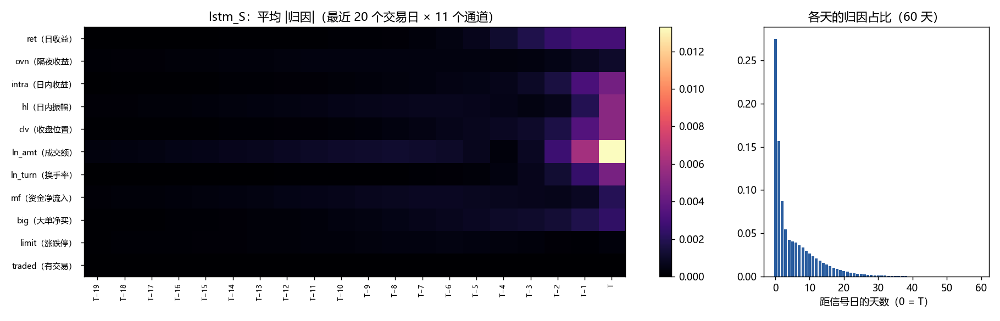
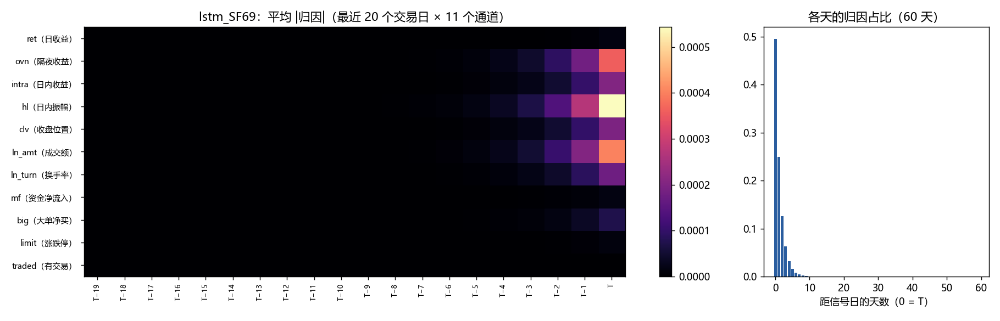

- 模型：冻结配置在选择阶段训练（2013 ~ 2020，固定 epoch，种子 0）；验证段随机抽 20,000 行；积分梯度 32 步，
  基线 = 截面中位数的股票（排名通道 0、涨跌停 0、有交易 1、手工特征 0）。
  完备性核对（归因之和 vs 分数 − 基线分数，相对误差中位数）：lstm_S 0.001、lstm_SF69 0.009

**lstm_S：各通道的平均 |归因| 占比，以及带符号的平均归因（正 = 让分数变高）**

| 通道 | 中文 | |归因| 占比 | 平均带符号归因 |
|---|---|---:|---:|
| ln_amt | 成交额 | 24.5% | -0.01138 |
| hl | 日内振幅 | 11.1% | -0.00141 |
| clv | 收盘位置 | 10.8% | -0.01256 |
| intra | 日内收益 | 9.5% | -0.01122 |
| mf | 资金净流入 | 9.3% | +0.00076 |
| ret | 日收益 | 9.3% | -0.00902 |
| big | 大单净买 | 8.6% | -0.00216 |
| ln_turn | 换手率 | 7.1% | -0.00815 |
| ovn | 隔夜收益 | 5.7% | -0.00263 |
| limit | 涨跌停 | 3.8% | -0.00382 |
| traded | 有交易 | 0.1% | -0.00015 |

时间上：最近 1 天（T）占 27.5%，最近 5 天占 61.7%，最近 20 天占 95.5%，21 ~ 60 天前占 4.5%。

**lstm_SF69：各通道的平均 |归因| 占比，以及带符号的平均归因（正 = 让分数变高）**

| 通道 | 中文 | |归因| 占比 | 平均带符号归因 |
|---|---|---:|---:|
| hl | 日内振幅 | 27.0% | +0.00056 |
| ln_amt | 成交额 | 20.2% | -0.00078 |
| ovn | 隔夜收益 | 18.0% | -0.00008 |
| intra | 日内收益 | 10.0% | -0.00005 |
| clv | 收盘位置 | 9.8% | -0.00003 |
| ln_turn | 换手率 | 8.8% | -0.00022 |
| big | 大单净买 | 3.7% | +0.00000 |
| mf | 资金净流入 | 0.9% | +0.00001 |
| ret | 日收益 | 0.8% | +0.00000 |
| limit | 涨跌停 | 0.7% | +0.00002 |
| traded | 有交易 | 0.0% | -0.00000 |

时间上：最近 1 天（T）占 49.6%，最近 5 天占 96.7%，最近 20 天占 100.0%，21 ~ 60 天前占 0.0%。

序列 vs 手工特征：每行 |归因| 中序列所占比例的中位数是 2.3%。手工特征里归因最大的 15 个：dev_ma5（0.0075）、low_shadow5（0.0057）、turn_f（0.0054）、r5（0.0054）、big_net5（0.0049）、mkt_ret20（0.0049）、rk_big_net5（0.0049）、ivol60（0.0048）、from_low60（0.0047）、breadth5（0.0046）、rk_turn20（0.0045）、mkt_vol20（0.0043）、clv1（0.0041）、turn20（0.0040）、dd250（0.0035）

