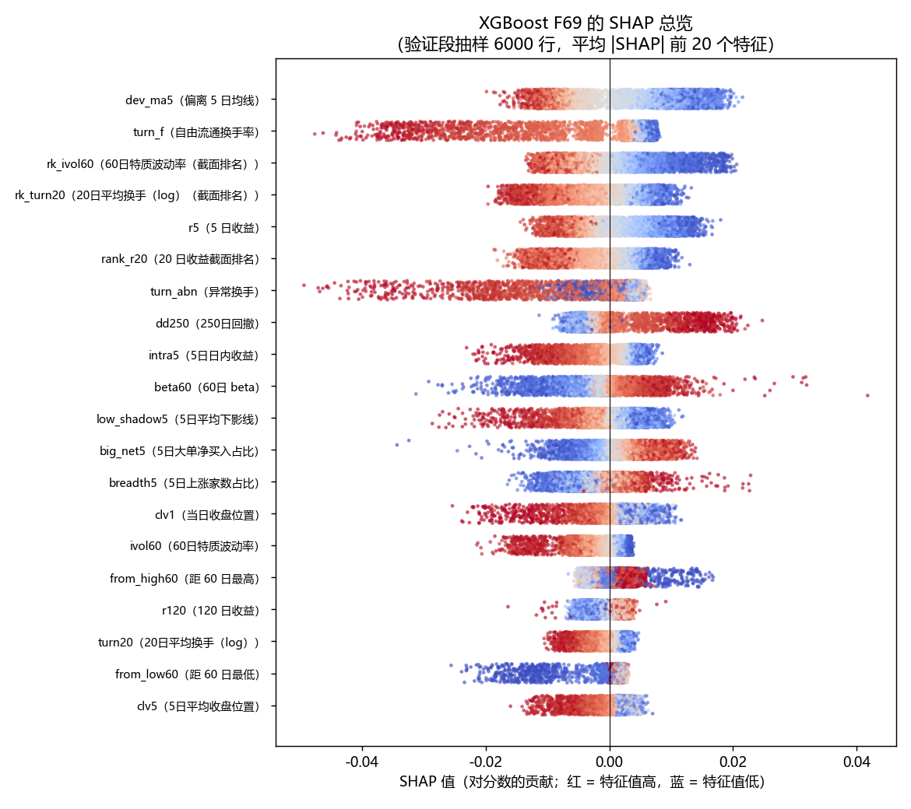
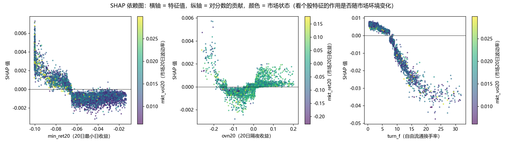
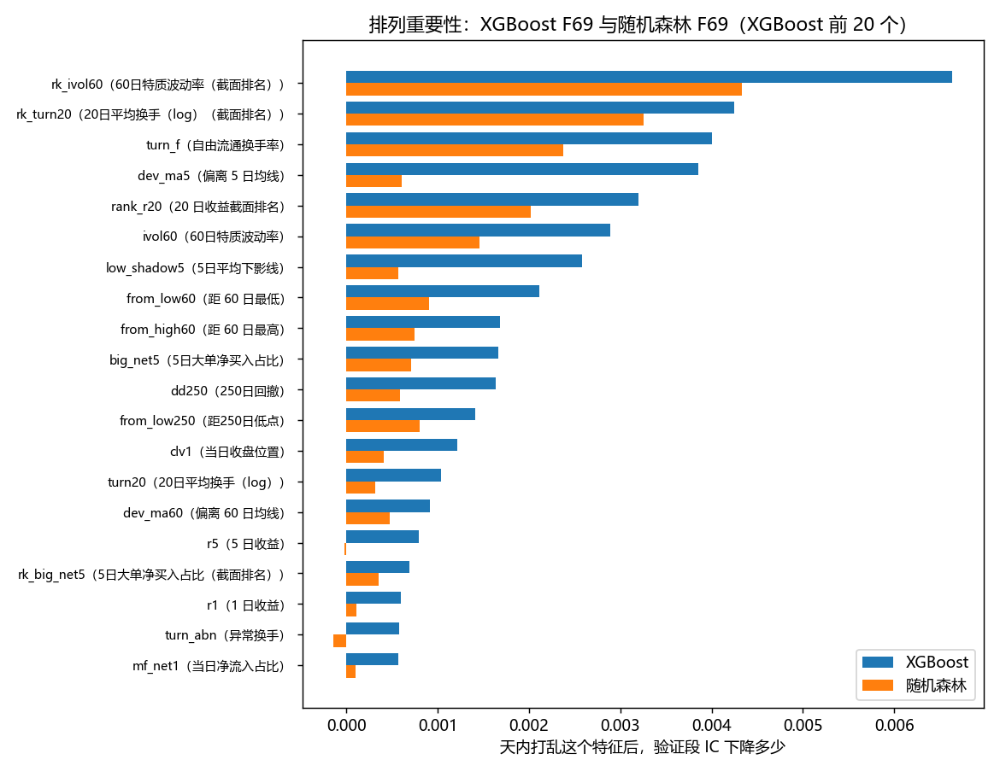
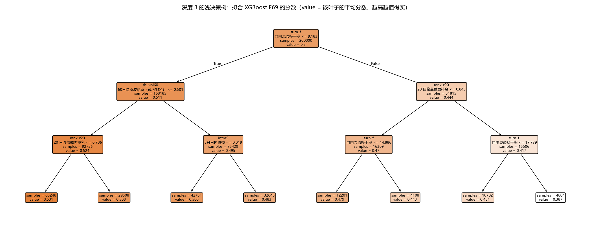
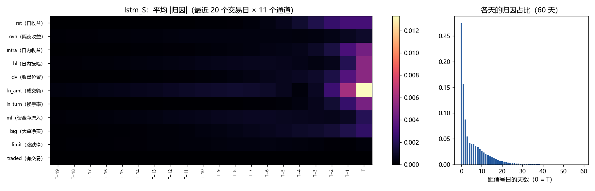
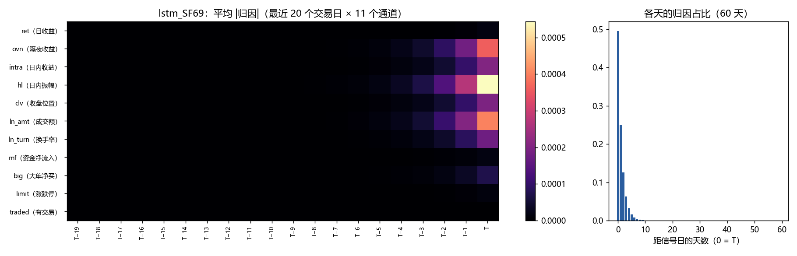

# 4.3 解释性

- 代码：`ml/p4_3_explain.py`（树模型）、`ml/lstm_ig.py`（LSTM 积分梯度）；结果 `importance.csv`、`group_permutation.csv`
- 解释的对象：按冻结配置在选择阶段（训练 2013 ~ 2020）重训的 XGBoost F69（161 棵 × 3 个种子）和随机森林 F69（种子 0），在验证段（2021 ~ 2022）上解释。
  这两个模型的验证 IC：XGBoost 0.0976、随机森林 0.0972
- 排列重要性：把特征在同一天内随机打乱，看验证段逐日 IC 下降多少（下降越多越重要；负数 = 打乱后反而更好）
- SHAP：xgboost 自带的精确 TreeSHAP，验证段抽样 60,000 行，3 个种子平均

## 一、按组的排列重要性（一组特征一起打乱）

| 对象                     |   特征数 |   XGB：IC 下降 |   RF：IC 下降 |
|:-------------------------|---------:|---------------:|--------------:|
| 原特征（F28）            |       28 |         0.0183 |        0.0194 |
| A 换手与流动性           |        4 |         0.0116 |        0.0073 |
| B 规模与上市年龄         |        3 |        -0.0002 |        0      |
| C 资金流                 |        5 |         0.0037 |        0.0016 |
| D 波动与收益分布         |        4 |         0.0006 |        0.0003 |
| E K线结构与隔夜/日内     |        8 |         0.008  |        0.0031 |
| F 与市场的关系、市场状态 |        6 |         0.0025 |        0.0016 |
| G 超跌与跌停             |        4 |         0.0028 |        0.0017 |
| H 截面排名版本           |        7 |         0.0163 |        0.0151 |

## 二、单个特征（按 XGBoost 平均 |SHAP| 排序的前 25 个；占比单位 %）

| 特征        | 中文名                          |   XGB gain 占比 |   XGB |SHAP| 均值 |   XGB 排列：IC 下降 |   RF 不纯度占比 |   RF 排列：IC 下降 |
|:------------|:--------------------------------|----------------:|------------------:|--------------------:|----------------:|-------------------:|
| dev_ma5     | 偏离 5 日均线                   |            2.81 |            0.0093 |              0.0039 |            2.32 |             0.0006 |
| turn_f      | 自由流通换手率                  |            8.56 |            0.0074 |              0.004  |            6.88 |             0.0024 |
| rk_ivol60   | 60日特质波动率（截面排名）      |            4.29 |            0.0063 |              0.0066 |            4.35 |             0.0043 |
| rk_turn20   | 20日平均换手（log）（截面排名） |            6.35 |            0.0062 |              0.0042 |            4.93 |             0.0033 |
| r5          | 5 日收益                        |            2.99 |            0.0061 |              0.0008 |            2.23 |            -0      |
| rank_r20    | 20 日收益截面排名               |            4.46 |            0.0059 |              0.0032 |            3.52 |             0.002  |
| turn_abn    | 异常换手                        |            4.12 |            0.0055 |              0.0006 |            3.02 |            -0.0001 |
| dd250       | 250日回撤                       |            2.44 |            0.0045 |              0.0016 |            2.09 |             0.0006 |
| intra5      | 5日日内收益                     |            2.75 |            0.0041 |              0.0001 |            3.05 |             0.0002 |
| beta60      | 60日 beta                       |            2.05 |            0.0041 |              0.0001 |            1.48 |             0.0003 |
| low_shadow5 | 5日平均下影线                   |            1.83 |            0.0039 |              0.0026 |            1.54 |             0.0006 |
| big_net5    | 5日大单净买入占比               |            1.79 |            0.0038 |              0.0017 |            1.26 |             0.0007 |
| breadth5    | 5日上涨家数占比                 |            3.52 |            0.0036 |              0      |            1.96 |             0      |
| clv1        | 当日收盘位置                    |            1.53 |            0.0033 |              0.0012 |            1.35 |             0.0004 |
| ivol60      | 60日特质波动率                  |            1.33 |            0.0031 |              0.0029 |            1.94 |             0.0015 |
| from_high60 | 距 60 日最高                    |            1.84 |            0.0027 |              0.0017 |            1.32 |             0.0007 |
| r120        | 120 日收益                      |            0.72 |            0.0025 |              0.0002 |            1.14 |             0.0003 |
| turn20      | 20日平均换手（log）             |            1.6  |            0.0024 |              0.001  |            2.17 |             0.0003 |
| from_low60  | 距 60 日最低                    |            1.14 |            0.0023 |              0.0021 |            1.12 |             0.0009 |
| clv5        | 5日平均收盘位置                 |            1.2  |            0.0022 |             -0.0002 |            1.45 |            -0      |
| vol20       | 相对 20 日量能                  |            1.71 |            0.0021 |             -0.0006 |            1.85 |            -0.0004 |
| mkt_vol20   | 市场20日波动率                  |            5.82 |            0.0018 |              0      |            2.12 |             0      |
| max_up20    | 20 日最大单日涨幅               |            1.49 |            0.0018 |              0.0005 |            2.04 |            -0      |
| mf_net20    | 20日净流入占比                  |            0.7  |            0.0017 |              0      |            1.39 |             0.0004 |
| from_low250 | 距250日低点                     |            0.93 |            0.0017 |              0.0014 |            1.62 |             0.0008 |

**五种重要性排名之间的 Spearman 相关**（69 个特征）

|                   |   XGB gain 占比 |   XGB |SHAP| 均值 |   XGB 排列：IC 下降 |   RF 不纯度占比 |   RF 排列：IC 下降 |
|:------------------|----------------:|------------------:|--------------------:|----------------:|-------------------:|
| XGB gain 占比     |            1    |              0.87 |                0.45 |            0.9  |               0.3  |
| XGB |SHAP| 均值   |            0.87 |              1    |                0.57 |            0.83 |               0.47 |
| XGB 排列：IC 下降 |            0.45 |              0.57 |                1    |            0.42 |               0.71 |
| RF 不纯度占比     |            0.9  |              0.83 |                0.42 |            1    |               0.32 |
| RF 排列：IC 下降  |            0.3  |              0.47 |                0.71 |            0.32 |               1    |

## 三、浅决策树（深度 3，拟合 XGBoost F69 的分数）

这棵树只有 8 个叶子，在验证段上的 IC 是 0.0753（XGBoost 本身 0.0976）。

## 四、LSTM：积分梯度

- 模型：冻结配置在选择阶段训练（2013 ~ 2020，固定 epoch，种子 0）；验证段随机抽 20,000 行；积分梯度 32 步，
  基线 = 截面中位数的股票（排名通道 0、涨跌停 0、有交易 1、手工特征 0）。
  完备性核对（归因之和 vs 分数 − 基线分数，相对误差中位数）：lstm_S 0.001、lstm_SF69 0.009

**lstm_S：各通道的平均 |归因| 占比，以及带符号的平均归因（正 = 让分数变高）**

| 通道 | 中文 | |归因| 占比 | 平均带符号归因 |
|---|---|---:|---:|
| ln_amt | 成交额 | 24.5% | -0.01138 |
| hl | 日内振幅 | 11.1% | -0.00141 |
| clv | 收盘位置 | 10.8% | -0.01256 |
| intra | 日内收益 | 9.5% | -0.01122 |
| mf | 资金净流入 | 9.3% | +0.00076 |
| ret | 日收益 | 9.3% | -0.00902 |
| big | 大单净买 | 8.6% | -0.00216 |
| ln_turn | 换手率 | 7.1% | -0.00815 |
| ovn | 隔夜收益 | 5.7% | -0.00263 |
| limit | 涨跌停 | 3.8% | -0.00382 |
| traded | 有交易 | 0.1% | -0.00015 |

时间上：最近 1 天（T）占 27.5%，最近 5 天占 61.7%，最近 20 天占 95.5%，21 ~ 60 天前占 4.5%。

**lstm_SF69：各通道的平均 |归因| 占比，以及带符号的平均归因（正 = 让分数变高）**

| 通道 | 中文 | |归因| 占比 | 平均带符号归因 |
|---|---|---:|---:|
| hl | 日内振幅 | 27.0% | +0.00056 |
| ln_amt | 成交额 | 20.2% | -0.00078 |
| ovn | 隔夜收益 | 18.0% | -0.00008 |
| intra | 日内收益 | 10.0% | -0.00005 |
| clv | 收盘位置 | 9.8% | -0.00003 |
| ln_turn | 换手率 | 8.8% | -0.00022 |
| big | 大单净买 | 3.7% | +0.00000 |
| mf | 资金净流入 | 0.9% | +0.00001 |
| ret | 日收益 | 0.8% | +0.00000 |
| limit | 涨跌停 | 0.7% | +0.00002 |
| traded | 有交易 | 0.0% | -0.00000 |

时间上：最近 1 天（T）占 49.6%，最近 5 天占 96.7%，最近 20 天占 100.0%，21 ~ 60 天前占 0.0%。

序列 vs 手工特征：每行 |归因| 中序列所占比例的中位数是 2.3%。手工特征里归因最大的 15 个：dev_ma5（0.0075）、low_shadow5（0.0057）、turn_f（0.0054）、r5（0.0054）、big_net5（0.0049）、mkt_ret20（0.0049）、rk_big_net5（0.0049）、ivol60（0.0048）、from_low60（0.0047）、breadth5（0.0046）、rk_turn20（0.0045）、mkt_vol20（0.0043）、clv1（0.0041）、turn20（0.0040）、dd250（0.0035）

## 五、读法

1. **模型最依赖的是“换手”和“最近涨了多少”。** 按组打乱（第一节），对 XGBoost 影响最大的是原特征整体（IC 下降 0.018）、
   H 截面排名版本（0.016）、A 换手与流动性（0.012），其次是 E K 线结构（0.008）；随机森林的顺序基本一样。
   单个特征里（第二节），平均 |SHAP| 最大的是偏离 5 日均线、自由流通换手率、特质波动（排名）、20 日换手（排名）、5 日收益、20 日收益排名、异常换手。
   这和 4.1 单因子检验的结论一致：最近“热”的股票（涨得多、换手高、波动大）分数低。
2. **SHAP 的方向（图 1）几乎全部和单因子一致**：换手高、特质波动大、最近涨得多、日内收益高、下影线长 → 分数低；
   有三个特征的方向和单因子不同，说明模型在控制了其他特征之后用法变了：
   - **大单净买（big_net5）**：单因子是负的（4.1），但在模型里大单净买多 → 分数**略高**。单因子的负号来自“大单买的票往往刚大涨”；
     模型已经用“5 日收益”等特征把“刚大涨”扣掉了，剩下的大单信息是正面的。
   - **beta60**：单因子不显著，模型里 beta 高 → 分数高；它和市场状态（breadth5）配合使用。
   - **250 日回撤（dd250）**：单因子略负、不显著，模型里离 250 日高点近（dd250 接近 0）→ 分数高。
     模型把“长期强势”（离一年高点近）和“短期过热”（最近 5 ~ 20 天涨得多）分开对待：前者加分，后者减分。
3. **依赖图（图 2）显示了明显的非线性：**
   - **20 日最小日收益（min_ret20）**：最近 20 天里有过接近 −10% 的单日大跌（主板的跌停）→ 分数明显加分；
     跌幅在 −6.5% 以内时则轻微减分。单因子 IC 是正的（最近没大跌过的更好），但模型发现了“真正暴跌过的票会反弹”这一段。
     这正是“反弹模型”的出发点，单因子的线性相关看不到它。
   - **20 日隔夜收益（ovn20）**：U 形。隔夜累计大跌（< −15%）的票加分，小幅为负时减分；隔夜为正时的加分在**市场 20 日收益高**时更大
     （图中黄色的点在上方）。这是个股特征和市场状态交互的一个例子。
   - **自由流通换手率（turn_f）**：换手 8% 以下基本是加分；超过 8% 后单调减分，到 25% 时减 0.03 ~ 0.04。
     这是全模型里最大的单项惩罚，和市场波动的高低关系不大。
4. **不同重要性指标的排名差别很大**（五种排名之间的 Spearman 相关只有 0.30 ~ 0.90）：
   - gain、不纯度、|SHAP| 衡量的是“模型用得多不多”，三者彼此相关 0.83 ~ 0.90；
   - 排列重要性衡量的是“拿掉之后排序变差多少”，和前三者只相关 0.3 ~ 0.57。
   主要原因有两个：一是信息冗余，换手的原值、排名、20 日均值说的是同一件事，打乱其中一个，模型可以用另一个顶上，排列重要性就低；
   二是市场状态特征（如 mkt_vol20 的 gain 占比 5.8%、breadth5 3.5%）同一天所有股票取值相同，**天内打乱对它们不起作用，排列重要性按构造就是 0**，
   并不说明它们没用。所以报告“哪类信息重要”时以**按组打乱**为准（第一节），单个特征的排列重要性只作参考。
5. **XGBoost 和随机森林看重的东西基本一样。** 两者的 gain / 不纯度排名相关 0.90，排列重要性排名相关 0.71，按组打乱的顺序几乎相同。
   差别是 XGBoost 对新特征（A 换手、E K 线、C 资金流）用得更充分（打乱后 IC 下降是随机森林的 1.6 ~ 2.6 倍）。
   这和 3.11 里两者成绩分不出、但 XGBoost 在新特征上略好的结果一致。
6. **一棵 3 层的树就能说出模型的主干逻辑**（第三节），验证段 IC 0.075，约为 XGBoost（0.098）的四分之三：
   先看换手率（≤ 9.2%？）；换手低的再看特质波动（排名 ≤ 0.5？）和 20 日收益排名；换手高的票再看 20 日收益排名和换手是否更高。
   得分最高的叶子是“换手低 + 特质波动低 + 20 日收益排名不高”，最低的是“换手高（> 17.8%）+ 20 日收益排名在前 16%”。
   一句话：**买换手低、波动小、最近没怎么涨的票，避开高换手、刚大涨的票。**
7. **LSTM（第四节）：**
   - **只看序列的 LSTM 主要看最近几天**：信号日当天占 27.5% 的归因，最近 5 天 62%，最近 20 天 95%，20 天以前几乎不看。
     通道里成交额最重要（24.5%），其次是日内振幅、收盘位置、日内收益、日收益。成交额、收盘位置、日内收益、日收益的平均作用都是负的
     （成交越大、收得越高、当天涨得越多 → 分数越低）。LSTM 从原始日线里自己学到了和手工特征一样的规律（4.1 第 1 条）。
   - **加了手工特征的 LSTM 几乎不看序列**：每行归因里序列只占约 2.3%，其余约 98% 来自 69 个手工特征
     （最重要的是偏离 5 日均线、下影线、换手率、5 日收益、大单净买，和 XGBoost 的前几名高度重合）。
     它实际上是一个用手工特征的神经网络，这解释了它的测试 IC（0.117）为什么和 XGBoost F69（0.120）这么接近。
   - 积分梯度的完备性核对通过：归因之和与“分数 − 基线分数”的相对误差中位数是 0.1%（S）和 0.9%（S+F69）。
8. 说明：解释用的是选择阶段重训的模型（训练 2013 ~ 2020，配置和测试段相同），在验证段上解释；测试段每年重训的模型没有逐个解释。
   XGBoost 这里 3 个种子都固定用 161 棵树（和测试段一样），验证 IC 0.0976，比选择阶段各种子各自早停时的 0.0987 略低。
