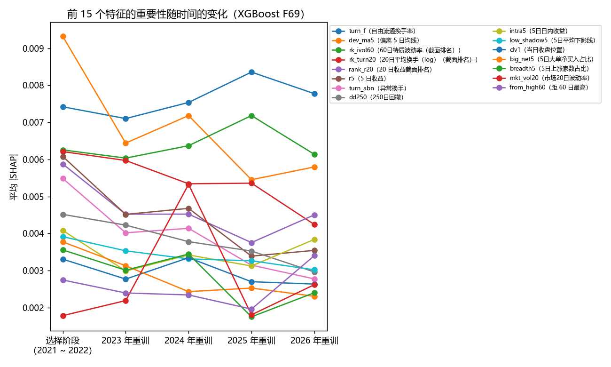

# 4.4 重要性的时间稳定性（选做）

- 代码：`ml/p4_4_shap_stability.py`；结果 `mean_abs_shap.csv`
- 模型：XGBoost F69 冻结配置（161 棵 × 3 个种子），选择阶段 1 次 + 测试段按年重训 4 次；每个模型在它负责的那一年上算 SHAP（3 个种子平均）
- 核对：按年重训得到的分数和测试段正式分数（`xgb_F69__final`）的最大差 5.96e-08（同一配置、同样的种子，应为 0 或浮点误差）
- 附带产物：`data/ml/explain/xgb_F69.parquet`，测试段每一行的基线值和贡献最大的 8 个特征，供 `api.explain` 使用

## 一、各模型平均 |SHAP| 排名之间的 Spearman 相关（69 个特征）

|                         |   选择阶段（2021 ~ 2022） |   2023 |   2024 |   2025 |   2026 |
|:------------------------|--------------------------:|-------:|-------:|-------:|-------:|
| 选择阶段（2021 ~ 2022） |                     1     |  0.924 |  0.91  |  0.835 |  0.857 |
| 2023                    |                     0.924 |  1     |  0.938 |  0.913 |  0.879 |
| 2024                    |                     0.91  |  0.938 |  1     |  0.913 |  0.901 |
| 2025                    |                     0.835 |  0.913 |  0.913 |  1     |  0.916 |
| 2026                    |                     0.857 |  0.879 |  0.901 |  0.916 |  1     |

## 二、各年的前 10 名

|    | 选择阶段（2021 ~ 2022）                      | 2023                                         | 2024                                         | 2025                                         | 2026                                         |
|---:|:---------------------------------------------|:---------------------------------------------|:---------------------------------------------|:---------------------------------------------|:---------------------------------------------|
|  1 | dev_ma5（偏离 5 日均线）                     | turn_f（自由流通换手率）                     | turn_f（自由流通换手率）                     | turn_f（自由流通换手率）                     | turn_f（自由流通换手率）                     |
|  2 | turn_f（自由流通换手率）                     | dev_ma5（偏离 5 日均线）                     | dev_ma5（偏离 5 日均线）                     | rk_ivol60（60日特质波动率（截面排名））      | rk_ivol60（60日特质波动率（截面排名））      |
|  3 | rk_ivol60（60日特质波动率（截面排名））      | rk_ivol60（60日特质波动率（截面排名））      | rk_ivol60（60日特质波动率（截面排名））      | dev_ma5（偏离 5 日均线）                     | dev_ma5（偏离 5 日均线）                     |
|  4 | rk_turn20（20日平均换手（log）（截面排名）） | rk_turn20（20日平均换手（log）（截面排名）） | rk_turn20（20日平均换手（log）（截面排名）） | rk_turn20（20日平均换手（log）（截面排名）） | rank_r20（20 日收益截面排名）                |
|  5 | r5（5 日收益）                               | rank_r20（20 日收益截面排名）                | mkt_vol20（市场20日波动率）                  | rank_r20（20 日收益截面排名）                | rk_turn20（20日平均换手（log）（截面排名）） |
|  6 | rank_r20（20 日收益截面排名）                | r5（5 日收益）                               | r5（5 日收益）                               | dd250（250日回撤）                           | intra5（5日日内收益）                        |
|  7 | turn_abn（异常换手）                         | dd250（250日回撤）                           | rank_r20（20 日收益截面排名）                | r5（5 日收益）                               | beta60（60日 beta）                          |
|  8 | dd250（250日回撤）                           | turn_abn（异常换手）                         | turn_abn（异常换手）                         | low_shadow5（5日平均下影线）                 | r5（5 日收益）                               |
|  9 | intra5（5日日内收益）                        | low_shadow5（5日平均下影线）                 | dd250（250日回撤）                           | turn_abn（异常换手）                         | from_high60（距 60 日最高）                  |
| 10 | beta60（60日 beta）                          | big_net5（5日大单净买入占比）                | mkt_ret20（市场20日收益）                    | intra5（5日日内收益）                        | low_shadow5（5日平均下影线）                 |

## 三、平均 |SHAP| 前 20 个特征在各模型里的名次

|                                              |   选择阶段（2021 ~ 2022） |   2023 |   2024 |   2025 |   2026 |
|:---------------------------------------------|--------------------------:|-------:|-------:|-------:|-------:|
| turn_f（自由流通换手率）                     |                         2 |      1 |      1 |      1 |      1 |
| dev_ma5（偏离 5 日均线）                     |                         1 |      2 |      2 |      3 |      3 |
| rk_ivol60（60日特质波动率（截面排名））      |                         3 |      3 |      3 |      2 |      2 |
| rk_turn20（20日平均换手（log）（截面排名）） |                         4 |      4 |      4 |      4 |      5 |
| rank_r20（20 日收益截面排名）                |                         6 |      5 |      7 |      5 |      4 |
| r5（5 日收益）                               |                         5 |      6 |      6 |      7 |      8 |
| turn_abn（异常换手）                         |                         7 |      8 |      8 |      9 |     12 |
| dd250（250日回撤）                           |                         8 |      7 |      9 |      6 |     11 |
| intra5（5日日内收益）                        |                         9 |     12 |     12 |     10 |      6 |
| low_shadow5（5日平均下影线）                 |                        11 |      9 |     14 |      8 |     10 |
| clv1（当日收盘位置）                         |                        14 |     13 |     13 |     12 |     13 |
| big_net5（5日大单净买入占比）                |                        12 |     10 |     16 |     13 |     18 |
| breadth5（5日上涨家数占比）                  |                        13 |     11 |     11 |     20 |     16 |
| mkt_vol20（市场20日波动率）                  |                        22 |     18 |      5 |     18 |     14 |
| from_high60（距 60 日最高）                  |                        16 |     15 |     17 |     17 |      9 |
| ivol60（60日特质波动率）                     |                        15 |     16 |     19 |     11 |     19 |
| beta60（60日 beta）                          |                        10 |     24 |     18 |     37 |      7 |
| r120（120 日收益）                           |                        17 |     19 |     21 |     14 |     15 |
| from_low60（距 60 日最低）                   |                        19 |     14 |     20 |     19 |     20 |
| turn20（20日平均换手（log））                |                        18 |     17 |     23 |     16 |     25 |

## 四、按组的 |SHAP| 占比（%）

|                          |   选择阶段（2021 ~ 2022） |   2023 |   2024 |   2025 |   2026 |
|:-------------------------|--------------------------:|-------:|-------:|-------:|-------:|
| A 换手与流动性           |                      12.9 |   13.4 |   12.7 |   14.6 |   13.2 |
| B 规模与上市年龄         |                       1.2 |    1.2 |    1.7 |    1.3 |    2   |
| C 资金流                 |                       6.3 |    6.4 |    4.9 |    6   |    5.1 |
| D 波动与收益分布         |                       2.3 |    3.1 |    3.8 |    3.1 |    2.3 |
| E K线结构与隔夜/日内     |                      12.3 |   11.8 |   11.6 |   12.2 |   11.9 |
| F 与市场的关系、市场状态 |                      11.6 |    9.8 |   14.7 |    9.1 |   13.6 |
| G 超跌与跌停             |                       5.3 |    5.9 |    5   |    6   |    5.1 |
| H 截面排名版本           |                      12.9 |   14.9 |   14.2 |   16   |   12.9 |
| 原特征                   |                      35.2 |   33.6 |   31.5 |   31.6 |   34   |

## 五、读法

1. **重要性在时间上很稳定。** 5 个模型（选择阶段、2023 ~ 2026 每年重训）的平均 |SHAP| 排名两两相关 0.84 ~ 0.94，相邻年份都在 0.90 以上。
   前 4 名每年基本不变：自由流通换手率、偏离 5 日均线、特质波动（排名）、20 日换手（排名）；2023 年起换手率一直是第一。
   这和 4.1 单因子“逐年方向稳定”、3.11“按年重训只多 0.001 ~ 0.002”的结论一致：模型依赖的规律在这几年没有大的变化，所以重训的收益很小。
2. **按组看，各组的贡献比例也很稳定**：原特征 32% ~ 35%，换手 13% ~ 15%，截面排名版本 13% ~ 16%，K 线结构约 12%，资金流 5% ~ 6%，
   规模只有 1% ~ 2%。新特征（A ~ H）合起来贡献了约三分之二的 |SHAP|。
3. **不稳定的主要是市场状态类特征（F 组）。** F 组占比在 9% ~ 15% 之间来回跳；市场 20 日波动率在 2024 年排第 5，其他年份排 14 ~ 22；
   beta60 在 2025 年排第 37，2026 年排第 7。这些特征的作用随行情变化，模型每年重训后用法不同。
   这和 4.2 的发现（去掉 F 组验证 IC 反而更高）、4.3 的说明（天内打乱对它们无效）合在一起，说明市场状态特征是新特征里最不可靠的一组。
4. **核对**：这里按年重训得到的分数与测试段正式分数（`xgb_F69__final`）最大只差 6e-8（浮点误差），说明测试段的流程可以完全复现。
5. **附带产物**：测试段每一行的基线值和贡献最大的 8 个特征（名称、特征值、SHAP）已存到 `data/ml/explain/xgb_F69.parquet`，
   供接口 `api.explain` 直接读取（6.2），不需要重新训练。

