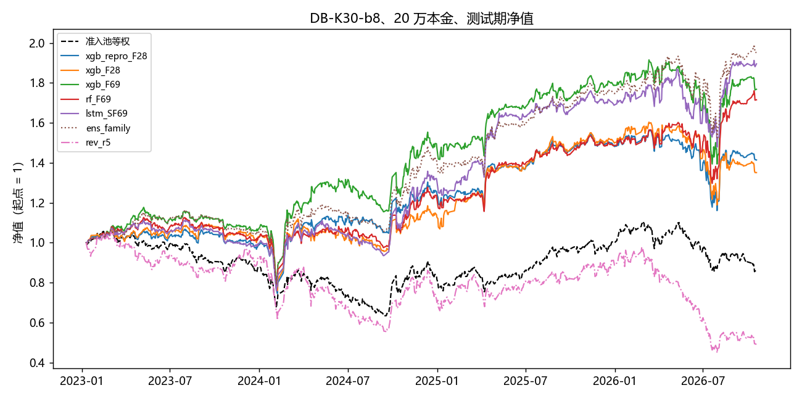
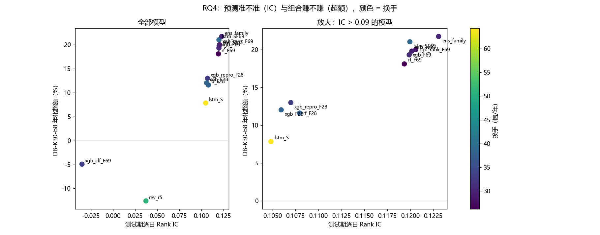

# P5 组合回测（测试期 2023-01 ~ 2026-10）

- 代码：`ml/p5_backtest.py`；结果 `results.json / .csv`（全部规则、口径）、`yearly.csv`、`nav_<规则>.csv`（每条规则各模型的净值）
- 模拟器：仓库的 `rebound.backtest`（`load_markets` → `candidates` → `simulate`，`stats.summary / period`），没有重写；
  不限价准入池（nocap）；真实费用口径（佣金万五、最低 5 元、过户费、印花税 0.05%、一手取整）；开盘买、尾盘卖（仓库现行时点）。
- 分数：测试段按年重训的正式分数（PREREG 补充登记十）。超额 = 相对准入池等权（每天收盘对收盘）的年化超额，区间是按月整块重抽 95% 区间。
- 组合层结果只报告，不用来挑模型（PREREG 2.5）。

## 一、5.2 三条固定规则

### DB-K30-b8（本金 20 万）

| model_id      |   全段 年化% |   全段 超额% | 全段 超额区间   |   T1 超额% |   T2 超额% |   全段 β |   全段 最大回撤% |   换手（倍/年） |   费用占比（%/年） |   平均持股 |
|:--------------|-------------:|-------------:|:----------------|-----------:|-----------:|---------:|-----------------:|----------------:|-------------------:|-----------:|
| random        |       -35.65 |       -40    | [-49.8, -29.9]  |     -28.07 |     -47.56 |    0.903 |           -81.01 |           110.7 |              38.06 |       16.1 |
| rev_r5        |       -17.26 |       -12.6  | [-31.3, +5.4]   |      -3.78 |     -18.19 |    1.173 |           -57.48 |            50.9 |              11.84 |       23.8 |
| xgb_repro_F28 |         9.66 |        13.01 | [-2.1, +28.6]   |      28.84 |       2.98 |    0.705 |           -30.15 |            33.1 |               5.9  |       25.8 |
| rf_F28        |         8.18 |        11.62 | [-4.9, +28.0]   |      23.21 |       4.27 |    0.714 |           -34.48 |            38.1 |               6.87 |       25.2 |
| rf_F69        |        15.44 |        18.12 | [+2.7, +34.1]   |      25.27 |      13.59 |    0.708 |           -31.87 |            26.2 |               4.58 |       26.8 |
| xgb_F28       |         8.33 |        12.05 | [-2.9, +26.3]   |      23.77 |       4.62 |    0.778 |           -30.94 |            38.3 |               6.82 |       25.1 |
| xgb_F69       |        16.37 |        19.33 | [+1.2, +36.9]   |      39.42 |       6.6  |    0.792 |           -31.72 |            30.9 |               5.06 |       26.2 |
| lstm_S        |         4.47 |         7.85 | [-5.7, +21.7]   |      13.15 |       4.48 |    0.744 |           -28.38 |            64.3 |              12.43 |       22   |
| lstm_SF69     |        18.63 |        21.09 | [+6.2, +37.0]   |      26.02 |      17.96 |    0.793 |           -30.51 |            40.8 |               6.78 |       25.1 |
| xgb_clf_F69   |       -10.97 |        -4.92 | [-30.0, +19.0]  |      -7.61 |      -3.22 |    1.162 |           -53.15 |            33.4 |               8.31 |       25.7 |
| xgb_rank_F69  |        17.33 |        20.02 | [+1.0, +37.8]   |      34.02 |      11.15 |    0.708 |           -32.28 |            28.1 |               4.68 |       26.6 |
| ens_top3      |        17.28 |        19.82 | [+2.8, +36.7]   |      31.39 |      12.49 |    0.719 |           -31.63 |            29.6 |               5.02 |       26.3 |
| ens_family    |        19.95 |        22.16 | [+6.1, +38.9]   |      30.41 |      16.93 |    0.757 |           -31.14 |            30.5 |               5.03 |       26.3 |

### DB-K3-b16（本金 2 万）

| model_id      |   全段 年化% |   全段 超额% | 全段 超额区间   |   T1 超额% |   T2 超额% |   全段 β |   全段 最大回撤% |   换手（倍/年） |   费用占比（%/年） |   平均持股 |
|:--------------|-------------:|-------------:|:----------------|-----------:|-----------:|---------:|-----------------:|----------------:|-------------------:|-----------:|
| random        |       -25.33 |       -22.36 | [-48.9, +5.8]   |      32.03 |     -56.83 |    0.855 |           -74.88 |           113.5 |              26.99 |        1.5 |
| rev_r5        |       -48.27 |       -56.35 | [-91.0, -21.6]  |     -26.9  |     -75.01 |    1.093 |           -92.77 |            56.8 |              19.92 |        2.2 |
| xgb_repro_F28 |        23.82 |        25.96 | [+6.4, +46.5]   |      45.51 |      13.56 |    0.589 |           -27.51 |            40.6 |               6.7  |        2.5 |
| rf_F28        |         8.47 |        12.71 | [-10.9, +36.0]  |      32.42 |       0.22 |    0.564 |           -37.21 |            43.7 |               7.91 |        2.4 |
| rf_F69        |        24.8  |        26.95 | [+3.7, +51.1]   |      33.66 |      22.7  |    0.618 |           -33.26 |            32.4 |               5.48 |        2.6 |
| xgb_F28       |        24.65 |        27.35 | [-0.6, +53.2]   |      60.46 |       6.36 |    0.684 |           -34.22 |            49.9 |               7.97 |        2.4 |
| xgb_F69       |        14.36 |        19.16 | [-5.0, +43.6]   |      59.62 |      -6.49 |    0.743 |           -41.28 |            34.2 |               5.56 |        2.6 |
| lstm_S        |       -10.34 |        -6.82 | [-22.8, +8.8]   |      -8.64 |      -5.68 |    0.726 |           -50.28 |            81.7 |              21.16 |        1.9 |
| lstm_SF69     |        14.7  |        18.46 | [-1.2, +39.0]   |      33.69 |       8.82 |    0.711 |           -32.69 |            55.5 |               9.05 |        2.3 |
| xgb_clf_F69   |       -40.55 |       -37.14 | [-76.4, +5.4]   |     -16.87 |     -49.99 |    1.056 |           -86.03 |            47   |              18.29 |        2.3 |
| xgb_rank_F69  |        21.13 |        23.96 | [+1.7, +45.8]   |      49.65 |       7.68 |    0.602 |           -41.08 |            30   |               4.76 |        2.6 |
| ens_top3      |        17.65 |        21.01 | [-2.5, +44.7]   |      40.44 |       8.69 |    0.639 |           -32.16 |            36.2 |               6.07 |        2.5 |
| ens_family    |        21.63 |        24.28 | [+5.3, +43.4]   |      20.31 |      26.8  |    0.606 |           -33.2  |            39   |               6.82 |        2.5 |

### FH-K6-h4（本金 20 万）

| model_id      |   全段 年化% |   全段 超额% | 全段 超额区间   |   T1 超额% |   T2 超额% |   全段 β |   全段 最大回撤% |   换手（倍/年） |   费用占比（%/年） |   平均持股 |
|:--------------|-------------:|-------------:|:----------------|-----------:|-----------:|---------:|-----------------:|----------------:|-------------------:|-----------:|
| random        |       -12.89 |       -10.15 | [-19.4, -0.2]   |       0.82 |     -17.09 |    0.839 |           -41.95 |            41.9 |              11.27 |       23.9 |
| rev_r5        |       -21.1  |       -17.72 | [-38.8, +4.0]   |     -11.46 |     -21.69 |    1.022 |           -63.08 |            41.6 |              11.65 |       23.7 |
| xgb_repro_F28 |         9.14 |        12.35 | [-4.7, +28.9]   |      32.25 |      -0.25 |    0.612 |           -25.6  |            44.4 |               8.2  |       23.9 |
| rf_F28        |         8.68 |        11.79 | [-8.4, +30.4]   |      29.35 |       0.67 |    0.588 |           -29.49 |            44.4 |               8.14 |       23.9 |
| rf_F69        |         6.25 |         9.64 | [-6.9, +26.1]   |      21.96 |       1.82 |    0.585 |           -30.41 |            43.8 |               8.89 |       24   |
| xgb_F28       |         7.22 |        10.8  | [-7.5, +27.1]   |      27.88 |      -0.03 |    0.678 |           -29.72 |            44.2 |               8.08 |       23.9 |
| xgb_F69       |        12.49 |        15.74 | [-2.2, +33.6]   |      33.96 |       4.2  |    0.654 |           -31.61 |            44.2 |               7.93 |       24   |
| lstm_S        |         6.32 |         9.45 | [-3.5, +21.8]   |      15.41 |       5.67 |    0.696 |           -25.22 |            44.4 |               8.99 |       24   |
| lstm_SF69     |        21.44 |        23.28 | [+9.2, +37.9]   |      36.71 |      14.78 |    0.725 |           -24.03 |            45.1 |               7.62 |       24   |
| xgb_clf_F69   |        -9.15 |        -3.41 | [-28.5, +21.3]  |       2.5  |      -7.15 |    0.958 |           -39.82 |            39.3 |               9.96 |       23.4 |
| xgb_rank_F69  |        14.09 |        16.92 | [-4.8, +36.5]   |      35.47 |       5.16 |    0.57  |           -29.44 |            44.3 |               7.98 |       24   |
| ens_top3      |        12.09 |        15.08 | [-4.3, +33.4]   |      30.83 |       5.09 |    0.615 |           -25.47 |            44.3 |               8.08 |       24   |
| ens_family    |        15.66 |        18.27 | [+2.6, +34.0]   |      31.4  |       9.95 |    0.637 |           -27.45 |            44.7 |               7.93 |       24   |

## 二、5.4 稳健性（主规则 DB-K30-b8）

**费用敏感性：全段年化超额（%）**（费用 ×1.5 = 佣金、最低佣金、印花税、过户费都上调 50%；历史印花税 = 2023-08-28 之前按 0.1%）

| model_id      |   历史印花税 |   基准 |   费用 ×1.5 |
|:--------------|-------------:|-------:|------------:|
| random        |       -42.48 | -40    |      -88.89 |
| rev_r5        |       -12.77 | -12.6  |      -20.93 |
| xgb_repro_F28 |        12.43 |  13.01 |        9.02 |
| rf_F28        |        11.51 |  11.62 |        7.51 |
| rf_F69        |        17.94 |  18.12 |       15.74 |
| xgb_F28       |        10.86 |  12.05 |        7.37 |
| xgb_F69       |        19.44 |  19.33 |       16.34 |
| lstm_S        |         7.19 |   7.85 |       -0.63 |
| lstm_SF69     |        21.13 |  21.09 |       17.3  |
| xgb_clf_F69   |        -8.04 |  -4.92 |       -9.8  |
| xgb_rank_F69  |        19.18 |  20.02 |       17.25 |
| ens_top3      |        19.44 |  19.82 |       17.32 |
| ens_family    |        21.86 |  22.16 |       19.71 |

**种子差异：每个种子的分数单独回测的全段年化超额（%）**

| model_id      |   种子 0 |   种子 1 |   种子 2 |   极差 |
|:--------------|---------:|---------:|---------:|-------:|
| xgb_repro_F28 |    13.13 |    13.44 |    12.64 |   0.8  |
| rf_F28        |    10.58 |    16.28 |    12.63 |   5.7  |
| rf_F69        |    18.2  |    18.46 |    18.22 |   0.26 |
| xgb_F28       |    10.32 |     9.62 |     9.45 |   0.87 |
| xgb_F69       |    19.03 |    22.28 |    20.78 |   3.25 |
| lstm_S        |     7.44 |     3.14 |     7.45 |   4.31 |
| lstm_SF69     |    20.41 |    18.73 |    21.36 |   2.63 |
| xgb_clf_F69   |    -5.05 |   -12.51 |    -7.41 |   7.46 |
| xgb_rank_F69  |    18.58 |    23.73 |    19.31 |   5.15 |
| ens_top3      |    17.64 |    19.24 |    19.38 |   1.74 |
| ens_family    |    22.17 |    25.27 |    20.26 |   5.01 |

**逐年超额（%，2026 年只到 10 月）**

| model_id      |   2023 |   2024 |   2025 |   2026 |
|:--------------|-------:|-------:|-------:|-------:|
| random        |  -28.1 |  -34.3 |  -51.7 |  -47.1 |
| rev_r5        |    6.6 |  -17.8 |    5.2 |  -52.9 |
| xgb_repro_F28 |   11.3 |   30.3 |   -3.6 |   14.4 |
| rf_F28        |   10   |   27.4 |   -2.4 |   11.4 |
| rf_F69        |   15.2 |   24.5 |   -1.1 |   38.3 |
| xgb_F28       |   15.9 |   16.6 |    7.6 |    7.1 |
| xgb_F69       |   19.3 |   40.2 |   -1.6 |   19.5 |
| lstm_S        |    3.7 |   10.2 |    2.8 |   16.3 |
| lstm_SF69     |   16.2 |   34.6 |   -0.4 |   37.6 |
| xgb_clf_F69   |    0.4 |  -23   |    1   |    4   |
| xgb_rank_F69  |   17.2 |   39.5 |   -3.9 |   29.3 |
| ens_top3      |   17.3 |   30.2 |    0.6 |   34.5 |
| ens_family    |   17.5 |   36.3 |    2.2 |   35.5 |

## 三、5.5 RQ4：IC 高不一定组合收益高

| model_id      |   全段 超额% |   换手（倍/年） |   费用占比（%/年） |   测试 IC |   测试前30超额（单笔，%） |
|:--------------|-------------:|----------------:|-------------------:|----------:|--------------------------:|
| random        |       -40    |           110.7 |              38.06 |   -0.0004 |                   -0.0619 |
| rev_r5        |       -12.6  |            50.9 |              11.84 |    0.0372 |                   -0.2414 |
| xgb_repro_F28 |        13.01 |            33.1 |               5.9  |    0.107  |                    0.3341 |
| rf_F28        |        11.62 |            38.1 |               6.87 |    0.108  |                    0.3528 |
| rf_F69        |        18.12 |            26.2 |               4.58 |    0.1193 |                    0.41   |
| xgb_F28       |        12.05 |            38.3 |               6.82 |    0.1059 |                    0.2594 |
| xgb_F69       |        19.33 |            30.9 |               5.06 |    0.1199 |                    0.4372 |
| lstm_S        |         7.85 |            64.3 |              12.43 |    0.1048 |                    0.2734 |
| lstm_SF69     |        21.09 |            40.8 |               6.78 |    0.1166 |                    0.458  |
| xgb_clf_F69   |        -4.92 |            33.4 |               8.31 |   -0.0352 |                    0.096  |
| xgb_rank_F69  |        20.02 |            28.1 |               4.68 |    0.1206 |                    0.4898 |
| ens_top3      |        19.82 |            29.6 |               5.02 |    0.1202 |                    0.3947 |
| ens_family    |        22.16 |            30.5 |               5.03 |    0.1221 |                    0.4724 |

## 四、读法

**主规则 DB-K30-b8（20 万）：模型之间的超额差（逐日组合收益差 × 242，按月整块重抽 95% 区间）**

| 比较 | 年化超额差（%） | 95% 区间 |
|---|---:|---|
| XGBoost F69 − F28（新特征） | +7.3 | [−3.6, +19.3] |
| 随机森林 F69 − F28（新特征） | +6.5 | [−1.5, +14.6] |
| XGBoost F69 − 仓库原模型 | +6.3 | [−2.0, +15.2] |
| XGBoost F28 − 仓库原模型（只调参） | −1.0 | [−6.7, +4.5] |
| 随机森林 F69 − XGBoost F69（RQ1） | −1.2 | [−9.8, +6.9] |
| LSTM-S − XGBoost F69（RQ2） | −11.5 | [−30.8, +8.4] |
| LSTM-S+F69 − LSTM-S | +13.2 | [−2.0, +27.9] |
| 集成 family − XGBoost F69 | +2.8 | [−3.1, +9.1] |

1. **组合层的方向和预测层一致，但都分不出显著差别。** 主规则下，用 F69 的模型年化超额 18% ~ 22%，用 F28 的 12% ~ 13%，只看序列的 LSTM 7.8%，
   排序和预测层的 IC 基本一致。但上表所有区间都跨 0：3.8 年的组合收益噪声很大，持仓 25 ~ 27 只、每年换手约 30 倍。
   这正是 PREREG 规定“用 IC 选模型和判定、组合收益只报告”的原因。预测层上显著的新特征优势（RQ3），组合层上表现为 +7 个百分点左右，但不显著。
2. **组合结果对种子很敏感。** 同一个模型，3 个种子的分数各自回测，年化超额能差 3 ~ 6 个百分点（XGBoost F69：19.0 / 22.3 / 20.8；随机森林 F28：10.6 / 16.3 / 12.6）。
   预测层上种子之间的 IC 差别只有 0.001 左右，到了组合层被放大：只买前 30 名，排名边界上一两只股票的进出就会改变收益。
   所以组合层上几个百分点的差别，本来就在噪声范围内。
3. **规则之间差别很大，2 万本金的集中规则（DB-K3-b16）最不稳定。** 同一个模型换规则，结果可能完全不同：XGBoost F69 在 20 万分散规则下超额 +19%，
   在 2 万集中规则下 T1 +60%、T2 −6%；XGBoost F28 反过来在集中规则下最好。只持 2 ~ 3 只股票，结果主要取决于少数几次买卖，不能用来比较模型。
   FH-K6-h4（每天买前 6 名、拿 4 天）换手最高（约 44 倍/年）：用 F69 的树模型和集成在这条规则下比 DB-K30-b8 低 3 ~ 9 个百分点，
   F28 模型两条规则差不多，两个 LSTM 在 FH 下反而略高。
4. **费用是重要的一环。** 主规则下费用每年吃掉 4.6% ~ 6.9% 的资金（树模型和集成）、12.4%（LSTM-S）、12% ~ 38%（反转因子、随机打分）；费用上调 50% 后，
   模型的超额降 2.4 ~ 4.7 个百分点，LSTM-S 从 +7.9% 变成 −0.6%（它换手 64 倍/年，是其他模型的两倍）。随机打分超额 −40%，主要就是费用和频繁换仓。
   按真实的历史印花税（2023-08-28 之前 0.1%）重算，模型的超额变化在 −1.2 ~ +0.1 个百分点之间（二分类 −3.1），结论不变。
   个别模型费用更高反而略好，是真实账户模拟里一手取整、现金分配的路径差异，属于噪声。
5. **5.3 一致性核对：复现基准和作者的十年实验在同一量级。**

   | | 作者（十年实验，`experiments/decade/CONCLUSION.md`） | 本项目复现基准（DB-K30-b8、20 万、按年重训、不限价准入池） |
   |---|---|---|
   | 2023 年起步年化 | +12.8%（每月重训 + DB-K30-b8，20 万） | +9.7%（2023-01 ~ 2026-10） |
   | 2024 年 | 模型 +39.7%（准入池 −7.3%） | 收益 +26.4%、超额 +30.3% |
   | 2025 年 | 普涨年落后准入池 10.1 个百分点 | 超额 −3.6 |
   | 回撤 | 约 −30% | −30.2% |

   口径不完全相同（作者每月重训；年度数字来自他的原方案；准入池版本不同），但量级、方向和逐年的强弱都对得上：
   下跌或震荡年（2023、2024）超额大，普涨年（2025）落后。这说明我们的回测接法（分数 → 仓库模拟器）没有问题。
6. **5.5 RQ4：为什么 IC 高不一定组合收益高（图 2）。**
   - **IC 衡量全截面的排序，组合只买最前面的几十只。** 组合超额和“前 30 名的单笔超额”更相关，和 IC 的关系较弱。
     例如 LSTM-S 的 IC（0.105）和 F28 树模型几乎一样（0.106 ~ 0.108），但组合超额只有 7.8%，比它们低 4 ~ 5 个百分点：
     它的前 30 单笔超额较低（0.27%），而且换手是两倍（64 倍/年），费用多吃掉约 6 个百分点。
   - **换手决定能保住多少。** 同样的预测能力，排名每天变化越大，越容易被缓冲区规则频繁换仓，费用越高。树模型里，用 F69 的换手（26 ~ 31 倍/年）低于用 F28 的（33 ~ 38）。
     新特征不仅让排序更准，也让排名更稳定，这是 F69 组合超额更高的另一半原因。
   - **二分类是反例**：IC 为负（−0.035），组合超额 −4.9%，但前 30 单笔超额仍是正的（+0.10%）。它挑高波动的票，β 1.16，大跌时亏得多（最大回撤 −53%）。
   - **时期**：所有模型的超额都集中在 2023、2024 年（准入池下跌或震荡），2025 年普涨时都落后准入池；2026 年（截至 10 月）用 F69 的模型超额最高（+20% ~ +38%）。
     这和作者“超额主要来自准入池下跌的年份”的结论一致。
7. **说明**：组合用的是仓库现行的买卖时点（T+1 开盘买、持有期最后一天尾盘卖），预测层的标签是 T+1 开盘买、T+5 开盘卖，两者不完全相同；
   超额基准是准入池等权的收盘对收盘收益，不可交易、不扣费用。
8. **候选名单修正检验（2026-11-19，P7 时补做）**：本节回测只用了有有效收益的行做候选，等于事先排除了之后买不进、卖不出的股票
   （测试期每年约 0.1% ~ 0.2% 的行）。P7 给全部股票打分后重做 2023 ~ 2026 主规则回测，5 个模型的年化超额变化 −0.16 ~ +0.22 个百分点，
   最大回撤几乎不变，低于事先定的 1 个百分点门槛，所以本节结果不重做（PREREG 补充登记十一，`p7_history/fix_check.csv`）。
