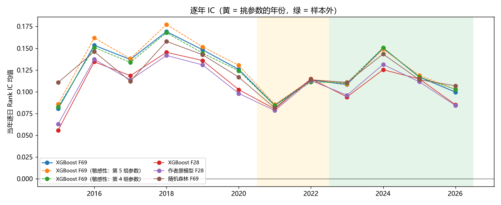
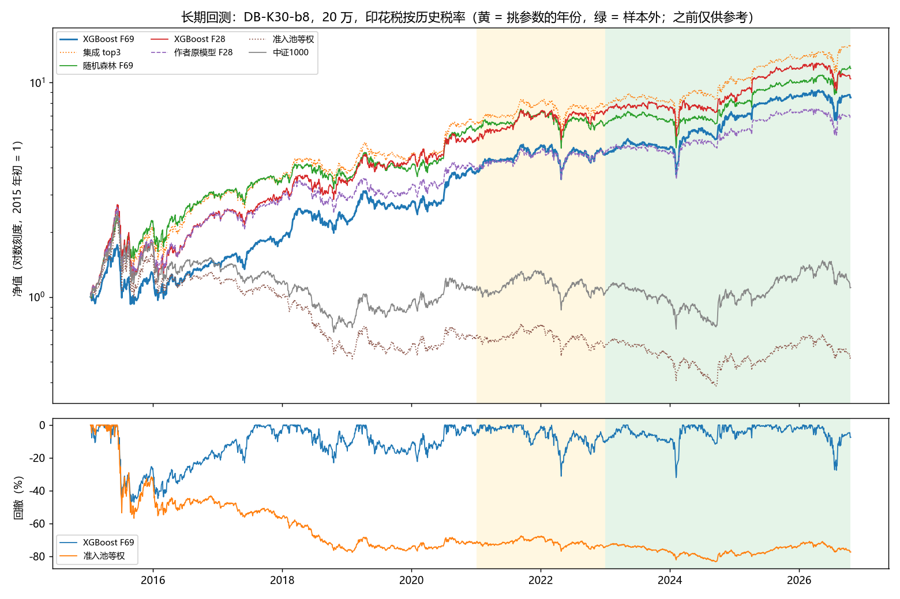
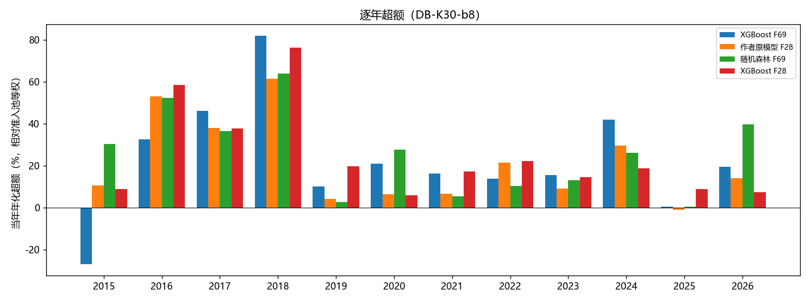
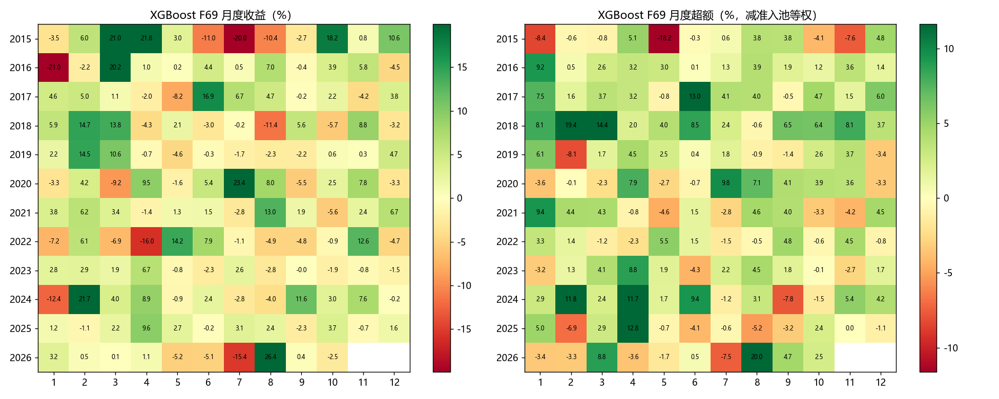

# P7 长期回测：2015 ~ 2026（补充分析）

- 代码：`ml/p7_history.py`（逐年重训）、`ml/p7_history_analyze.py`（回测与分析）、`ml/p7_history_report.py`（本报告）；设置事先登记在 `ml/PREREG.md` 补充登记十一
- 做法：超参数全部沿用冻结记录；2015 ~ 2026 每年第一个交易日，用 2013-08 起、卖出日早于重训日的全部样本训练（3 个种子），给当年准入池**全部**股票打分；
  用仓库模拟器从 2015 年初连续回测到 2026-10（最后一个信号日 2026-10-16），20 万本金、真实费用、印花税按历史税率
- 结果文件：`results.json`（每个模型 × 规则 × 时段）、`yearly.csv`、`monthly_<规则>.csv`（每月收益，%）、`nav_<规则>.csv`、`yearly_ic.csv`、`stress.csv`、
  `author_check.csv`、`fix_check.csv`；交易明细、每日持仓、每日候选名单在 `data/ml/history/`（不进 Git）
- **这是补充分析，不改变任何正式判定。** 三段的性质：2015 ~ 2020 仅供参考，2021 ~ 2022 偏乐观（挑参数的年份），2023 ~ 2026 是真正的样本外

**“间接偷看”的渠道和对应的检查**

| 渠道 | 影响到哪 | 对应的检查 |
|---|---|---|
| 超参数是在 2013 ~ 2020 训练、2021 ~ 2022 验证上选的 | 2015 ~ 2022 | 参数敏感性：换成验证 IC 最高的第 5 组、较低的第 4 组，看结果变不变（第三、六节） |
| 41 个新特征是看过全样本的探索性分析后设计的 | 全期 | 无法消除；新特征的方向是在计算任何统计量之前登记的（PREREG 第一节） |
| 作者的 28 个特征和原参数是在 2022-09 ~ 2024-06 上挑的 | 全期（作者原模型、F28 模型） | 无法消除，如实说明 |
| DB-K30-b8 是作者在 2015 ~ 2026 上从 150 条规则里挑的 | 用这条规则的组合结果 | 对照 FH-K6-h4（不是搜出来的，第七节） |
| 集成的成员是按验证段结果选的 | 集成 | 只描述 |

## 一、核对

**1. 和测试段正式分数一致**（2023 ~ 2026 有效行，同样的重训日、训练行、参数、种子）

| 模型           |   对上的行数 |   测试段正式分数行数 |   最大绝对差 |
|:---------------|-------------:|---------------------:|-------------:|
| XGBoost F69    |      1612404 |              1612404 |  5.96046e-08 |
| XGBoost F28    |      1612404 |              1612404 |  5.96046e-08 |
| 作者原模型 F28 |      1612404 |              1612404 |  5.96046e-08 |
| 随机森林 F69   |      1612404 |              1612404 |  0           |

**2. 候选名单修正前后**（2023 ~ 2026，DB-K30-b8，印花税口径与 P5 基准相同；PREREG 规定：差超过 1 个百分点则重做 P5 及其下游）

| 模型           |   P5 原来（只用有有效收益的候选）年化超额% |   修正后（全部股票都是候选）年化超额% |   差（百分点） |   P5 原来最大回撤% |   修正后最大回撤% |
|:---------------|-------------------------------------------:|--------------------------------------:|---------------:|-------------------:|------------------:|
| XGBoost F69    |                                      19.33 |                                 19.33 |           0    |             -31.72 |            -31.72 |
| XGBoost F28    |                                      12.05 |                                 11.89 |          -0.16 |             -30.94 |            -30.94 |
| 作者原模型 F28 |                                      13.01 |                                 13.23 |           0.22 |             -30.15 |            -30.15 |
| 随机森林 F69   |                                      18.12 |                                 18.25 |           0.13 |             -31.87 |            -31.87 |
| 集成 top3      |                                      19.82 |                                 19.81 |          -0.01 |             -31.63 |            -31.97 |

**3. 与作者十年实验逐年对照**：作者原模型 × 作者当时的规则 `FH-K6-next-o1o5`（每天买前 6 只、分批持有、第 5 天开盘卖）、20 万、历史印花税，
对照 `experiments/decade/REPORT.md` 的“按年重训”一栏

| 年份     |   准入池（作者） |   作者：收益% |   作者：超额% |   我们：收益% |   我们：超额% |   收益差 |   超额差 |
|:---------|-----------------:|--------------:|--------------:|--------------:|--------------:|---------:|---------:|
| 2015     |             55   |          83.8 |          13.1 |         65.16 |          2.12 |    -18.6 |    -11   |
| 2016     |            -21.8 |          17   |          39.7 |         19.04 |         41.35 |      2   |      1.6 |
| 2017     |            -16.8 |           2.1 |          21.4 |          0.33 |         19.46 |     -1.8 |     -1.9 |
| 2018     |            -47   |         -31.4 |          28.2 |        -34.86 |         21.31 |     -3.5 |     -6.9 |
| 2019     |              6.8 |           8.3 |           0.1 |          9.11 |         -0.39 |      0.8 |     -0.5 |
| 2020     |             10.2 |          -6.8 |         -16.9 |         -7.05 |        -20.06 |     -0.2 |     -3.2 |
| 2021     |             12.8 |          11.5 |          -1.5 |         12.09 |         -1.1  |      0.6 |      0.4 |
| 2022     |            -20.3 |          -1   |          21.2 |          2.13 |         24.74 |      3.1 |      3.5 |
| 2023     |             -8.5 |           3.2 |          11.6 |          3.66 |         13.12 |      0.5 |      1.5 |
| 2024     |             -7.3 |          39.7 |          40   |         52.61 |         48.84 |     12.9 |      8.8 |
| 2025     |             22.5 |          11.7 |         -10.1 |          5.88 |        -15.52 |     -5.8 |     -5.4 |
| 2026     |            -14.2 |         -12   |           4.8 |         -8.54 |          9.67 |      3.5 |      4.9 |
| 全期年化 |             -5.6 |           7.6 |          12.8 |          7.25 |         12.01 |     -0.3 |     -0.8 |

## 二、逐年 IC（预测层，只在有有效收益的行上算）

|   date |   XGBoost F69 |   XGBoost F69（敏感性：第 5 组参数） |   XGBoost F69（敏感性：第 4 组参数） |   XGBoost F28 |   作者原模型 F28 |   随机森林 F69 |   集成 top3 |
|-------:|--------------:|-------------------------------------:|-------------------------------------:|--------------:|-----------------:|---------------:|------------:|
|   2015 |        0.0805 |                               0.0857 |                               0.0826 |        0.0557 |           0.0629 |         0.1106 |      0.1005 |
|   2016 |        0.1533 |                               0.1619 |                               0.1508 |        0.1343 |           0.1373 |         0.146  |      0.1585 |
|   2017 |        0.137  |                               0.138  |                               0.1337 |        0.1184 |           0.1136 |         0.112  |      0.1317 |
|   2018 |        0.1691 |                               0.1773 |                               0.1677 |        0.1452 |           0.1417 |         0.1579 |      0.1697 |
|   2019 |        0.1482 |                               0.1516 |                               0.1443 |        0.1358 |           0.1308 |         0.1425 |      0.1498 |
|   2020 |        0.1257 |                               0.1303 |                               0.124  |        0.1024 |           0.098  |         0.1168 |      0.1206 |
|   2021 |        0.0842 |                               0.0852 |                               0.084  |        0.0801 |           0.0783 |         0.0813 |      0.0861 |
|   2022 |        0.1134 |                               0.1139 |                               0.1112 |        0.1148 |           0.1129 |         0.1138 |      0.119  |
|   2023 |        0.1082 |                               0.1089 |                               0.1101 |        0.094  |           0.0959 |         0.1107 |      0.1088 |
|   2024 |        0.1502 |                               0.1488 |                               0.1506 |        0.1252 |           0.1313 |         0.1432 |      0.1462 |
|   2025 |        0.117  |                               0.1188 |                               0.1169 |        0.1147 |           0.1114 |         0.1139 |      0.1192 |
|   2026 |        0.0996 |                               0.1026 |                               0.1028 |        0.0851 |           0.0842 |         0.1068 |      0.1026 |

**模型之间的 IC 差（按月整块重抽 95% 区间）**

| 比较                           | 2015 ~ 2020（仅供参考）    | 2021 ~ 2022（挑参数的年份，偏乐观）   | 2023 ~ 2026（样本外）      | 全期 2015 ~ 2026           |
|:-------------------------------|:---------------------------|:--------------------------------------|:---------------------------|:---------------------------|
| XGBoost F69 − F28（新特征）    | +0.0203 [+0.0123, +0.0288] | +0.0013 [-0.0079, +0.0105]            | +0.0139 [+0.0034, +0.0245] | +0.0151 [+0.0094, +0.0210] |
| XGBoost F69 − 作者原模型       | +0.0216 [+0.0138, +0.0296] | +0.0032 [-0.0074, +0.0135]            | +0.0129 [+0.0018, +0.0238] | +0.0157 [+0.0099, +0.0212] |
| 随机森林 F69 − XGBoost F69     | -0.0047 [-0.0101, +0.0017] | -0.0013 [-0.0084, +0.0059]            | -0.0005 [-0.0075, +0.0071] | -0.0028 [-0.0066, +0.0013] |
| 敏感性：第 5 组参数 − 选定参数 | +0.0052 [+0.0034, +0.0071] | +0.0007 [-0.0009, +0.0027]            | +0.0009 [-0.0013, +0.0029] | +0.0031 [+0.0018, +0.0043] |
| 敏感性：第 4 组参数 − 选定参数 | -0.0017 [-0.0032, -0.0000] | -0.0012 [-0.0030, +0.0007]            | +0.0012 [-0.0006, +0.0033] | -0.0007 [-0.0018, +0.0005] |
| 集成 top3 − XGBoost F69        | +0.0029 [-0.0010, +0.0070] | +0.0037 [-0.0019, +0.0095]            | +0.0003 [-0.0048, +0.0062] | +0.0022 [-0.0006, +0.0050] |

## 三、组合：分段汇总（DB-K30-b8，年化 / 年化超额 [区间] / 最大回撤）

| 模型                               | 2015 ~ 2020（仅供参考）                           | 2021 ~ 2022（挑参数的年份，偏乐观）              | 2023 ~ 2026（样本外）                            | 全期 2015 ~ 2026                                  |
|:-----------------------------------|:--------------------------------------------------|:-------------------------------------------------|:-------------------------------------------------|:--------------------------------------------------|
| XGBoost F69                        | +24.9% / 超额 +27.8% [+13.3, +43.0] / 回撤 -47.1% | +9.8% / 超额 +15.2% [-1.4, +32.8] / 回撤 -31.3%  | +17.5% / 超额 +19.5% [+1.1, +37.2] / 回撤 -32.1% | +19.9% / 超额 +23.0% [+13.0, +33.3] / 回撤 -47.1% |
| XGBoost F69（敏感性：第 5 组参数） | +34.2% / 超额 +35.4% [+22.3, +49.2] / 回撤 -48.2% | +6.2% / 超额 +11.9% [-5.1, +29.4] / 回撤 -32.9%  | +20.8% / 超额 +22.4% [+4.6, +40.8] / 回撤 -31.3% | +24.7% / 超额 +27.2% [+17.6, +37.2] / 回撤 -48.2% |
| XGBoost F69（敏感性：第 4 组参数） | +27.9% / 超额 +30.1% [+16.7, +44.4] / 回撤 -49.3% | +7.9% / 超额 +13.4% [-5.1, +33.0] / 回撤 -34.8%  | +18.2% / 超额 +20.0% [+3.0, +37.2] / 回撤 -30.2% | +21.2% / 超额 +24.0% [+14.3, +33.8] / 回撤 -49.3% |
| XGBoost F28                        | +32.5% / 超额 +34.7% [+23.6, +46.2] / 回撤 -55.5% | +15.4% / 超额 +19.8% [+6.8, +33.1] / 回撤 -27.2% | +10.0% / 超额 +12.8% [-2.6, +27.4] / 回撤 -31.1% | +21.9% / 超额 +25.2% [+17.0, +33.2] / 回撤 -55.5% |
| 作者原模型 F28                     | +25.6% / 超额 +29.1% [+16.9, +41.0] / 回撤 -51.4% | +9.1% / 超额 +14.1% [-1.9, +30.1] / 回撤 -27.9%  | +10.5% / 超额 +12.9% [-3.0, +29.1] / 回撤 -30.8% | +17.7% / 超额 +21.4% [+12.8, +30.0] / 回撤 -51.4% |
| 随机森林 F69                       | +34.9% / 超额 +35.6% [+23.6, +48.1] / 回撤 -40.1% | +2.6% / 超额 +8.0% [-9.2, +25.6] / 回撤 -34.3%   | +17.2% / 超额 +18.8% [+2.9, +34.6] / 回撤 -32.4% | +23.1% / 超额 +25.5% [+16.8, +34.5] / 回撤 -40.1% |
| 集成 top3                          | +36.5% / 超额 +37.1% [+24.9, +50.2] / 回撤 -44.8% | +9.1% / 超额 +14.2% [-2.1, +30.5] / 回撤 -31.7%  | +18.2% / 超额 +19.8% [+2.5, +36.9] / 回撤 -31.8% | +25.5% / 超额 +27.6% [+18.5, +37.0] / 回撤 -44.8% |

**换手与费用（DB-K30-b8，全期）**

|                                    |   换手（倍/年） |   费用占比（%/年） |   平均持有天数 |   平均持股 |
|:-----------------------------------|----------------:|-------------------:|---------------:|-----------:|
| XGBoost F69                        |            34.9 |               6.36 |            5.4 |       25.5 |
| XGBoost F69（敏感性：第 5 组参数） |            36.8 |               6.65 |            5.2 |       25.2 |
| XGBoost F69（敏感性：第 4 组参数） |            35.2 |               6.43 |            5.4 |       25.4 |
| XGBoost F28                        |            44.6 |               8.2  |            4.1 |       24.2 |
| 作者原模型 F28                     |            40.7 |               7.59 |            4.6 |       24.7 |
| 随机森林 F69                       |            32.2 |               5.96 |            5.8 |       25.6 |
| 集成 top3                          |            35   |               6.42 |            5.2 |       25.2 |

## 四、逐年收益与超额（DB-K30-b8）

**逐年收益（%）**，附准入池等权和指数

|   年 |   准入池等权 |   XGBoost F69 |   XGBoost F69（敏感性：第 5 组参数） |   XGBoost F69（敏感性：第 4 组参数） |   XGBoost F28 |   作者原模型 F28 |   随机森林 F69 |   集成 top3 |   沪深300 |   中证500 |   中证1000 |
|-----:|-------------:|--------------:|-------------------------------------:|-------------------------------------:|--------------:|-----------------:|---------------:|------------:|----------:|----------:|-----------:|
| 2015 |         54   |          27.1 |                                 48.6 |                                 38   |          72.6 |             78.3 |          122.9 |       108.5 |       6.2 |      42.9 |       75.1 |
| 2016 |        -21.9 |          10.3 |                                 32.2 |                                  8   |          41.3 |             33.3 |           31.8 |        39.3 |     -11.3 |     -17.8 |      -20   |
| 2017 |        -16.8 |          32.2 |                                 27.4 |                                 36   |          21.1 |             21.4 |           19.8 |        22.7 |      21.8 |      -0.2 |      -17.4 |
| 2018 |        -46.5 |          21.6 |                                 29.3 |                                 21.5 |          14.6 |             -1.1 |            1.8 |         8   |     -25.3 |     -33.3 |      -36.9 |
| 2019 |          8.2 |          21   |                                 29.4 |                                 24.2 |          33.2 |             14.2 |           12.6 |        18.9 |      36.1 |      26.4 |       25.7 |
| 2020 |         13.2 |          40   |                                 40.4 |                                 44   |          20.4 |             21   |           50   |        42.1 |      27.2 |      20.9 |       19.4 |
| 2021 |         13   |          33.3 |                                 29.6 |                                 40.7 |          34.5 |             21.2 |           20   |        26   |      -5.2 |      15.6 |       20.5 |
| 2022 |        -20.6 |          -9.5 |                                -13   |                                -17.2 |          -1   |             -1.8 |          -12.3 |        -5.5 |     -21.6 |     -20.3 |      -21.6 |
| 2023 |         -9.4 |           6.3 |                                  5.8 |                                  6.3 |           5   |             -0.4 |            3.8 |         5   |     -11.4 |      -7.4 |       -6.3 |
| 2024 |         -7.3 |          41.1 |                                 42.6 |                                 34.4 |          12.2 |             25.5 |           21.5 |        25.5 |      14.7 |       5.5 |        1.2 |
| 2025 |         22.6 |          24.1 |                                 25   |                                 27.6 |          34.8 |             22.4 |           23.9 |        25.5 |      17.7 |      30.4 |       27.5 |
| 2026 |        -14   |          -1.1 |                                  8.4 |                                  3.4 |          -9.7 |             -4.8 |           16.6 |        14   |      -9.8 |      -8.9 |      -11.8 |

**逐年超额（%，相对准入池等权，逐日超额均值 × 242）**

|   年 |   XGBoost F69 |   XGBoost F69（敏感性：第 5 组参数） |   XGBoost F69（敏感性：第 4 组参数） |   XGBoost F28 |   作者原模型 F28 |   随机森林 F69 |   集成 top3 |
|-----:|--------------:|-------------------------------------:|-------------------------------------:|--------------:|-----------------:|---------------:|------------:|
| 2015 |         -26.8 |                                -10   |                                -18   |           9   |             10.7 |           30.3 |        25   |
| 2016 |          32.8 |                                 51.2 |                                 30.4 |          58.7 |             53   |           52.4 |        57.6 |
| 2017 |          46.3 |                                 42.8 |                                 49   |          37.8 |             38.1 |           36.5 |        39   |
| 2018 |          82   |                                 88.4 |                                 81.5 |          76.4 |             61.5 |           63.9 |        70   |
| 2019 |          10.2 |                                 17.3 |                                 12.8 |          19.8 |              4.4 |            2.8 |         8.4 |
| 2020 |          21.1 |                                 21.4 |                                 23.8 |           6   |              6.6 |           27.6 |        22.4 |
| 2021 |          16.5 |                                 13.8 |                                 21.8 |          17.4 |              6.8 |            5.5 |        10.5 |
| 2022 |          13.8 |                                 10   |                                  5   |          22.3 |             21.5 |           10.5 |        17.8 |
| 2023 |          15.7 |                                 15.3 |                                 15.6 |          14.6 |              9.2 |           13.2 |        14.4 |
| 2024 |          42.1 |                                 43.4 |                                 37   |          18.9 |             29.6 |           26.2 |        29.7 |
| 2025 |           0.6 |                                  1.4 |                                  3.4 |           8.9 |             -0.9 |            0.5 |         1.8 |
| 2026 |          19.6 |                                 31.7 |                                 25.2 |           7.5 |             14.2 |           39.8 |        37.3 |

**逐年最大回撤（%）**

|   年 |   XGBoost F69 |   作者原模型 F28 |   随机森林 F69 |
|-----:|--------------:|-----------------:|---------------:|
| 2015 |         -47.2 |            -51.4 |          -40.1 |
| 2016 |         -24.1 |            -27.6 |          -27.1 |
| 2017 |         -15.9 |            -20.3 |          -16   |
| 2018 |         -23.1 |            -29.7 |          -23.7 |
| 2019 |         -18.1 |            -19.6 |          -18.6 |
| 2020 |         -15.6 |            -15.2 |          -13   |
| 2021 |         -12.4 |             -9.3 |           -9   |
| 2022 |         -31.2 |            -27.9 |          -32.9 |
| 2023 |         -10.8 |            -10.5 |          -11   |
| 2024 |         -26.1 |            -25.5 |          -26.6 |
| 2025 |          -6.3 |             -6.3 |           -7.4 |
| 2026 |         -27.6 |            -26   |          -19   |

## 五、极端行情（DB-K30-b8）

| 时期                                       |   xgb_F69｜区间收益% |   xgb_F69｜区间最大回撤% |   xgb_F69｜回到前高（交易日） |   xgb_repro_F28｜区间收益% |   xgb_repro_F28｜区间最大回撤% |   xgb_repro_F28｜回到前高（交易日） |   准入池等权｜区间收益% |   准入池等权｜区间最大回撤% | 准入池等权｜回到前高（交易日）   |   中证1000｜区间收益% |   中证1000｜区间最大回撤% | 中证1000｜回到前高（交易日）   |   沪深300｜区间收益% |   沪深300｜区间最大回撤% | 沪深300｜回到前高（交易日）   |
|:-------------------------------------------|---------------------:|-------------------------:|------------------------------:|---------------------------:|-------------------------------:|------------------------------------:|------------------------:|----------------------------:|:---------------------------------|----------------------:|--------------------------:|:-------------------------------|---------------------:|-------------------------:|:------------------------------|
| 2015 股灾（2015-06-12 ~ 2015-09-30）       |                -44.4 |                    -47.2 |                           469 |                      -48.7 |                          -51.4 |                                 481 |                   -51.6 |                       -57   | 未回到                           |                 -47.7 |                     -53.1 | 未回到                         |                -39.6 |                    -43.3 | 1304                          |
| 2016 熔断（2016-01-01 ~ 2016-01-31）       |                -21   |                    -24.1 |                            49 |                      -24.4 |                          -27.6 |                                  50 |                   -30.2 |                       -33   | 未回到                           |                 -30.4 |                     -33.1 | 未回到                         |                -21   |                    -23.5 | 358                           |
| 2018 熊市（2018-01-29 ~ 2018-12-31）       |                 13.1 |                    -23.1 |                            85 |                       -7   |                          -29.7 |                                 101 |                   -47.2 |                       -47.2 | 未回到                           |                 -37.2 |                     -41.2 | 419                            |                -31.3 |                    -31.7 | 365                           |
| 2020 疫情（2020-01-20 ~ 2020-03-31）       |                 -9.2 |                    -15.6 |                            61 |                       -9.1 |                          -15.2 |                                  62 |                    -6.4 |                       -14.5 | 69                               |                  -7.7 |                     -15.5 | 62                             |                -11.3 |                    -16.1 | 66                            |
| 2024 小盘股暴跌（2024-01-01 ~ 2024-02-07） |                -22.2 |                    -26.1 |                             9 |                      -24.2 |                          -25.5 |                                   8 |                   -19.2 |                       -23.3 | 181                              |                 -18.5 |                     -27.1 | 157                            |                 -2.5 |                     -7.3 | 7                             |
| 2026 年 7 月（2026-07-01 ~ 2026-07-31）    |                -15.4 |                    -21.6 |                            13 |                      -12.1 |                          -18.1 |                                   6 |                    -7.9 |                       -12.4 | 未回到                           |                 -19.7 |                     -22.3 | 未回到                         |                 -7.9 |                     -9   | 未回到                        |

## 六、参数敏感性（XGBoost F69 三组参数，三条规则）

| 模型                               | 2015 ~ 2020（仅供参考）                           | 2021 ~ 2022（挑参数的年份，偏乐观）              | 2023 ~ 2026（样本外）                            | 全期 2015 ~ 2026                                  | 规则      |
|:-----------------------------------|:--------------------------------------------------|:-------------------------------------------------|:-------------------------------------------------|:--------------------------------------------------|:----------|
| XGBoost F69                        | +24.9% / 超额 +27.8% [+13.3, +43.0] / 回撤 -47.1% | +9.8% / 超额 +15.2% [-1.4, +32.8] / 回撤 -31.3%  | +17.5% / 超额 +19.5% [+1.1, +37.2] / 回撤 -32.1% | +19.9% / 超额 +23.0% [+13.0, +33.3] / 回撤 -47.1% | DB-K30-b8 |
| XGBoost F69（敏感性：第 5 组参数） | +34.2% / 超额 +35.4% [+22.3, +49.2] / 回撤 -48.2% | +6.2% / 超额 +11.9% [-5.1, +29.4] / 回撤 -32.9%  | +20.8% / 超额 +22.4% [+4.6, +40.8] / 回撤 -31.3% | +24.7% / 超额 +27.2% [+17.6, +37.2] / 回撤 -48.2% | DB-K30-b8 |
| XGBoost F69（敏感性：第 4 组参数） | +27.9% / 超额 +30.1% [+16.7, +44.4] / 回撤 -49.3% | +7.9% / 超额 +13.4% [-5.1, +33.0] / 回撤 -34.8%  | +18.2% / 超额 +20.0% [+3.0, +37.2] / 回撤 -30.2% | +21.2% / 超额 +24.0% [+14.3, +33.8] / 回撤 -49.3% | DB-K30-b8 |
| XGBoost F69                        | +19.8% / 超额 +23.6% [+7.7, +40.5] / 回撤 -45.8%  | +0.2% / 超额 +6.3% [-10.9, +23.5] / 回撤 -37.8%  | +14.3% / 超额 +16.7% [-2.9, +36.2] / 回撤 -33.4% | +14.5% / 超额 +18.4% [+7.5, +29.8] / 回撤 -45.8%  | FH-K6-h4  |
| XGBoost F69（敏感性：第 5 组参数） | +22.5% / 超额 +25.9% [+10.3, +43.3] / 回撤 -47.0% | +2.4% / 超额 +8.6% [-11.4, +29.4] / 回撤 -36.6%  | +11.0% / 超额 +13.9% [-4.5, +32.1] / 回撤 -36.6% | +15.1% / 超额 +19.1% [+8.0, +30.2] / 回撤 -47.0%  | FH-K6-h4  |
| XGBoost F69（敏感性：第 4 组参数） | +20.0% / 超额 +23.7% [+8.5, +40.7] / 回撤 -46.1%  | +0.9% / 超额 +7.0% [-9.5, +24.9] / 回撤 -36.0%   | +12.8% / 超额 +15.4% [-4.4, +34.9] / 回撤 -33.6% | +14.2% / 超额 +18.2% [+6.8, +29.5] / 回撤 -46.1%  | FH-K6-h4  |
| XGBoost F69                        | +9.2% / 超额 +17.1% [-7.9, +41.8] / 回撤 -65.0%   | -7.3% / 超额 +0.2% [-17.9, +18.1] / 回撤 -43.4%  | +14.3% / 超额 +18.3% [-6.0, +43.3] / 回撤 -41.0% | +7.8% / 超额 +14.6% [-0.4, +29.3] / 回撤 -65.0%   | DB-K3-b16 |
| XGBoost F69（敏感性：第 5 组参数） | +9.5% / 超额 +17.2% [-10.1, +44.0] / 回撤 -69.8%  | -21.8% / 超额 -16.7% [-42.9, +9.1] / 回撤 -54.0% | +17.2% / 超额 +20.5% [-4.1, +44.8] / 回撤 -35.1% | +5.7% / 超额 +12.5% [-5.1, +29.4] / 回撤 -77.3%   | DB-K3-b16 |
| XGBoost F69（敏感性：第 4 组参数） | +25.4% / 超额 +30.7% [+8.8, +54.5] / 回撤 -46.5%  | -12.9% / 超额 -5.5% [-31.5, +22.0] / 回撤 -45.5% | +24.5% / 超额 +26.4% [+2.5, +51.2] / 回撤 -36.6% | +17.6% / 超额 +23.2% [+8.1, +38.4] / 回撤 -51.5%  | DB-K3-b16 |

## 七、规则对照（全期：年化 / 年化超额 / 最大回撤）

| 模型                               | DB-K30-b8                          | FH-K6-h4                           | DB-K3-b16                          |
|:-----------------------------------|:-----------------------------------|:-----------------------------------|:-----------------------------------|
| XGBoost F69                        | +19.9% / 超额 +23.0% / 回撤 -47.1% | +14.5% / 超额 +18.4% / 回撤 -45.8% | +7.8% / 超额 +14.6% / 回撤 -65.0%  |
| XGBoost F69（敏感性：第 5 组参数） | +24.7% / 超额 +27.2% / 回撤 -48.2% | +15.1% / 超额 +19.1% / 回撤 -47.0% | +5.7% / 超额 +12.5% / 回撤 -77.3%  |
| XGBoost F69（敏感性：第 4 组参数） | +21.2% / 超额 +24.0% / 回撤 -49.3% | +14.2% / 超额 +18.2% / 回撤 -46.1% | +17.6% / 超额 +23.2% / 回撤 -51.5% |
| XGBoost F28                        | +21.9% / 超额 +25.2% / 回撤 -55.5% | +13.0% / 超额 +17.1% / 回撤 -44.3% | +17.3% / 超额 +24.3% / 回撤 -65.8% |
| 作者原模型 F28                     | +17.7% / 超额 +21.4% / 回撤 -51.4% | +8.5% / 超额 +12.8% / 回撤 -49.6%  | +15.5% / 超额 +22.1% / 回撤 -69.0% |
| 随机森林 F69                       | +23.1% / 超额 +25.5% / 回撤 -40.1% | +14.8% / 超额 +18.6% / 回撤 -41.2% | +24.4% / 超额 +28.0% / 回撤 -49.4% |
| 集成 top3                          | +25.5% / 超额 +27.6% / 回撤 -44.8% | +18.8% / 超额 +21.9% / 回撤 -49.1% | +25.4% / 超额 +28.6% / 回撤 -56.1% |

## 八、选了哪些股票、怎么交易

**XGBoost F69：逐年交易统计**（胜率、平均单笔收益按扣费后计，%）

|   年 |   交易笔数 |   平均持有天数 |   胜率 |   平均单笔收益 |   被卡住笔数 |
|-----:|-----------:|---------------:|-------:|---------------:|-------------:|
| 2015 |       1233 |           5.09 |  55.96 |           0.56 |           94 |
| 2016 |       1051 |           5.62 |  52.05 |           0.71 |           17 |
| 2017 |       1413 |           3.93 |  51.38 |           0.55 |            9 |
| 2018 |       1243 |           4.68 |  53.98 |           0.56 |           12 |
| 2019 |       1185 |           4.97 |  49.54 |           0.53 |            5 |
| 2020 |       1417 |           3.91 |  54.41 |           0.8  |            7 |
| 2021 |       1051 |           5.86 |  50.9  |           0.74 |            3 |
| 2022 |       1091 |           5.82 |  48.3  |           0.03 |            3 |
| 2023 |        533 |          11.27 |  42.59 |           0.11 |            0 |
| 2024 |       1226 |           4.68 |  51.47 |           0.87 |            5 |
| 2025 |        735 |           8.81 |  52.38 |           1    |            9 |
| 2026 |        766 |           5.68 |  49.35 |           0.21 |            5 |

**持有天数最多的 15 只股票**

| ts_code   | 名称     | 行业     |   持有天数 |
|:----------|:---------|:---------|-----------:|
| 600900.SH | 长江电力 | 水力发电 |        991 |
| 601006.SH | 大秦铁路 | 铁路     |        879 |
| 600028.SH | 中国石化 | 石油加工 |        587 |
| 000333.SZ | 美的集团 | 家用电器 |        503 |
| 601088.SH | 中国神华 | 煤炭开采 |        487 |
| 002129.SZ | TCL中环  | 电气设备 |        464 |
| 600008.SH | 首创环保 | 水务     |        456 |
| 601288.SH | 农业银行 | 银行     |        403 |
| 000623.SZ | 吉林敖东 | 中成药   |        396 |
| 601985.SH | 中国核电 | 新型电力 |        389 |
| 600153.SH | 建发股份 | 仓储物流 |        387 |
| 601857.SH | 中国石油 | 石油开采 |        383 |
| 601988.SH | 中国银行 | 银行     |        371 |
| 601318.SH | 中国平安 | 保险     |        364 |
| 000895.SZ | 双汇发展 | 食品     |        361 |

**每年持仓最多的 3 个行业（按持有天数占比）**

|   年 | 行业（占比%）                                     |
|-----:|:--------------------------------------------------|
| 2015 | 电气设备（4.6）、证券（4.6）、元器件（3.6）       |
| 2016 | 电气设备（6.5）、软件服务（5.8）、仓储物流（4.6） |
| 2017 | 电气设备（6.3）、（3.7）、建筑工程（3.6）         |
| 2018 | 电气设备（4.7）、医疗保健（4.3）、元器件（4.1）   |
| 2019 | 银行（5.8）、建筑工程（4.1）、证券（4.0）         |
| 2020 | 银行（4.7）、建筑工程（3.7）、电气设备（3.6）     |
| 2021 | 银行（6.2）、水力发电（4.4）、元器件（3.6）       |
| 2022 | 银行（5.5）、电气设备（4.2）、汽车配件（3.9）     |
| 2023 | 银行（7.2）、水力发电（6.1）、证券（5.9）         |
| 2024 | 银行（5.3）、电气设备（4.4）、化工原料（3.9）     |
| 2025 | 中成药（6.1）、银行（6.0）、汽车配件（3.9）       |
| 2026 | 元器件（4.3）、银行（4.1）、电气设备（3.9）       |

**作者原模型 F28：逐年交易统计**（胜率、平均单笔收益按扣费后计，%）

|   年 |   交易笔数 |   平均持有天数 |   胜率 |   平均单笔收益 |   被卡住笔数 |
|-----:|-----------:|---------------:|-------:|---------------:|-------------:|
| 2015 |       1465 |           4.06 |  61.3  |           1.45 |          105 |
| 2016 |       1547 |           3.73 |  54.95 |           0.83 |           23 |
| 2017 |       1362 |           4.44 |  48.53 |           0.44 |           20 |
| 2018 |       1301 |           4.57 |  50.42 |           0.1  |           25 |
| 2019 |       1414 |           4.23 |  50.28 |           0.3  |           14 |
| 2020 |       1588 |           3.49 |  51.51 |           0.46 |           14 |
| 2021 |       1427 |           4.25 |  49.47 |           0.41 |            6 |
| 2022 |       1317 |           4.47 |  49.58 |           0.12 |            7 |
| 2023 |       1207 |           4.99 |  43.99 |          -0.06 |            2 |
| 2024 |       1192 |           5    |  51.01 |           0.64 |           13 |
| 2025 |        734 |           9.11 |  49.59 |           0.99 |            4 |
| 2026 |        725 |           6.24 |  44.83 |          -0.06 |            7 |

**持有天数最多的 15 只股票**

| ts_code   | 名称     | 行业     |   持有天数 |
|:----------|:---------|:---------|-----------:|
| 600900.SH | 长江电力 | 水力发电 |       1130 |
| 601006.SH | 大秦铁路 | 铁路     |        944 |
| 601988.SH | 中国银行 | 银行     |        728 |
| 600028.SH | 中国石化 | 石油加工 |        519 |
| 600008.SH | 首创环保 | 水务     |        512 |
| 000538.SZ | 云南白药 | 中成药   |        432 |
| 000895.SZ | 双汇发展 | 食品     |        381 |
| 601288.SH | 农业银行 | 银行     |        353 |
| 601857.SH | 中国石油 | 石油开采 |        342 |
| 600018.SH | 上港集团 | 港口     |        339 |
| 600177.SH | 雅戈尔   | 服饰     |        321 |
| 601985.SH | 中国核电 | 新型电力 |        316 |
| 000623.SZ | 吉林敖东 | 中成药   |        299 |
| 601766.SH | 中国中车 | 运输设备 |        293 |
| 601088.SH | 中国神华 | 煤炭开采 |        292 |

**每年持仓最多的 3 个行业（按持有天数占比）**

|   年 | 行业（占比%）                                 |
|-----:|:----------------------------------------------|
| 2015 | （5.3）、元器件（4.4）、电气设备（4.1）       |
| 2016 | （6.1）、电气设备（3.2）、元器件（3.1）       |
| 2017 | （5.4）、通信设备（4.1）、电气设备（3.3）     |
| 2018 | （5.8）、电气设备（4.6）、综合类（4.3）       |
| 2019 | 银行（6.7）、水力发电（4.1）、（3.9）         |
| 2020 | 银行（5.2）、建筑工程（3.4）、（3.3）         |
| 2021 | 银行（7.4）、（4.5）、证券（3.8）             |
| 2022 | 银行（6.7）、（3.6）、元器件（3.3）           |
| 2023 | 银行（6.7）、水力发电（4.9）、证券（4.8）     |
| 2024 | 银行（6.6）、铁路（3.9）、建筑工程（3.9）     |
| 2025 | 中成药（6.0）、银行（5.1）、食品（4.3）       |
| 2026 | 银行（4.4）、建筑工程（3.7）、新型电力（3.4） |

明细（不进 Git，在 `data/ml/history/`）：`trades_<模型>__<规则>.parquet`（每一笔交易：信号日、买入日、卖出日、代码、当时的名称、行业、买入时排名、
买卖价、扣费前后收益、持有天数、是否被卡住）、`holdings_<模型>__<规则>.parquet`（每天收盘后的持仓）、`picks_<模型>.parquet`（每天的前 30 名，每个行业最多 2 只）。

## 九、月度收益

全部模型、全部规则的月度收益在 `monthly_<规则>.csv`（%）。下图是 XGBoost F69 在 DB-K30-b8 下的月度收益和月度超额。

## 九点五、换起点

2015 ~ 2024 每年第一个交易日起步的结果见 [starts.md](starts.md)（补充登记十二）。

## 十、交易策略说明

**DB-K30-b8（20 万本金，主规则）**：每天收盘后，模型给准入池里全部股票打分排名。第二天：
1. 先卖：持仓里排名掉出前 240 名（30 × 8）的股票，在持有满 5 天后的尾盘卖出（跌停卖不出、停牌就继续拿着，记为“被卡住”）；
2. 再补：按当天排名从高往低，把空位补满到 30 只，开盘买入，每只分到的钱大致相等；同一个行业最多 2 只；
   涨停买不进就顺延到下一名；一手（100 股）都买不起的跳过；
3. 排名还在前 240 名以内的持仓继续拿着，不必每天换。目的是减少换手和手续费。

**FH-K6-h4（20 万本金，最朴素的对照）**：资金分成 4 份轮流用。每天用其中一份，开盘买入当天排名前 6 的股票（同样每个行业最多 2 只），
持有到第 5 天尾盘卖出。这条规则不是搜出来的。

**DB-K3-b16（2 万本金，集中）**：同 DB-K30-b8，但最多持 3 只，排名掉出前 48 名才卖。

**费用（三条规则相同）**：佣金万五（每笔最低 5 元）、过户费十万分之一（双边）、印花税卖出时收（2023-08-28 之前 0.1%，之后 0.05%）、买入按一手取整。
不计冲击成本。**买卖时点**：信号日 T 收盘后出名单，T+1 开盘买，持有期最后一天尾盘卖（仓库现行口径）。

## 十一、读法

**先说定位**：这是补充分析，不改变任何正式判定。2015 ~ 2020 仅供参考，2021 ~ 2022 偏乐观，只有 2023 ~ 2026 是真正的样本外（与测试段相同）。

1. **三项核对都通过，流程可信。**
   - 2023 ~ 2026 有效行上的分数和测试段正式分数最大差 6e-8（浮点误差），说明长期回测和测试段用的是同一套流程。
   - **候选名单修正的影响可以忽略**：给全部股票打分后，2023 ~ 2026 主规则下 5 个模型的年化超额变化 −0.16 ~ +0.22 个百分点，最大回撤几乎不变，
     低于事先定的 1 个百分点门槛，按登记的规则 P5 及其下游不重做，只在 P5 报告中注明。但这个修正对 2015 年重要：
     那一年 XGBoost F69 有 94 笔交易因为跌停、停牌被卡住（其他年份每年 0 ~ 17 笔），不修正会低估股灾时的回撤。
   - **与作者十年实验逐年对照基本一致**：作者原模型 × 作者当时的规则，全期年化 +7.3%、超额 +12.0%，作者记录是 +7.6%、+12.8%。
     12 年中 9 年的收益差在 ±4 个百分点以内，逐年强弱一致（2016、2018、2022 大幅跑赢准入池，2020、2025 跑输）。差别较大的是 2015 年
     （我们低 18.6 个百分点）和 2024 年（高 12.9）。可能的原因是作者的训练起点、准入池版本和我们不完全相同，量级和方向没有问题。
2. **预测层：新特征在 12 年里一直有用，这是最稳的结论。**
   - XGBoost F69 − F28 的 IC 差：2015 ~ 2020 年 +0.020（区间 [+0.012, +0.029]），2023 ~ 2026 年 +0.014（区间 [+0.003, +0.025]），全期 +0.015（区间 [+0.009, +0.021]）；
     只有 2021 ~ 2022 两年分不出（+0.001）。逐年看，12 年中有 11 年 F69 更高。比作者原模型也是全期高 0.016。
   - 随机森林和 XGBoost 在 12 年里同样分不出（全期 −0.003，区间跨 0），和测试段的 RQ1 一致。
   - 各模型的 IC 在 2016 ~ 2019 年最高（0.11 ~ 0.18），2021 和 2026 年最低（约 0.08 ~ 0.10）。
3. **组合层：模型之间仍然分不出，而且结果明显依赖规则和时期。**
   - 主规则 DB-K30-b8 全期年化：集成 25.5%、随机森林 F69 23.1%、XGBoost F28 21.9%、XGBoost F69 19.9%、作者原模型 17.7%，
     全部大幅跑赢准入池等权（全期年化超额 +21% ~ +28%，区间都不含 0）。但模型两两之间的超额差，区间全部跨 0。
   - **XGBoost F28 的长期组合收益略高于 F69**（全期 −2.2 个百分点，区间 [−9.3, +5.0]），差距几乎全部来自 **2015 年**：F69 当年超额 −26.8%，F28 +9.0%。
     原因是 2015 年 1 ~ 5 月的小盘股牛市：F69 偏好低换手、低波动、偏大盘的股票（上半年持仓最多的是证券、银行、建筑），在“越热越涨”的行情里明显跑输
     （1 月 −3.5% 对准入池 +4.9%，5 月 +3.0% 对 +21.2%）；F28 没有换手和市值信息，跟上了牛市。股灾期间（7 ~ 8 月）F69 反而比 F28 每月少跌约 4 个百分点。
     2023 ~ 2026 样本外则是 F69 更好（+6.7 个百分点，区间跨 0）。
   - 这暴露了 F69 的**风格风险**：它偏向冷门、平稳的股票，在小盘股投机行情里会大幅跑输。这和风格归因（`p5_style/`）的发现一致。
   - **规则的影响**：在不是搜出来的朴素规则 FH-K6-h4 下，F69（+14.5%）高于 F28（+13.0%）；在作者挑出来的 DB-K30-b8 下反过来。
     DB-K30-b8 是作者用 28 个特征的模型在 2015 ~ 2026 上挑的，可能对 F28 类模型更有利。2 万本金只持 3 只的 DB-K3-b16 噪声极大，
     同一模型换一组参数，年化就从 +5.7% 变到 +17.6%，不能用来比较。
4. **换手与费用**：F69 模型每年换手约 35 倍、费用约 6.4%；F28 约 45 倍、8.2%；作者原模型约 41 倍、7.6%。新特征让排名更稳定，每年省下约 1.2 ~ 1.8 个百分点的费用。
   F69 平均每只持有约 5.4 天，胜率（单笔扣费后赚钱）约 50% ~ 56%，平均单笔收益 0.5% ~ 1.0%（2022、2023、2026 年较低）。
5. **极端行情**（DB-K30-b8，20 万；括号里是准入池等权）：
   - 2015 股灾：XGBoost F69 区间 −44.4%（准入池 −51.6%），区间最大回撤 −47.2%，469 个交易日后回到前高；作者原模型 −48.7%；
   - 2016 熔断：F69 −21.0%（准入池 −30.2%），49 天回到前高；
   - 2018 熊市：**F69 +13.1%**（准入池 −47.2%，作者原模型 −7.0%），区间内最大回撤 −23.1%；
   - 2020 疫情：F69 −9.2%（准入池 −6.4%），和市场差不多；
   - 2024 年初小盘股暴跌：F69 −22.2%（准入池 −19.2%），但 9 个交易日就回到前高（准入池用了 181 天）；
   - 2026 年 7 月：F69 −15.4%，**比准入池（−7.9%）跌得多**，和作者记录的“7 月高 beta 崩盘”一致，是近年最弱的一段。
   全期最大回撤都出现在 2015 年股灾：F69 −47.1%、F28 −55.5%、作者原模型 −51.4%、随机森林 −40.1%、集成 −44.8%。即使超额很高，
   这类策略在系统性暴跌中仍会亏掉近一半，**它降低的是相对损失，不能避免绝对亏损**。
6. **参数敏感性：结果不依赖“挑中”的参数。** 选定参数的 IC 和另外两组只差 −0.003 ~ +0.001。组合层上，选定参数在三组里反而最低
   （主规则年化：选定 19.9%、第 4 组 21.2%、第 5 组 24.7%）。也就是说，事后看并没有挑到“运气最好”的参数，参数前视没有让结果虚高。
   第 5 组（验证 IC 最高、但按打平规则没选）在 2015 ~ 2020 年 IC 显著高 0.005，说明“打平选更简单”的规则在这里偏保守。
7. **对整个项目结论的意义**：
   - 长期回测**支持**测试段的预测层结论：新特征在 12 年里稳定地提高了 IC；树模型之间分不出高下。
   - 组合层的结论依然是“分不出”，而且长期看，组合收益主要受时期风格（2015 年小盘股牛市）和规则选择影响，比模型选择的影响大。
   - 所有模型在 12 年里都大幅跑赢准入池等权，但最大回撤约 −40% ~ −56%，回本可能需要接近两年（2015 年股灾后约 470 个交易日）。
8. **局限**：2015 ~ 2022 年的结果受参数、特征、规则选择的“间接偷看”影响（见报告开头的表）；早年训练数据很少（2015 年的模型只有 23 万行训练样本，
   约为后来的十分之一）；准入池等权是不可交易的基准；没有冲击成本；印花税按历史税率，其他费用按现行标准。
9. **换起点（补充登记十二，`starts.md`）**：上面的全期数字都从 2015 年起步，受 2015 年股灾和小盘股牛市影响很大。
   换成 2016 ~ 2024 年任一年起步，XGBoost F69 在 9 个起点里每一个都是年化收益最高的单个模型，最大回撤约 −27% ~ −33%；
   随机森林和 F28 的长期领先、随机森林回撤更小，都只在 2015 年起步时成立。所有模型从每个起点出发都赚钱、都跑赢准入池。
